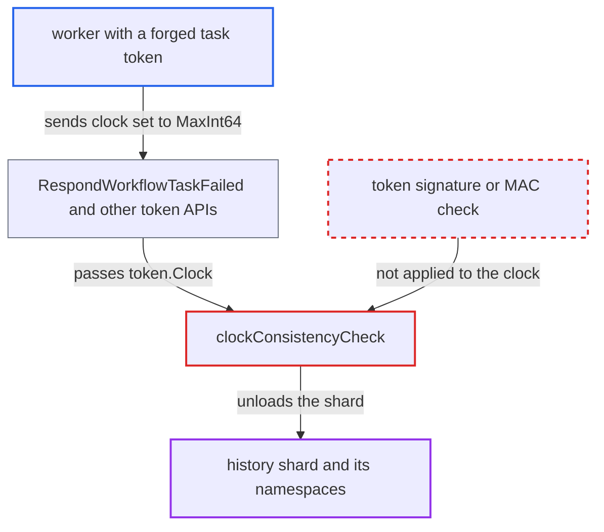

# Client-forged vector clock in unsigned task token forces history shard unload

| Field | Value |
|---|---|
| ID | `find_01FWUCPx4CTyK68WqopNtMj6` |
| Severity | **High** |
| Status | open |
| CWE | CWE-642 — External control of critical state data |
| Created | 2026-10-27T21:17:09.732973Z |
| Claude Security | https://claude.ai/security/findings/find_01FWUCPx4CTyK68WqopNtMj6 |

## Description

A worker with access to its own namespace's worker APIs can stop any history shard and keep it stopped. Workflow progress stalls for every namespace on that shard, so service can be denied cluster-wide. The cause is `clockConsistencyCheck`. It trusts a vector clock from an unsigned task token that the worker can edit, and it unloads the shard when that clock is too high.

1. **worker** gets a task token or builds one. The token is a plain `tokenspb.Task` protobuf with no signature or MAC, so the holder can rewrite its clock field. ([`common/tasktoken/serializer.go:15-26`](https://github.com/cx-benchmark/temporal/blob/bf81a4c20009db89dc952592c9cfe770bafe66ee/common/tasktoken/serializer.go#L15-L26))
2. **worker** sets the clock to `clock.clock=MaxInt64` and keeps the cluster id and shard id. A real token already holds both ids, and the shard id is a public hash of the namespace id and workflow id, so the worker can also compute them for any shard. ([`common/util.go:420-428`](https://github.com/cx-benchmark/temporal/blob/bf81a4c20009db89dc952592c9cfe770bafe66ee/common/util.go#L420-L428))
3. **worker** calls `RespondWorkflowTaskFailed`, `RespondWorkflowTaskCompleted` or an activity-token API. The only checks on the way in are that the token's namespace matches the request and that `WorkflowId` is set. Nothing validates the clock. ([`service/history/handler.go:558-596`](https://github.com/cx-benchmark/temporal/blob/bf81a4c20009db89dc952592c9cfe770bafe66ee/service/history/handler.go#L558-L596))
4. **the handler `Invoke`** passes `token.Clock` to the workflow lease lookup. The handlers pass the worker-supplied clock straight on, without checking that it came from the server. ([`service/history/api/respondworkflowtaskfailed/api.go:29-48`](https://github.com/cx-benchmark/temporal/blob/bf81a4c20009db89dc952592c9cfe770bafe66ee/service/history/api/respondworkflowtaskfailed/api.go#L29-L48))
5. **`getWorkflowLeaseImpl`** runs `clockConsistencyCheck` before it looks up any workflow. The workflow named in the token does not need to exist. ([`service/history/api/consistency_checker.go:176-198`](https://github.com/cx-benchmark/temporal/blob/bf81a4c20009db89dc952592c9cfe770bafe66ee/service/history/api/consistency_checker.go#L176-L198))
6. **`clockConsistencyCheck`** calls `UnloadForOwnershipLost` and returns `ShardOwnershipLostError`. The clock has the same cluster id and shard id and is larger than the shard's next transfer task id, so the check treats it as proof that another host took over the shard. ([`service/history/api/consistency_checker.go:201-226`](https://github.com/cx-benchmark/temporal/blob/bf81a4c20009db89dc952592c9cfe770bafe66ee/service/history/api/consistency_checker.go#L201-L226))
7. **the shard context** moves to Stopping, and the controller removes the shard and stops its engine. Request handling and queue processing stop until the shard is acquired again, which needs a range-id `UpdateShard` write. The next forged request unloads it again. ([`service/history/shard/context_impl.go:1577-1579`](https://github.com/cx-benchmark/temporal/blob/bf81a4c20009db89dc952592c9cfe770bafe66ee/service/history/shard/context_impl.go#L1577-L1579))

## Assessment

The attacker is a worker allowed to call worker APIs for its own namespace. It needs a task token, either polled for one task or built by hand. No victim action is needed and the default configuration is affected. The attacker can send the token through `RespondWorkflowTaskFailed`, `RespondWorkflowTaskCompleted`, `RecordActivityTaskHeartbeat` or the `RespondActivityTask*` handlers. By choosing different workflow ids the attacker can hit every shard, because the shard id is computed from the namespace id and workflow id.

Impact: The attacker can stop any history shard on demand and repeat it. The engine and task queues halt and in-flight requests on the shard fail. Every namespace sharing the shard stalls, and each reload costs a range-id write. Data is neither disclosed nor modified, because writes stay fenced by range id.

## Recommendation

`clockConsistencyCheck` trusts the vector clock in a client-held, unsigned task token as evidence of lost shard ownership, and unloads the shard because of it.

Fix criteria: No value a client can change can trigger `UnloadForOwnershipLost` or any other shard state transition. Either the token is authenticated (MAC or signature checked before the clock is read), or, for the external task-token APIs, a clock ahead of the shard is an error for that request only. A token with `clock.clock=MaxInt64` sent through `RespondWorkflowTaskFailed` fails only that request, and the shard logs no Stopping transition.

## Evidence

**https://github.com/cx-benchmark/temporal**

- [`service/history/api/consistency_checker.go:201-226`](https://github.com/cx-benchmark/temporal/blob/bf81a4c20009db89dc952592c9cfe770bafe66ee/service/history/api/consistency_checker.go#L201-L226)
- [`service/history/api/consistency_checker.go:176-198`](https://github.com/cx-benchmark/temporal/blob/bf81a4c20009db89dc952592c9cfe770bafe66ee/service/history/api/consistency_checker.go#L176-L198)
- [`service/history/api/respondworkflowtaskcompleted/api.go:122-150`](https://github.com/cx-benchmark/temporal/blob/bf81a4c20009db89dc952592c9cfe770bafe66ee/service/history/api/respondworkflowtaskcompleted/api.go#L122-L150)
- [`service/history/api/respondworkflowtaskfailed/api.go:29-48`](https://github.com/cx-benchmark/temporal/blob/bf81a4c20009db89dc952592c9cfe770bafe66ee/service/history/api/respondworkflowtaskfailed/api.go#L29-L48)
- [`common/tasktoken/serializer.go:15-26`](https://github.com/cx-benchmark/temporal/blob/bf81a4c20009db89dc952592c9cfe770bafe66ee/common/tasktoken/serializer.go#L15-L26)
- [`service/history/handler.go:558-596`](https://github.com/cx-benchmark/temporal/blob/bf81a4c20009db89dc952592c9cfe770bafe66ee/service/history/handler.go#L558-L596)
- [`service/history/vclock/vclock.go:20-52`](https://github.com/cx-benchmark/temporal/blob/bf81a4c20009db89dc952592c9cfe770bafe66ee/service/history/vclock/vclock.go#L20-L52)
- [`service/history/shard/context_impl.go:1577-1579`](https://github.com/cx-benchmark/temporal/blob/bf81a4c20009db89dc952592c9cfe770bafe66ee/service/history/shard/context_impl.go#L1577-L1579)
- [`common/util.go:420-428`](https://github.com/cx-benchmark/temporal/blob/bf81a4c20009db89dc952592c9cfe770bafe66ee/common/util.go#L420-L428)

