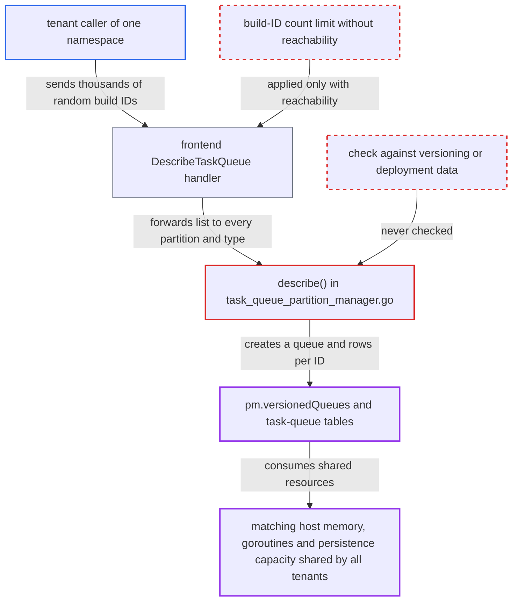

# Enhanced DescribeTaskQueue creates a physical task queue and DB row per caller-supplied build ID

| Field | Value |
|---|---|
| ID | `find_01Y3k4CN4NFfU5WizpwMuyrJ` |
| Severity | **High** |
| Status | open |
| CWE | CWE-770 — Resource exhaustion |
| Created | 2026-10-27T21:11:51.319741Z |
| Claude Security | https://claude.ai/security/findings/find_01Y3k4CN4NFfU5WizpwMuyrJ |

## Description

A caller with access to one namespace can exhaust memory, goroutines and database capacity on shared matching hosts. This starves other tenants' task queues. One enhanced `DescribeTaskQueue` request with a huge build-ID list is enough, and no special setting is needed. `describe()` creates a real queue and database rows for each unknown build ID, and nothing bounds the list.

1. **attacker** sends an enhanced `DescribeTaskQueue` request with thousands of random build IDs. `ReportTaskReachability` is left unset, so the frontend does not apply `ReachabilityQueryBuildIdLimit` and the list goes on unbounded. ([`service/frontend/workflow_handler.go:3472-3482`](https://github.com/cx-benchmark/temporal/blob/bf81a4c20009db89dc952592c9cfe770bafe66ee/service/frontend/workflow_handler.go#L3472-L3482))
2. **matching engine** copies the list and sends it to every partition for every task-queue type. `getBuildIds` copies every entry without a limit, and the enhanced handler calls `DescribeTaskQueuePartition` for each partition and each requested type. ([`service/matching/matching_engine.go:1915-1926`](https://github.com/cx-benchmark/temporal/blob/bf81a4c20009db89dc952592c9cfe770bafe66ee/service/matching/matching_engine.go#L1915-L1926))
3. **`describe()` in the partition manager** adds every unmatched build ID to `versions`. It does not check the string against the task queue's versioning or deployment data, and it applies no count limit. ([`service/matching/task_queue_partition_manager.go:1359-1392`](https://github.com/cx-benchmark/temporal/blob/bf81a4c20009db89dc952592c9cfe770bafe66ee/service/matching/task_queue_partition_manager.go#L1359-L1392))
4. **`getPhysicalQueue`** calls `getVersionedQueue` with `create=true` for each entry and waits for initialization. `getVersionedQueueNoWait` allocates and starts a new `physicalTaskQueueManager` for each unseen key and stores it in the unbounded `pm.versionedQueues` map. ([`service/matching/task_queue_partition_manager.go:2088-2138`](https://github.com/cx-benchmark/temporal/blob/bf81a4c20009db89dc952592c9cfe770bafe66ee/service/matching/task_queue_partition_manager.go#L2088-L2138))
5. **`Start()` of the new queue** launches the liveness timer, the backlog manager and the matcher. Each queue holds several goroutines and structures for at least `matching.maxTaskQueueIdleTime` (5 minutes), and `MarkAlive()` is called afterwards. ([`service/matching/physical_task_queue_manager.go:236-248`](https://github.com/cx-benchmark/temporal/blob/bf81a4c20009db89dc952592c9cfe770bafe66ee/service/matching/physical_task_queue_manager.go#L236-L248))
6. **queue initialization in `db.go`** writes new rows for each fake build ID. On `NotFound` a task-queue metadata row is written with no TTL for normal partitions. `SetupDraining()` then starts a second backlog manager and adds a row in the other task table. ([`service/matching/db.go:209-235`](https://github.com/cx-benchmark/temporal/blob/bf81a4c20009db89dc952592c9cfe770bafe66ee/service/matching/db.go#L209-L235))

## Assessment

The attacker is a caller of one namespace who can reach the public frontend gRPC endpoint. They send `DescribeTaskQueue` with `ApiMode` ENHANCED and a very long `Versions.BuildIds` list of random strings, leaving `ReportTaskReachability` unset. They can repeat this with new strings. No victim action and no non-default setting is needed. The report does not give any other entry point.

Impact: One request causes `len(BuildIds) × partitions × types` queue creations and about twice that many persistence writes and rows. Sustained requests can exhaust matching memory and goroutines and starve other tenants' task-queue persistence, which is counted against the host-wide `matching.persistenceMaxQPS`. They also bloat the task-queue tables, and the rows stay until the scavenger removes them. Data is not disclosed or modified.

## Recommendation

(1) `describe()` creates versioned physical queues, rather than just looking them up, for caller-supplied build IDs that are neither loaded nor registered. A read-only API therefore allocates long-lived queues and persistence rows.

Fix criteria: Describing a build ID or deployment version that is not loaded and not in the task queue's versioning or deployment data creates no physical queue and writes no task-queue row, and returns empty stats. A test shows that an enhanced `DescribeTaskQueue` with N random build IDs leaves `pm.versionedQueues` and the task-queue table unchanged.

(2) The build-ID list in `DescribeTaskQueue` and `DescribeTaskQueuePartition` has no length limit outside reachability queries. One request's work therefore grows with a list the attacker chooses.

Fix criteria: The number of build IDs accepted per describe request is bounded by a configured limit, enforced in the frontend and in matching `getBuildIds`, whether or not reachability is requested. A test shows that requests over the limit are rejected with `InvalidArgument` before any partition is contacted.

## Evidence

**https://github.com/cx-benchmark/temporal**

- [`service/matching/task_queue_partition_manager.go:1359-1392`](https://github.com/cx-benchmark/temporal/blob/bf81a4c20009db89dc952592c9cfe770bafe66ee/service/matching/task_queue_partition_manager.go#L1359-L1392)
- [`service/matching/task_queue_partition_manager.go:1448-1465`](https://github.com/cx-benchmark/temporal/blob/bf81a4c20009db89dc952592c9cfe770bafe66ee/service/matching/task_queue_partition_manager.go#L1448-L1465)
- [`service/matching/task_queue_partition_manager.go:2088-2138`](https://github.com/cx-benchmark/temporal/blob/bf81a4c20009db89dc952592c9cfe770bafe66ee/service/matching/task_queue_partition_manager.go#L2088-L2138)
- [`service/matching/matching_engine.go:1915-1926`](https://github.com/cx-benchmark/temporal/blob/bf81a4c20009db89dc952592c9cfe770bafe66ee/service/matching/matching_engine.go#L1915-L1926)
- [`service/frontend/workflow_handler.go:3472-3482`](https://github.com/cx-benchmark/temporal/blob/bf81a4c20009db89dc952592c9cfe770bafe66ee/service/frontend/workflow_handler.go#L3472-L3482)
- [`service/matching/db.go:209-235`](https://github.com/cx-benchmark/temporal/blob/bf81a4c20009db89dc952592c9cfe770bafe66ee/service/matching/db.go#L209-L235)
- [`service/matching/physical_task_queue_manager.go:236-248`](https://github.com/cx-benchmark/temporal/blob/bf81a4c20009db89dc952592c9cfe770bafe66ee/service/matching/physical_task_queue_manager.go#L236-L248)

