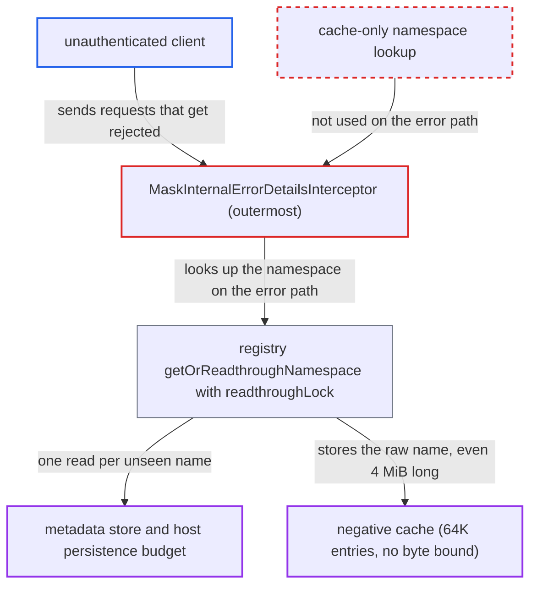

# Error-masking interceptor reads namespace through to persistence for rejected unauthenticated requests

| Field | Value |
|---|---|
| ID | `find_01QpHVJ9wktf5siMXvk7d9cf` |
| Severity | **High** |
| Status | open |
| CWE | CWE-770 — Resource allocation without limits |
| Created | 2026-10-27T22:05:12.788223Z |
| Claude Security | https://claude.ai/security/findings/find_01QpHVJ9wktf5siMXvk7d9cf |

## Description

An unauthenticated client can slow down or crash a Temporal frontend whose authorizer is enforcing. Each rejected request with an unseen namespace name causes a metadata-store read behind a process-wide lock, and over-long names pile up in memory. The cause is `MaskInternalErrorDetailsInterceptor`, which looks up the namespace with the readthrough registry lookup (`MustGetNamespaceName`) after the request was already rejected.

1. **unauthenticated attacker** sends namespaced calls with a fresh `namespace` each time. Any call such as `DescribeWorkflowExecution` works, and the name can be up to about 4 MiB long because no `MaxRecvMsgSize` is set on the frontend server. ([`common/rpc/interceptor/namespace_validator.go:173-199`](https://github.com/cx-benchmark/temporal/blob/bf81a4c20009db89dc952592c9cfe770bafe66ee/common/rpc/interceptor/namespace_validator.go#L173-L199))
2. **inner interceptor chain** rejects the request. `NamespaceValidateIntercept` refuses names longer than `limit.maxIDLength` (default 1000) with `errNamespaceTooLong`, or `authInterceptor` denies the request because it has no credentials and the enforcing authorizer gives it nil claims. ([`common/authorization/interceptor.go:163-177`](https://github.com/cx-benchmark/temporal/blob/bf81a4c20009db89dc952592c9cfe770bafe66ee/common/authorization/interceptor.go#L163-L177))
3. **the outermost interceptor `MaskInternalErrorDetailsInterceptor`** calls `MustGetNamespaceName` on the returned error. This runs for any error, including the ones above, and `GetNamespaceName` resolves the name with the readthrough-enabled `namespaceRegistry.GetNamespace`. ([`common/rpc/interceptor/mask_internal_error.go:51-65`](https://github.com/cx-benchmark/temporal/blob/bf81a4c20009db89dc952592c9cfe770bafe66ee/common/rpc/interceptor/mask_internal_error.go#L51-L65))
4. **the registry function `getOrReadthroughNamespace`** takes the process-wide `readthroughLock` and queries persistence on an in-memory miss. Unless the name is in the 1-second negative cache, each unseen name costs one serialized metadata-store read, and legitimate readthroughs have to wait on the same lock. ([`common/namespace/nsregistry/registry.go:750-781`](https://github.com/cx-benchmark/temporal/blob/bf81a4c20009db89dc952592c9cfe770bafe66ee/common/namespace/nsregistry/registry.go#L750-L781))
5. **the registry** runs the read as caller `system`. The read skips the per-namespace limiter and draws on the host-wide `frontend.persistenceMaxQPS` budget (default 2000). The API rate limiters never run for these rejected requests. ([`common/namespace/nsregistry/registry.go:848-896`](https://github.com/cx-benchmark/temporal/blob/bf81a4c20009db89dc952592c9cfe770bafe66ee/common/namespace/nsregistry/registry.go#L848-L896))
6. **the registry** stores the raw name in the negative cache when the store reports not-found. The cache counts entries (64K), not bytes, and expired entries stay in memory until they are accessed again or pushed out, so retained heap grows by the size of every name sent. ([`common/cache/lru.go:296-366`](https://github.com/cx-benchmark/temporal/blob/bf81a4c20009db89dc952592c9cfe770bafe66ee/common/cache/lru.go#L296-L366))

## Assessment

The attacker is an unauthenticated client who can reach the frontend gRPC port of a deployment that has an enforcing authorizer configured. The shipped config template exposes this through `TEMPORAL_AUTH_AUTHORIZER`. The attacker needs no credentials and sends any namespaced call with a new `namespace` value each time, optionally about 4 MiB long. Either the length check rejects the request or the authorizer denies it, and the lookup happens anyway. Under the shipped noop authorizer the same requests also work, but every caller is already admin-equivalent there, so nothing is gained. `NamespaceLogInterceptor` has the same pattern before auth, but it is inert in `cmd/server` because no namespace logger is set.

Impact: The attacker can degrade the frontend's availability. Metadata-store reads are serialized on one lock, so legitimate readthroughs queue behind them. Exhausting the persistence budget makes lookups fail as `NamespaceNotFound`. Memory use grows by up to about 4 MiB per request until the process runs out of memory. The report says nothing is disclosed or modified.

## Recommendation

(1) `MaskInternalErrorDetailsInterceptor` (`shouldMaskErrors`, `logError`) resolves the request namespace on the error path with the readthrough registry lookup. It does this even for requests the length validator or the authorizer already rejected.

Fix criteria: A request rejected by the namespace length check, or before or by authorization, completes without any metadata-store call, `readthroughLock` acquisition or negative-cache insertion, whatever namespace it carries. Send unauthenticated requests with fresh and over-long namespace names to a frontend with an enforcing authorizer. Expect zero `GetNamespace` persistence operations and no growth of the negative cache.

(2) `interceptor.GetNamespaceName` uses the readthrough variants of the registry lookup, although its `MustGetNamespaceName` callers only need a best-effort label or masking decision and already tolerate `EmptyName`.

Fix criteria: Best-effort labelling and masking lookups are cache-only and never cause persistence I/O. Readthrough stays limited to lookups whose correctness needs it and that run after authorization and rate limiting.

(3) The registry's negative cache bounds the number of entries, not bytes, and accepts names of any length. Any path that reaches the readthrough with an over-long name keeps that name in memory.

Fix criteria: Names longer than the configured ID limit are rejected before any registry readthrough or cache insertion, or the negative cache bounds retained bytes. Sending many distinct over-long names does not raise frontend memory beyond a fixed cap.

## Evidence

**https://github.com/cx-benchmark/temporal**

- [`common/rpc/interceptor/mask_internal_error.go:51-65`](https://github.com/cx-benchmark/temporal/blob/bf81a4c20009db89dc952592c9cfe770bafe66ee/common/rpc/interceptor/mask_internal_error.go#L51-L65)
- [`common/rpc/interceptor/namespace.go:44-50`](https://github.com/cx-benchmark/temporal/blob/bf81a4c20009db89dc952592c9cfe770bafe66ee/common/rpc/interceptor/namespace.go#L44-L50)
- [`service/frontend/fx.go:308-333`](https://github.com/cx-benchmark/temporal/blob/bf81a4c20009db89dc952592c9cfe770bafe66ee/service/frontend/fx.go#L308-L333)
- [`common/rpc/interceptor/namespace_validator.go:173-199`](https://github.com/cx-benchmark/temporal/blob/bf81a4c20009db89dc952592c9cfe770bafe66ee/common/rpc/interceptor/namespace_validator.go#L173-L199)
- [`common/authorization/interceptor.go:163-177`](https://github.com/cx-benchmark/temporal/blob/bf81a4c20009db89dc952592c9cfe770bafe66ee/common/authorization/interceptor.go#L163-L177)
- [`common/namespace/nsregistry/registry.go:750-781`](https://github.com/cx-benchmark/temporal/blob/bf81a4c20009db89dc952592c9cfe770bafe66ee/common/namespace/nsregistry/registry.go#L750-L781)
- [`common/namespace/nsregistry/registry.go:848-896`](https://github.com/cx-benchmark/temporal/blob/bf81a4c20009db89dc952592c9cfe770bafe66ee/common/namespace/nsregistry/registry.go#L848-L896)
- [`common/namespace/nsregistry/registry.go:50-56`](https://github.com/cx-benchmark/temporal/blob/bf81a4c20009db89dc952592c9cfe770bafe66ee/common/namespace/nsregistry/registry.go#L50-L56)
- [`common/cache/lru.go:296-366`](https://github.com/cx-benchmark/temporal/blob/bf81a4c20009db89dc952592c9cfe770bafe66ee/common/cache/lru.go#L296-L366)
- [`common/persistence/sql/metadata.go:94-104`](https://github.com/cx-benchmark/temporal/blob/bf81a4c20009db89dc952592c9cfe770bafe66ee/common/persistence/sql/metadata.go#L94-L104)

