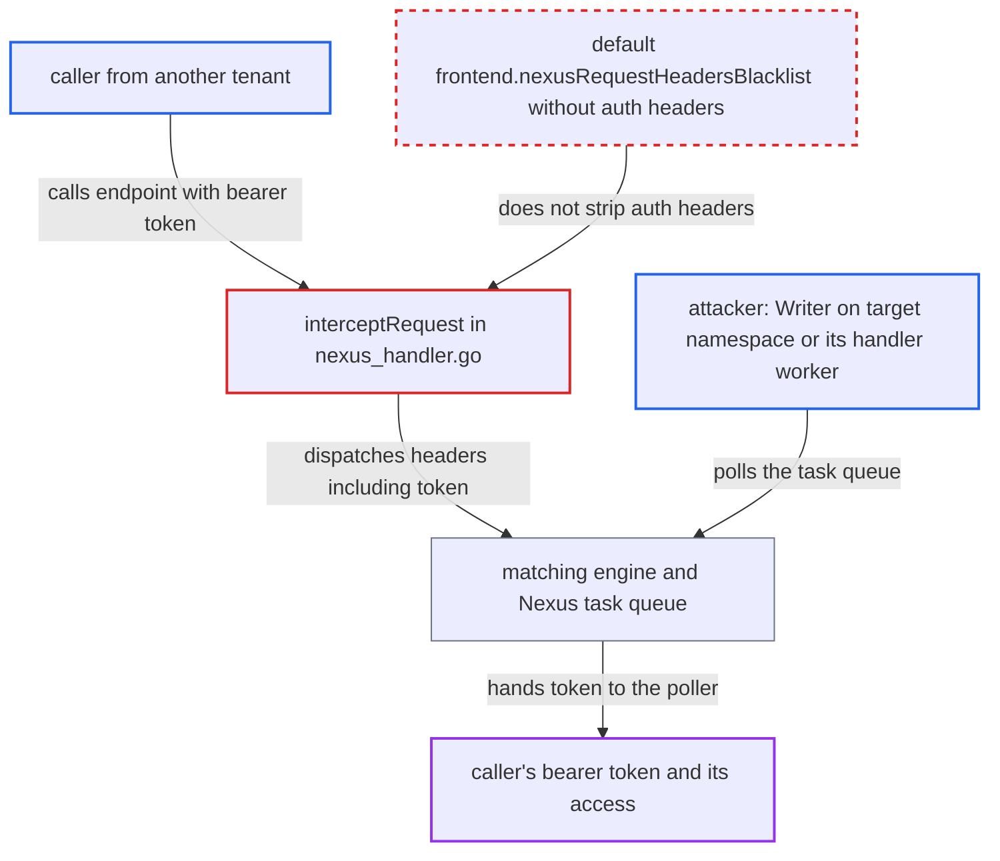

# Frontend forwards caller's Authorization bearer token to Nexus handler workers of the target namespace

| Field | Value |
|---|---|
| ID | `find_01Peb2t1PVsNqf3zxMMYTbc3` |
| Severity | **High** |
| Status | open |
| CWE | CWE-522 — Insufficiently protected credentials |
| Created | 2026-10-27T21:14:50.309318Z |
| Claude Security | https://claude.ai/security/findings/find_01Peb2t1PVsNqf3zxMMYTbc3 |

## Description

An attacker who has Writer access on a namespace, or who runs that namespace's Nexus handler worker, can steal the live bearer token of a caller from another tenant. The attacker can then replay it against the frontend with all the caller's permissions until it expires. This needs bearer-token auth to be configured and a caller whose token reaches beyond the target namespace. The cause is `operationContext.interceptRequest`, which passes the `Authorization` header on to the handler because the default `frontend.nexusRequestHeadersBlacklist` does not list it.

1. **a caller from another tenant** calls the target namespace's Nexus endpoint through the frontend Nexus HTTP API. The request carries `Authorization: Bearer <token>`. The frontend uses the same `Authorization` and `Authorization-Extras` headers to authenticate the caller, so the value is a credential the server accepts. ([`service/frontend/nexus_operation_http_handler.go:331-354`](https://github.com/cx-benchmark/temporal/blob/bf81a4c20009db89dc952592c9cfe770bafe66ee/service/frontend/nexus_operation_http_handler.go#L331-L354))
2. **the nexusrpc HTTP layer** copies the inbound HTTP headers into the Nexus operation header. `httpHeaderToNexusHeader` copies every header. Start leaves out only `content-*` and `nexus-callback-*`, and cancel leaves out nothing, so the token stays in the map. ([`common/nexus/nexusrpc/server.go:202-212`](https://github.com/cx-benchmark/temporal/blob/bf81a4c20009db89dc952592c9cfe770bafe66ee/common/nexus/nexusrpc/server.go#L202-L212))
3. **the method `operationContext.interceptRequest`** removes only the headers on the blacklist. The default `frontend.nexusRequestHeadersBlacklist` holds transport and internal Temporal headers. It does not hold `authorization` or `authorization-extras`, so both stay in the request. ([`service/frontend/nexus_handler.go:276-288`](https://github.com/cx-benchmark/temporal/blob/bf81a4c20009db89dc952592c9cfe770bafe66ee/service/frontend/nexus_handler.go#L276-L288))
4. **the frontend `nexusHandler`** puts the header map into the `nexuspb.Request` sent to matching. `StartOperation` and `CancelOperation` both do this, and the map still contains the bearer token. ([`service/frontend/nexus_handler.go:455-466`](https://github.com/cx-benchmark/temporal/blob/bf81a4c20009db89dc952592c9cfe770bafe66ee/service/frontend/nexus_handler.go#L455-L466))
5. **the matching engine** returns the request to the poller in `PollNexusTaskQueueResponse.Request.Header`. The `Header` map is passed along unchanged. ([`service/matching/matching_engine.go:2950-2967`](https://github.com/cx-benchmark/temporal/blob/bf81a4c20009db89dc952592c9cfe770bafe66ee/service/matching/matching_engine.go#L2950-L2967))
6. **the attacker** polls the target Nexus task queue and reads the caller's token. `PollNexusTaskQueue` needs only namespace-scoped Writer access on the target namespace, so any writer or the handler worker can poll. ([`common/api/metadata.go:107`](https://github.com/cx-benchmark/temporal/blob/bf81a4c20009db89dc952592c9cfe770bafe66ee/common/api/metadata.go#L107))
7. **the attacker** replays the token against the frontend gRPC or HTTP API. The attacker then acts with the caller's claims until the token expires.

## Assessment

The attacker holds Writer on namespace B or runs B's Nexus handler worker, so they can poll B's Nexus task queue. A caller from another tenant invokes B's endpoint over the frontend Nexus HTTP API (`/nexus/endpoints/{id}/services/...` or `/namespaces/{ns}/task-queues/{tq}/nexus-services/...`) with a bearer token. That token must grant Writer on B. In practice it often also covers the caller's own namespaces. The attack depends on bearer-token auth being configured and on a caller using a token with a scope wider than B. Both StartOperation and CancelOperation leak the header.

Impact: The attacker gets another principal's live credential and inherits all of its claims until it expires. If the token also covers the caller's own or other namespaces, or system roles, the attacker can read histories and payloads there. They can also start, signal or terminate workflows, which breaks namespace isolation. The token's claims and lifetime set the limit.

## Recommendation

`operationContext.interceptRequest` in `service/frontend/nexus_handler.go` forwards inbound HTTP headers to the handler worker. It filters them only with the operator-tunable `frontend.nexusRequestHeadersBlacklist`, whose default omits the credential headers the frontend uses for authentication. The caller's credential therefore crosses the tenant boundary.

Fix criteria: The `nexuspb.Request.Header` sent to matching never contains the configured auth header (`authHeaderName`, default `authorization`), the extras header (`authExtraHeaderName`, default `authorization-extras`) or `proxy-authorization`. This holds whatever the dynamic config says, for StartOperation and CancelOperation on both dispatch routes. A test confirms that a poller's `PollNexusTaskQueueResponse.Request.Header` has none of these keys after a call made with a bearer token. Cross-cluster forwarding must still authenticate at the remote cluster.

## Evidence

**https://github.com/cx-benchmark/temporal**

- [`service/frontend/nexus_handler.go:276-288`](https://github.com/cx-benchmark/temporal/blob/bf81a4c20009db89dc952592c9cfe770bafe66ee/service/frontend/nexus_handler.go#L276-L288)
- [`common/dynamicconfig/constants.go:1142-1157`](https://github.com/cx-benchmark/temporal/blob/bf81a4c20009db89dc952592c9cfe770bafe66ee/common/dynamicconfig/constants.go#L1142-L1157)
- [`common/nexus/nexusrpc/server.go:202-212`](https://github.com/cx-benchmark/temporal/blob/bf81a4c20009db89dc952592c9cfe770bafe66ee/common/nexus/nexusrpc/server.go#L202-L212)
- [`service/frontend/nexus_handler.go:455-466`](https://github.com/cx-benchmark/temporal/blob/bf81a4c20009db89dc952592c9cfe770bafe66ee/service/frontend/nexus_handler.go#L455-L466)
- [`service/frontend/nexus_operation_http_handler.go:331-354`](https://github.com/cx-benchmark/temporal/blob/bf81a4c20009db89dc952592c9cfe770bafe66ee/service/frontend/nexus_operation_http_handler.go#L331-L354)
- [`service/matching/matching_engine.go:2950-2967`](https://github.com/cx-benchmark/temporal/blob/bf81a4c20009db89dc952592c9cfe770bafe66ee/service/matching/matching_engine.go#L2950-L2967)
- [`common/api/metadata.go:107`](https://github.com/cx-benchmark/temporal/blob/bf81a4c20009db89dc952592c9cfe770bafe66ee/common/api/metadata.go#L107)

