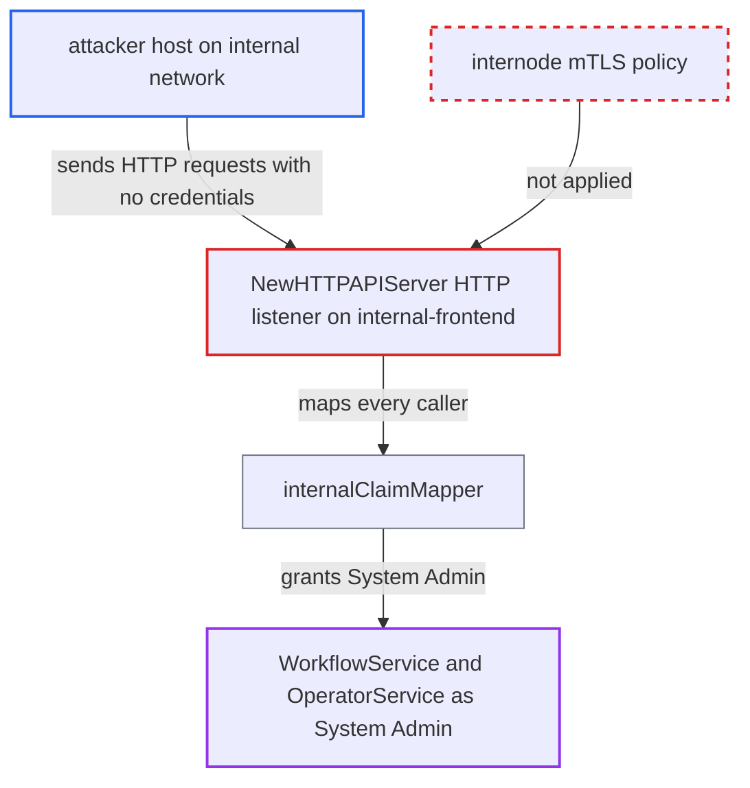

# Internal-frontend HTTP API bypasses internode mTLS and grants System Admin

| Field | Value |
|---|---|
| ID | `find_015o4SZY8YmL6rmqqGwa7nzj` |
| Severity | **High** |
| Status | open |
| CWE | CWE-306 — Missing Authentication |
| Created | 2026-10-27T21:11:45.627977Z |
| Claude Security | https://claude.ai/security/findings/find_015o4SZY8YmL6rmqqGwa7nzj |

## Description

A host on the cluster's internal network can send HTTP requests to the `internal-frontend` HTTP port without any Temporal credentials and run them as System Admin. That covers all of WorkflowService and OperatorService, so the attacker can read, change or delete workflows and namespaces. It needs `httpPort` set on `internal-frontend` and a frontend TLS group that is absent, has no client auth, or trusts external client CAs. The cause is that `NewHTTPAPIServer` uses the public frontend TLS config, not the internode one.

1. **Deployment** starts the HTTP gateway on `internal-frontend`. `httpEnabled` turns the gateway on whenever `rpc.httpPort` is set, and the shipped template sets it to 7246 when `USE_INTERNAL_FRONTEND` is set. ([`service/frontend/fx.go:1125-1167`](https://github.com/cx-benchmark/temporal/blob/bf81a4c20009db89dc952592c9cfe770bafe66ee/service/frontend/fx.go#L1125-L1167))
2. **`NewHTTPAPIServer`** wraps the listener with the public frontend TLS config. It calls `GetFrontendServerConfig()` whatever service hosts it, and leaves the listener plaintext when that group has no server key, so the internode mTLS policy is never applied. ([`service/frontend/http_api_server.go:102-109`](https://github.com/cx-benchmark/temporal/blob/bf81a4c20009db89dc952592c9cfe770bafe66ee/service/frontend/http_api_server.go#L102-L109))
3. **attacker on the internal network** sends an HTTP(S) request to the `internal-frontend` `httpPort`. The request needs no token and no internode certificate, for example `POST /api/v1/namespaces/{ns}/workflows/{id}` or an OperatorService route.
4. **`internalClaimMapper`** gives the caller System Admin claims. `GetClaims` returns `System: RoleAdmin` for every request and `AuthInfoRequired()` is false, so the missing credentials are not an obstacle. ([`common/authorization/claim_mapper.go:72-78`](https://github.com/cx-benchmark/temporal/blob/bf81a4c20009db89dc952592c9cfe770bafe66ee/common/authorization/claim_mapper.go#L72-L78))
5. **`defaultAuthorizer`** allows the call and the handler runs it. System Admin is allowed for every API, and the gateway mounts all of WorkflowService and OperatorService behind the same interceptor chain. ([`temporal/fx.go:565-574`](https://github.com/cx-benchmark/temporal/blob/bf81a4c20009db89dc952592c9cfe770bafe66ee/temporal/fx.go#L565-L574))

## Assessment

The attacker is a host on the cluster's internal network, such as a compromised internal host. The report treats that network as assumed trusted. No Temporal credentials are needed. The deployment must run `internal-frontend` with `httpPort` set and rely on internode mTLS. The frontend TLS group must also be one of these: absent (the listener is then plaintext), present with no client auth (any TLS client is accepted), or trusting external client CAs (any holder of a public-client certificate is accepted). In the shipped template those CAs (`TEMPORAL_TLS_CLIENT1/2_CA_CERT`) differ from the internode CA.

Impact: Every request runs as the Temporal server with System Admin across all namespaces. The attacker can read any workflow history and payload. They can start, signal, terminate or delete workflows anywhere, delete namespaces, add or remove remote clusters and search attributes, and create Nexus endpoints. The code places no limit once the request reaches the listener.

## Recommendation

`NewHTTPAPIServer` picks its server TLS config from the public frontend group whatever service hosts it. The `internal-frontend` HTTP listener, whose callers all get System Admin from `internalClaimMapper`, is therefore not covered by the internode mTLS policy that guards its gRPC listener.

Fix criteria: The `internal-frontend` HTTP listener enforces the same internode server TLS policy as its gRPC listener (same certificate, `RequireClientAuth` and client CAs), or HTTP is disabled for `internal-frontend`. Test with internode mTLS on and a frontend group that is absent, has no client auth, or uses different client CAs. An HTTP request to the `internal-frontend` `httpPort` without a valid internode client certificate must fail at the handshake. Internal HTTP clients using the internode client config must still succeed.

## Evidence

**https://github.com/cx-benchmark/temporal**

- [`service/frontend/http_api_server.go:102-109`](https://github.com/cx-benchmark/temporal/blob/bf81a4c20009db89dc952592c9cfe770bafe66ee/service/frontend/http_api_server.go#L102-L109)
- [`service/frontend/fx.go:1125-1167`](https://github.com/cx-benchmark/temporal/blob/bf81a4c20009db89dc952592c9cfe770bafe66ee/service/frontend/fx.go#L1125-L1167)
- [`service/frontend/fx.go:296-304`](https://github.com/cx-benchmark/temporal/blob/bf81a4c20009db89dc952592c9cfe770bafe66ee/service/frontend/fx.go#L296-L304)
- [`temporal/fx.go:565-574`](https://github.com/cx-benchmark/temporal/blob/bf81a4c20009db89dc952592c9cfe770bafe66ee/temporal/fx.go#L565-L574)
- [`common/authorization/claim_mapper.go:72-78`](https://github.com/cx-benchmark/temporal/blob/bf81a4c20009db89dc952592c9cfe770bafe66ee/common/authorization/claim_mapper.go#L72-L78)
- [`common/config/config.go:563-568`](https://github.com/cx-benchmark/temporal/blob/bf81a4c20009db89dc952592c9cfe770bafe66ee/common/config/config.go#L563-L568)
- [`common/resource/fx.go:490-506`](https://github.com/cx-benchmark/temporal/blob/bf81a4c20009db89dc952592c9cfe770bafe66ee/common/resource/fx.go#L490-L506)
- [`common/config/config_template_embedded.yaml:208-321`](https://github.com/cx-benchmark/temporal/blob/bf81a4c20009db89dc952592c9cfe770bafe66ee/common/config/config_template_embedded.yaml#L208-L321)

