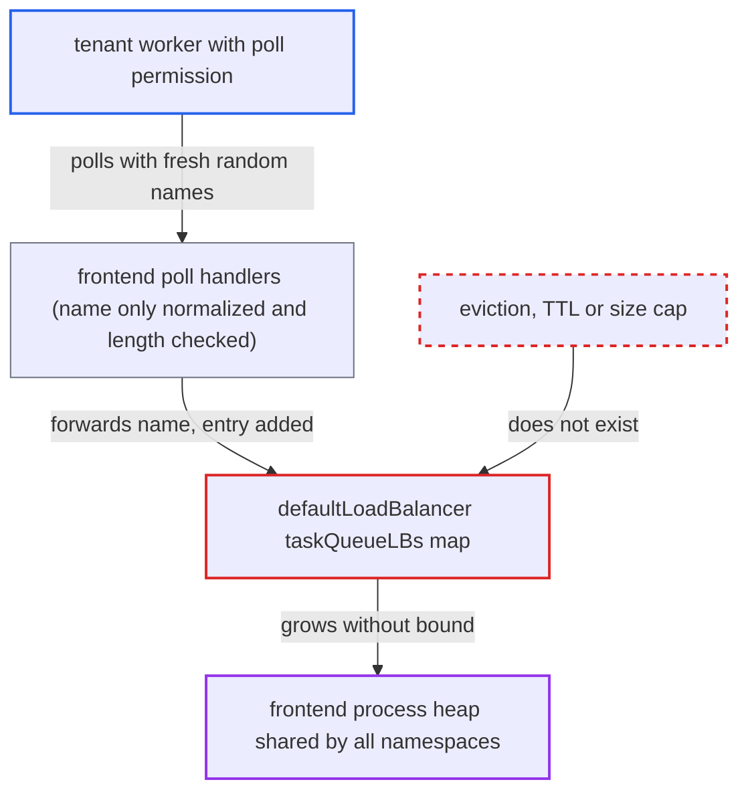

# Matching client load balancer keeps one entry per caller-chosen task queue name forever

| Field | Value |
|---|---|
| ID | `find_01HpGzKKyBQWLXga1iX2jQhn` |
| Severity | **High** |
| Status | open |
| CWE | CWE-770 — Resource exhaustion |
| Created | 2026-10-27T21:35:14.009087Z |
| Claude Security | https://claude.ai/security/findings/find_01HpGzKKyBQWLXga1iX2jQhn |

## Description

A tenant worker with poll permission on one namespace can crash the frontend by exhausting its memory. This takes down the API for every namespace on that host. Under the shipped noop authorizer, any client that can reach the frontend can do it. The map `taskQueueLBs` in `defaultLoadBalancer` gets a new entry for each task queue name a poller sends, and nothing ever removes entries.

1. **attacker** sends poll requests with a fresh random task queue name each time. The calls are `PollWorkflowTaskQueue`, `PollActivityTaskQueue` or `PollNexusTaskQueue`, each with a name of up to 1000 bytes and a deadline of at least 2s. ([`service/frontend/workflow_handler.go:1145-1173`](https://github.com/cx-benchmark/temporal/blob/bf81a4c20009db89dc952592c9cfe770bafe66ee/service/frontend/workflow_handler.go#L1145-L1173))
2. **frontend poll handler** accepts the name and forwards it unchanged to the matching client. It only normalizes the name and checks for valid UTF-8, no bad whitespace and a length of at most `limit.maxIDLength` (default 1000), so any such name passes. ([`service/frontend/workflow_handler.go:1145-1173`](https://github.com/cx-benchmark/temporal/blob/bf81a4c20009db89dc952592c9cfe770bafe66ee/service/frontend/workflow_handler.go#L1145-L1173))
3. **the method `doPollWorkflowTaskQueue`** calls `PickReadPartition` with the caller's task queue name. `doPollActivityTaskQueue` and `doPollNexusTaskQueue` do the same, for every non-forwarded normal root partition. ([`client/matching/client_gen.go:816-860`](https://github.com/cx-benchmark/temporal/blob/bf81a4c20009db89dc952592c9cfe770bafe66ee/client/matching/client_gen.go#L816-L860))
4. **the method `PickReadPartition`** calls `getTaskQueueLoadBalancer` before making any RPC. The entry is therefore created even if the downstream poll later fails or is cancelled. ([`client/matching/loadbalancer.go:191-213`](https://github.com/cx-benchmark/temporal/blob/bf81a4c20009db89dc952592c9cfe770bafe66ee/client/matching/loadbalancer.go#L191-L213))
5. **the method `getTaskQueueLoadBalancer`** inserts a new `tqLoadBalancer` into `taskQueueLBs` for each name it has not seen. The key is the namespace ID, task queue name and task type, and nothing in the package ever deletes from the map. ([`client/matching/loadbalancer.go:215-231`](https://github.com/cx-benchmark/temporal/blob/bf81a4c20009db89dc952592c9cfe770bafe66ee/client/matching/loadbalancer.go#L215-L231))
6. **`pollToken.Release`** only decrements a counter when the poll ends. The entry stays, so memory grows by about 1.1 to 1.2 KiB per distinct name and task type until the frontend runs out of memory. ([`client/matching/client_gen.go:816-860`](https://github.com/cx-benchmark/temporal/blob/bf81a4c20009db89dc952592c9cfe770bafe66ee/client/matching/client_gen.go#L816-L860))

## Assessment

The attacker is a tenant worker with poll permission on one namespace. Under the shipped noop authorizer, any client that can reach the frontend qualifies. Each poll uses a new random name and a deadline of at least 2s. Only the rate is limited, by `frontend.namespaceRPS` (2400/s) and `frontend.namespaceCount` (1200 concurrent per API). No victim action is needed. The report also notes that legitimate workloads using unique per-worker task queues leak entries the same way.

Impact: The frontend heap grows without a cap, at roughly gigabytes per hour per frontend host at the default namespace rate. The frontend is then killed for running out of memory, and the public API goes down for every namespace on that host. The attacker can repeat this after each restart and against every frontend. Confidentiality and integrity are not affected.

## Recommendation

`defaultLoadBalancer.taskQueueLBs` gains one entry per distinct task queue name chosen by the caller and never releases any. Untrusted input therefore sets process memory with no upper bound.

Fix criteria: Entries for task queues with no outstanding polls are released. For example, they are evicted when the poller count returns to zero, expired after an idle period, or held in a size-bounded or periodically rotated structure like `partitionCache`. Polling N distinct random task queue names and letting the polls finish leaves the map size bounded independently of N. Read-partition balancing for actively polled queues is unchanged.

## Evidence

**https://github.com/cx-benchmark/temporal**

- [`client/matching/loadbalancer.go:215-231`](https://github.com/cx-benchmark/temporal/blob/bf81a4c20009db89dc952592c9cfe770bafe66ee/client/matching/loadbalancer.go#L215-L231)
- [`client/matching/loadbalancer.go:191-213`](https://github.com/cx-benchmark/temporal/blob/bf81a4c20009db89dc952592c9cfe770bafe66ee/client/matching/loadbalancer.go#L191-L213)
- [`client/matching/client_gen.go:816-860`](https://github.com/cx-benchmark/temporal/blob/bf81a4c20009db89dc952592c9cfe770bafe66ee/client/matching/client_gen.go#L816-L860)
- [`service/frontend/workflow_handler.go:1145-1173`](https://github.com/cx-benchmark/temporal/blob/bf81a4c20009db89dc952592c9cfe770bafe66ee/service/frontend/workflow_handler.go#L1145-L1173)
- [`common/dynamicconfig/constants.go:551-556`](https://github.com/cx-benchmark/temporal/blob/bf81a4c20009db89dc952592c9cfe770bafe66ee/common/dynamicconfig/constants.go#L551-L556)

