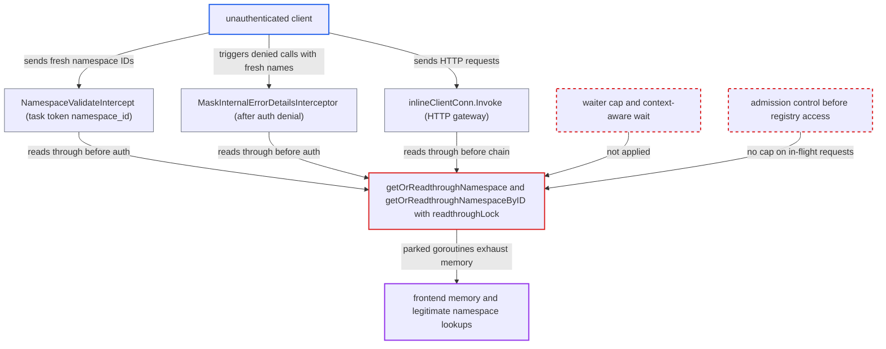

# Namespace registry readthrough lock admits unbounded, uncancellable waiters, letting pre-auth floods exhaust frontend memory

| Field | Value |
|---|---|
| ID | `find_01KwECuXr8oGKD27jFvdx2eh` |
| Severity | **High** |
| Status | open |
| CWE | CWE-770 — Resource exhaustion |
| Created | 2026-10-27T22:21:57.400271Z |
| Claude Security | https://claude.ai/security/findings/find_01KwECuXr8oGKD27jFvdx2eh |

## Description

An unauthenticated client can exhaust the frontend's memory and take it down, which cuts service for every tenant on that host. The attack needs a deployment with an enforcing authorizer, because the shipped noop authorizer already treats every caller as admin. The cause is `readthroughLock`, taken with a bare `Lock()` in `getOrReadthroughNamespace` and `getOrReadthroughNamespaceByID`. It has no waiter cap and ignores request cancellation.

1. **unauthenticated client** sends many requests that carry never-seen namespace names or IDs. One route is a task-token request with an empty `namespace` and a fresh random `namespace_id`. The task token is unsigned, and `extractNamespaceFromTaskToken` looks up its `namespace_id` with `GetNamespaceByID`. ([`common/rpc/interceptor/namespace_validator.go:393-422`](https://github.com/cx-benchmark/temporal/blob/bf81a4c20009db89dc952592c9cfe770bafe66ee/common/rpc/interceptor/namespace_validator.go#L393-L422))
2. **`MaskInternalErrorDetailsInterceptor`** looks up the request's namespace name after any error. This includes the authorizer's denial, so a namespaced call with a fresh name that auth rejects still feeds the same lookup. ([`common/rpc/interceptor/mask_internal_error.go:44-65`](https://github.com/cx-benchmark/temporal/blob/bf81a4c20009db89dc952592c9cfe770bafe66ee/common/rpc/interceptor/mask_internal_error.go#L44-L65))
3. **HTTP gateway `inlineClientConn.Invoke`** looks up the namespace name before the interceptor chain runs. HTTP API requests therefore reach the same lock, and their handlers outlive a client disconnect. ([`service/frontend/http_api_server.go:431-446`](https://github.com/cx-benchmark/temporal/blob/bf81a4c20009db89dc952592c9cfe770bafe66ee/service/frontend/http_api_server.go#L431-L446))
4. **frontend interceptor chain** lets the requests reach the registry before any admission control. The mask and namespace-validation interceptors run before `authInterceptor`. The only concurrency and rate limiters run after auth, and the gRPC server sets no `MaxConcurrentStreams`. ([`service/frontend/fx.go:311-336`](https://github.com/cx-benchmark/temporal/blob/bf81a4c20009db89dc952592c9cfe770bafe66ee/service/frontend/fx.go#L311-L336))
5. **registry lookups `getOrReadthroughNamespaceByID` and `getOrReadthroughNamespace`** park each request's goroutine on `readthroughLock`. `Lock()` is called before the negative cache is checked. It cannot see the request's context, and no limit applies to the number of waiters. ([`common/namespace/nsregistry/registry.go:785-818`](https://github.com/cx-benchmark/temporal/blob/bf81a4c20009db89dc952592c9cfe770bafe66ee/common/namespace/nsregistry/registry.go#L785-L818))
6. **lock holder** reads the namespace from persistence on a fresh 3 s context. The read uses `context.WithTimeout(context.Background(), 3s)`. Each waiter therefore costs a full database round trip when its turn comes, even if its client has cancelled. ([`common/namespace/nsregistry/registry.go:880-897`](https://github.com/cx-benchmark/temporal/blob/bf81a4c20009db89dc952592c9cfe770bafe66ee/common/namespace/nsregistry/registry.go#L880-L897))
7. **negative cache** does not stop repeated lookups of fresh keys. A key is cached only after the database read, under its exact string, with a 1 s TTL. Fresh names and UUIDs never hit it. ([`common/namespace/nsregistry/registry.go:848-878`](https://github.com/cx-benchmark/temporal/blob/bf81a4c20009db89dc952592c9cfe770bafe66ee/common/namespace/nsregistry/registry.go#L848-L878))
8. **frontend process** accumulates parked goroutines until memory runs out. The queue drains at about one waiter per database round trip. A flood faster than that grows it without bound, and each waiter holds its stack, decoded request and stream state. ([`common/persistence/persistence_rate_limited_clients.go:1146-1176`](https://github.com/cx-benchmark/temporal/blob/bf81a4c20009db89dc952592c9cfe770bafe66ee/common/persistence/persistence_rate_limited_clients.go#L1146-L1176))

## Assessment

The attacker is an unauthenticated client of the frontend gRPC or HTTP port. The deployment must use an enforcing authorizer, such as `default` or a custom one. Under the shipped noop authorizer every caller is already admin-equivalent, so the added gain exists only with an enforcing authorizer. No victim action is needed. The attacker sends requests faster than one per database round trip, and may cancel each one. Ways in: a task-token request with an empty `namespace` and a fresh random `namespace_id`; any namespaced call with a fresh name that auth denies; or an HTTP API request. The lock is the bottleneck while database round trip time times `frontend.persistenceMaxQPS` (2000) is at least 1. The report assumes grpc-go v1.83.2 defaults `maxConcurrentStreams` to `math.MaxUint32` and decodes a unary request message before the interceptors run, so HTTP/2 flow control gives no backpressure.

Impact: The attacker can make the frontend process run out of memory, so every tenant served by that host loses service. While the queue is deep, legitimate uncached lookups wait and fail as `NamespaceNotFound`. Examples are namespaces created inside the refresh interval and forced search-attribute reads. Nothing is disclosed or modified.

## Recommendation

(1) `getOrReadthroughNamespace` and `getOrReadthroughNamespaceByID` take `readthroughLock` with a bare `Lock()`. The wait cannot be cancelled by the caller's context, and any number of waiters is admitted.

Fix criteria: The number of callers waiting for a readthrough is bounded, and callers beyond a small cap fail fast with a retryable error. The wait observes the caller's context or deadline. Lookups of distinct unknown keys cannot park goroutines indefinitely. Under a sustained flood of fresh namespace IDs, including cancelled requests, the frontend's goroutine count and RSS stay flat. A concurrent legitimate uncached lookup completes within its deadline.

(2) `getNamespacePersistence` runs the readthrough on `context.Background()` with a fixed 3 s timeout. Work continues for callers that have already gone away, and the lock is held for it.

Fix criteria: A readthrough does not reach persistence for a caller that has already cancelled or passed its deadline. Cancelling a batch of queued readthrough requests results in no further `GetNamespace` persistence calls for them.

(3) Nothing ahead of the registry readthrough limits how many unauthenticated requests are in flight. Neither the frontend chain nor the gRPC transport sets any cap, and the transport has no `MaxConcurrentStreams`. The queue is therefore fed without admission control.

Fix criteria: In-flight requests per connection or host are capped before any registry access and before authentication, as defense in depth. An unauthenticated client cannot have more than the configured number of handlers executing at once, whatever the request content.

## Evidence

**https://github.com/cx-benchmark/temporal**

- [`common/namespace/nsregistry/registry.go:785-818`](https://github.com/cx-benchmark/temporal/blob/bf81a4c20009db89dc952592c9cfe770bafe66ee/common/namespace/nsregistry/registry.go#L785-L818)
- [`common/namespace/nsregistry/registry.go:750-782`](https://github.com/cx-benchmark/temporal/blob/bf81a4c20009db89dc952592c9cfe770bafe66ee/common/namespace/nsregistry/registry.go#L750-L782)
- [`common/namespace/nsregistry/registry.go:880-897`](https://github.com/cx-benchmark/temporal/blob/bf81a4c20009db89dc952592c9cfe770bafe66ee/common/namespace/nsregistry/registry.go#L880-L897)
- [`common/namespace/nsregistry/registry.go:848-878`](https://github.com/cx-benchmark/temporal/blob/bf81a4c20009db89dc952592c9cfe770bafe66ee/common/namespace/nsregistry/registry.go#L848-L878)
- [`common/rpc/interceptor/namespace_validator.go:393-422`](https://github.com/cx-benchmark/temporal/blob/bf81a4c20009db89dc952592c9cfe770bafe66ee/common/rpc/interceptor/namespace_validator.go#L393-L422)
- [`common/rpc/interceptor/mask_internal_error.go:44-65`](https://github.com/cx-benchmark/temporal/blob/bf81a4c20009db89dc952592c9cfe770bafe66ee/common/rpc/interceptor/mask_internal_error.go#L44-L65)
- [`service/frontend/fx.go:311-336`](https://github.com/cx-benchmark/temporal/blob/bf81a4c20009db89dc952592c9cfe770bafe66ee/service/frontend/fx.go#L311-L336)
- [`common/rpc/rpc.go:131-146`](https://github.com/cx-benchmark/temporal/blob/bf81a4c20009db89dc952592c9cfe770bafe66ee/common/rpc/rpc.go#L131-L146)
- [`common/persistence/persistence_rate_limited_clients.go:1146-1176`](https://github.com/cx-benchmark/temporal/blob/bf81a4c20009db89dc952592c9cfe770bafe66ee/common/persistence/persistence_rate_limited_clients.go#L1146-L1176)
- [`service/frontend/http_api_server.go:431-446`](https://github.com/cx-benchmark/temporal/blob/bf81a4c20009db89dc952592c9cfe770bafe66ee/service/frontend/http_api_server.go#L431-L446)
- [`common/authorization/authorizer.go:64-73`](https://github.com/cx-benchmark/temporal/blob/bf81a4c20009db89dc952592c9cfe770bafe66ee/common/authorization/authorizer.go#L64-L73)

