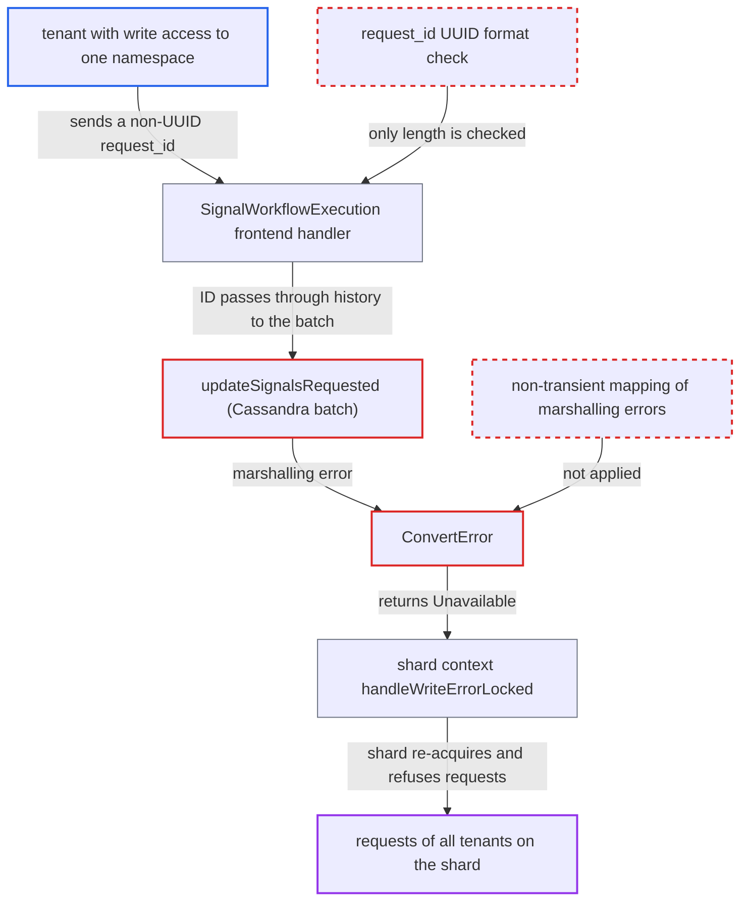

# Non-UUID signal request_id fails Cassandra batch as Unavailable, forcing shard re-acquisition

| Field | Value |
|---|---|
| ID | `find_01UvBrDW3SZd6qw11GBkEGUE` |
| Severity | **High** |
| Status | open |
| CWE | CWE-1287 — Improper input validation |
| Created | 2026-10-27T21:19:46.496051Z |
| Claude Security | https://claude.ai/security/findings/find_01UvBrDW3SZd6qw11GBkEGUE |

## Description

A tenant with write access to one namespace can knock whole Cassandra history shards offline for every other tenant on them. Each attack write makes the shard drop and re-acquire its lease, and the shard refuses all requests meanwhile. It needs no victim action. It affects the default setup, where `history.enableCHASMSignalBacklinks` is false. The cause is that a signal `request_id` is never checked to be a UUID, and the resulting local driver error is reported as `Unavailable`.

1. **attacker (tenant with write access to a namespace)** sends `SignalWorkflowExecution` with a non-UUID `request_id` such as "x". The frontend only checks the length against `MaxIDLengthLimit`, so the value passes; `SignalWithStartWorkflowExecution` checks only that it is non-empty and within the limit. ([`service/frontend/workflow_handler.go:2359-2361`](https://github.com/cx-benchmark/temporal/blob/bf81a4c20009db89dc952592c9cfe770bafe66ee/service/frontend/workflow_handler.go#L2359-L2361))
2. **history handler in `service/history/api/signalworkflow/api.go`** adds the raw ID to mutable state with `AddSignalRequested`. The early return in `AddSignalRequested` applies only when `history.enableCHASMSignalBacklinks` is on, and it defaults to false, so the ID goes into `updateSignalRequestedIDs` and is emitted as `UpsertSignalRequestedIDs`. ([`service/history/workflow/mutable_state_impl.go:2558-2576`](https://github.com/cx-benchmark/temporal/blob/bf81a4c20009db89dc952592c9cfe770bafe66ee/service/history/workflow/mutable_state_impl.go#L2558-L2576))
3. **`updateSignalsRequested`** binds the ID into the `signal_requested` column of the batch. The column is `set<uuid>`, and gocql v1.7.0 cannot marshal a non-UUID string, so the batch fails on the client before it is sent. This marshalling behaviour is the report's assumption about the pinned driver, since its source is not in the checkout. ([`common/persistence/cassandra/util.go:1020-1050`](https://github.com/cx-benchmark/temporal/blob/bf81a4c20009db89dc952592c9cfe770bafe66ee/common/persistence/cassandra/util.go#L1020-L1050))
4. **`ConvertError`** turns the local marshalling error into `serviceerror.Unavailable`. It has no case for such an error, and its default branch returns `Unavailable` even though the write was never sent. ([`common/persistence/nosql/nosqlplugin/cassandra/gocql/errors.go:15-62`](https://github.com/cx-benchmark/temporal/blob/bf81a4c20009db89dc952592c9cfe770bafe66ee/common/persistence/nosql/nosqlplugin/cassandra/gocql/errors.go#L15-L62))
5. **`ContextImpl.UpdateWorkflowExecution`** passes the error to `handleWriteErrorLocked`. `Unavailable` is not a 'definitely not committed' error type, so it takes the `default` branch and calls `transition(contextRequestLost{})`, which moves the shard to `Acquiring`. ([`service/history/shard/context_impl.go:1503-1553`](https://github.com/cx-benchmark/temporal/blob/bf81a4c20009db89dc952592c9cfe770bafe66ee/service/history/shard/context_impl.go#L1503-L1553))
6. **shard** drains in-flight requests, bumps `range_id` with an `UpdateShard` write, and refuses all requests meanwhile. Until re-acquisition ends, `errorByState` returns `ErrShardStatusUnknown` for every namespace's workflows on that shard. ([`service/history/shard/context_impl.go:1503-1553`](https://github.com/cx-benchmark/temporal/blob/bf81a4c20009db89dc952592c9cfe770bafe66ee/service/history/shard/context_impl.go#L1503-L1553))
7. **attacker** repeats the request against every shard. The first failing write after each renewal triggers another re-acquisition, and the frontend's history client also retries `Unavailable`, so one RPC can cause more than one. ([`service/history/shard/context_impl.go:650-658`](https://github.com/cx-benchmark/temporal/blob/bf81a4c20009db89dc952592c9cfe770bafe66ee/service/history/shard/context_impl.go#L650-L658))

## Assessment

The attacker is a tenant with write access to a single namespace, and frontend traffic is treated as untrusted. They start workflows, or use signal-with-start, with workflow IDs that hash to the shards they want, since placement is `hash(namespaceID, workflowID) % numShards`. Then they repeatedly send `SignalWorkflowExecution` with a non-UUID `request_id`. `SignalWithStartWorkflowExecution` is a second way to reach the same code. The attack applies to the Cassandra store, which is the default in the embedded config, with `history.enableCHASMSignalBacklinks` at its default of false. The embedded config defaults to 4 history shards, and the shipped `frontend.namespaceRPS` default of 2400 lets one tenant keep every shard cycling.

Impact: The attacker can keep shards in constant re-acquisition, so co-located tenants get errors for as long as the attack runs. No data is disclosed or changed, and the malformed write itself is never applied.

## Recommendation

(1) `updateSignalsRequested` and `resetSignalRequested` in `common/persistence/cassandra/util.go` pass tenant-controlled request IDs into a `set<uuid>` column without checking the format. A malformed ID causes a client-side gocql marshalling failure of the whole mutable-state batch.

Fix criteria: The Cassandra store rejects a mutation or snapshot whose `SignalRequestedIDs` contain a non-UUID value with a non-transient error such as `InvalidPersistenceRequestError`, before building the batch. The shard keeps its lease. A test calls `UpdateWorkflowExecution` with `UpsertSignalRequestedIDs: {"x"}` against the Cassandra store. It asserts the error is not `*serviceerror.Unavailable` and that `ShardContext.handleWriteError` does not move the shard to `Acquiring`.

(2) `gocql.ConvertError` maps every unclassified driver error to `serviceerror.Unavailable`. This includes local marshalling and binding failures where the statement was never sent. Callers read `Unavailable` as 'outcome unknown, re-acquire the shard'.

Fix criteria: Errors gocql raises before the request leaves the client, such as marshalling errors and argument-count mismatches, come back as a non-transient persistence error instead of `Unavailable`. A unit test feeds a gocql marshal error into `ConvertError`. It asserts the result is not `*serviceerror.Unavailable` and is not retried by `IsPersistenceTransientError`.

(3) The frontend accepts any string up to `MaxIDLengthLimit` (default 1000) as a signal `request_id`. The persistence schemas can store only UUIDs (Cassandra `set<uuid>`) or 255-character strings (SQL `VARCHAR(255)`).

Fix criteria: `SignalWorkflowExecution` and `SignalWithStartWorkflowExecution` reject, with `InvalidArgument`, any `request_id` the configured persistence layer cannot store, before any history call. Sending `request_id: "x"` on Cassandra, or a 300-character ID on SQL, returns `InvalidArgument`. The shard's `range_id` does not change.

## Evidence

**https://github.com/cx-benchmark/temporal**

- [`common/persistence/cassandra/util.go:1020-1050`](https://github.com/cx-benchmark/temporal/blob/bf81a4c20009db89dc952592c9cfe770bafe66ee/common/persistence/cassandra/util.go#L1020-L1050)
- [`common/persistence/nosql/nosqlplugin/cassandra/gocql/errors.go:15-62`](https://github.com/cx-benchmark/temporal/blob/bf81a4c20009db89dc952592c9cfe770bafe66ee/common/persistence/nosql/nosqlplugin/cassandra/gocql/errors.go#L15-L62)
- [`service/history/shard/context_impl.go:1503-1553`](https://github.com/cx-benchmark/temporal/blob/bf81a4c20009db89dc952592c9cfe770bafe66ee/service/history/shard/context_impl.go#L1503-L1553)
- [`service/history/shard/context_impl.go:650-658`](https://github.com/cx-benchmark/temporal/blob/bf81a4c20009db89dc952592c9cfe770bafe66ee/service/history/shard/context_impl.go#L650-L658)
- [`service/frontend/workflow_handler.go:2359-2361`](https://github.com/cx-benchmark/temporal/blob/bf81a4c20009db89dc952592c9cfe770bafe66ee/service/frontend/workflow_handler.go#L2359-L2361)
- [`service/history/api/signalworkflow/api.go:96-98`](https://github.com/cx-benchmark/temporal/blob/bf81a4c20009db89dc952592c9cfe770bafe66ee/service/history/api/signalworkflow/api.go#L96-L98)
- [`service/history/workflow/mutable_state_impl.go:2558-2576`](https://github.com/cx-benchmark/temporal/blob/bf81a4c20009db89dc952592c9cfe770bafe66ee/service/history/workflow/mutable_state_impl.go#L2558-L2576)
- [`schema/cassandra/temporal/schema.cql:44`](https://github.com/cx-benchmark/temporal/blob/bf81a4c20009db89dc952592c9cfe770bafe66ee/schema/cassandra/temporal/schema.cql#L44)
- [`common/config/config_template_embedded.yaml:7-17`](https://github.com/cx-benchmark/temporal/blob/bf81a4c20009db89dc952592c9cfe770bafe66ee/common/config/config_template_embedded.yaml#L7-L17)

