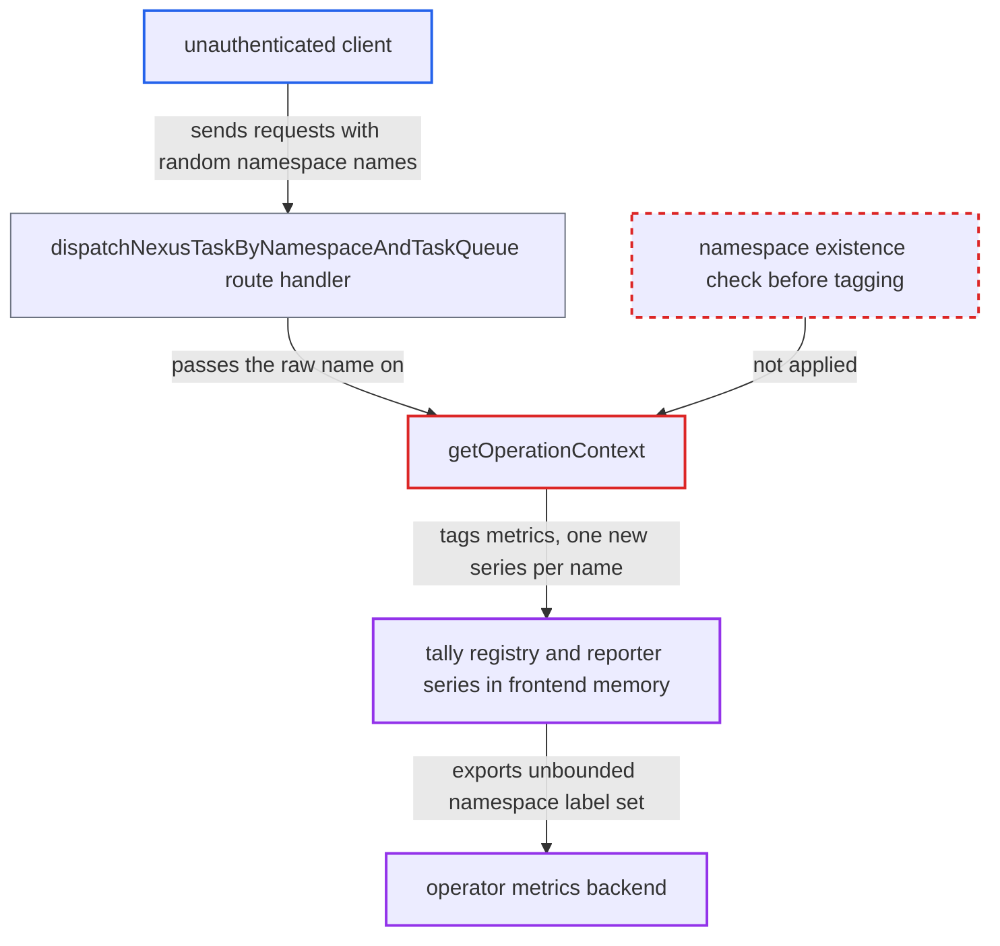

# Pre-auth Nexus namespace route emits metrics tagged with unvalidated URL namespace

| Field | Value |
|---|---|
| ID | `find_01CEo8QNxmdxiRnd3J4ikG3L` |
| Severity | **High** |
| Status | open |
| CWE | CWE-770 — Allocation without limits |
| Created | 2026-10-27T21:35:55.328264Z |
| Claude Security | https://claude.ai/security/findings/find_01CEo8QNxmdxiRnd3J4ikG3L |

## Description

An unauthenticated client who can reach the frontend HTTP port can make the Temporal frontend run out of memory and be killed. That frontend is shared by every namespace. It works only when the operator has configured a StatsD or Prometheus metrics reporter. `getOperationContext` tags metrics with the unchecked namespace from the URL, and this happens before authorization or rate limiting.

1. **unauthenticated client** sends a POST to the namespace/task-queue Nexus route with a fresh random namespace segment. The route is `/namespaces/{namespace}/task-queues/{task_queue}/nexus-services/...`. It is served on the frontend HTTP port and needs no credentials, and each request uses a new name of up to 1000 characters. ([`service/frontend/nexus_operation_http_handler.go:118-135`](https://github.com/cx-benchmark/temporal/blob/bf81a4c20009db89dc952592c9cfe770bafe66ee/service/frontend/nexus_operation_http_handler.go#L118-L135))
2. **the handler `dispatchNexusTaskByNamespaceAndTaskQueue`** copies the URL namespace into `nc.namespaceName` after only a length check. `ValidateName` checks the length against `limit.maxIDLength` (default 1000) and nothing else, so any string passes. ([`service/frontend/nexus_operation_http_handler.go:157-198`](https://github.com/cx-benchmark/temporal/blob/bf81a4c20009db89dc952592c9cfe770bafe66ee/service/frontend/nexus_operation_http_handler.go#L157-L198))
3. **`parseTLSAndAuthInfo`** lets the request continue with no credentials. With no `Authorization` header and no client certificate, `GetAuthInfo` returns nil, and the request is not rejected. ([`service/frontend/nexus_operation_http_handler.go:331-355`](https://github.com/cx-benchmark/temporal/blob/bf81a4c20009db89dc952592c9cfe770bafe66ee/service/frontend/nexus_operation_http_handler.go#L331-L355))
4. **`getOperationContext`** tags two metrics handlers with the raw namespace string and records `nexus_requests` with outcome `namespace_not_found`. The tagging happens through `metrics.NamespaceTag(nc.namespaceName)` before the lookup in `namespaceRegistry.GetNamespace`, and the failed lookup then returns. ([`service/frontend/nexus_handler.go:393-411`](https://github.com/cx-benchmark/temporal/blob/bf81a4c20009db89dc952592c9cfe770bafe66ee/service/frontend/nexus_handler.go#L393-L411))
5. **the interceptor `interceptRequest`** runs `c.auth.Authorize` and the rate limiters only after `getOperationContext` succeeds. For an unknown namespace the function has already returned, so no authorization or throttling happens before the metric is recorded. ([`service/frontend/nexus_handler.go:173-195`](https://github.com/cx-benchmark/temporal/blob/bf81a4c20009db89dc952592c9cfe770bafe66ee/service/frontend/nexus_handler.go#L173-L195))
6. **the tally metrics handler** creates a new tally sub-scope for every new tag set. `WithTags` and `cachedTaggedScope` call `tally.Scope.Tagged`. The `sharedScopeCache` only bounds Temporal's own lookup maps, and `Close()` is a no-op, so each name stays in the registry and reporter for the life of the process. ([`common/metrics/tally_metrics_handler.go:155-188`](https://github.com/cx-benchmark/temporal/blob/bf81a4c20009db89dc952592c9cfe770bafe66ee/common/metrics/tally_metrics_handler.go#L155-L188))

## Assessment

The attacker is an unauthenticated network client that can reach the frontend HTTP port (7243 in the shipped template). No victim action is needed. The operator must have configured a metrics reporter, which the shipped templates enable when `STATSD_ENDPOINT` or `PROMETHEUS_ENDPOINT` is set. Without a reporter, `MetricsHandlerFromConfig` returns `NoopMetricsHandler` and nothing accumulates. The path relies on the default tally framework, because the shipped templates set no framework. The report did not check whether the OpenTelemetry framework caps cardinality by default. The report also assumes, without the dependency source, that `tally/v4 v4.1.17` keeps `Tagged` sub-scopes until the root scope closes and that the Prometheus reporter keeps every label set. The `/nexus/endpoints/...` route is not affected, because it resolves the namespace from a registered endpoint first.

Impact: Sustained requests grow the frontend's heap and make each metrics scrape or flush more expensive, until the frontend is killed for running out of memory. The frontend is shared by every namespace. No data is disclosed or modified.

Subsequent-system impact: The operator's metrics backend receives an unbounded set of attacker-chosen `namespace` label values, which pollutes that dimension and adds some ingestion load. The report shows the export path but not the backend's capacity.

## Recommendation

(1) `getOperationContext` uses the unresolved, caller-supplied namespace string as a metric tag. It records `nexus_requests` with that tag when the lookup fails, before authorization and rate limiting.

Fix criteria: On `nexus_requests` and the interceptor metrics handler, the `namespace` tag takes only names of registered namespaces or a fixed placeholder such as `_unknown_`. A `namespace_not_found` outcome is recorded under the placeholder. N unauthenticated requests with N distinct unknown namespace segments add at most one new series and do not grow the tally registry.

(2) The metrics layer has no global cap on tag-value cardinality, so any call site that passes a request-derived string through becomes an unbounded allocation.

Fix criteria: The handler tree bounds the number of distinct tag sets it creates, overflows into a placeholder, and caps tag-value length. An unguarded call site can then no longer exhaust process memory. Going past the bound yields a placeholder series rather than new registry entries.

## Evidence

**https://github.com/cx-benchmark/temporal**

- [`service/frontend/nexus_handler.go:393-411`](https://github.com/cx-benchmark/temporal/blob/bf81a4c20009db89dc952592c9cfe770bafe66ee/service/frontend/nexus_handler.go#L393-L411)
- [`service/frontend/nexus_operation_http_handler.go:157-198`](https://github.com/cx-benchmark/temporal/blob/bf81a4c20009db89dc952592c9cfe770bafe66ee/service/frontend/nexus_operation_http_handler.go#L157-L198)
- [`service/frontend/nexus_operation_http_handler.go:331-355`](https://github.com/cx-benchmark/temporal/blob/bf81a4c20009db89dc952592c9cfe770bafe66ee/service/frontend/nexus_operation_http_handler.go#L331-L355)
- [`service/frontend/nexus_handler.go:173-195`](https://github.com/cx-benchmark/temporal/blob/bf81a4c20009db89dc952592c9cfe770bafe66ee/service/frontend/nexus_handler.go#L173-L195)
- [`service/frontend/nexus_operation_http_handler.go:118-135`](https://github.com/cx-benchmark/temporal/blob/bf81a4c20009db89dc952592c9cfe770bafe66ee/service/frontend/nexus_operation_http_handler.go#L118-L135)
- [`common/metrics/tally_metrics_handler.go:155-188`](https://github.com/cx-benchmark/temporal/blob/bf81a4c20009db89dc952592c9cfe770bafe66ee/common/metrics/tally_metrics_handler.go#L155-L188)
- [`common/metrics/config.go:474-505`](https://github.com/cx-benchmark/temporal/blob/bf81a4c20009db89dc952592c9cfe770bafe66ee/common/metrics/config.go#L474-L505)
- [`common/config/config_template_embedded.yaml:277-287`](https://github.com/cx-benchmark/temporal/blob/bf81a4c20009db89dc952592c9cfe770bafe66ee/common/config/config_template_embedded.yaml#L277-L287)
- [`common/authorization/interceptor.go:337-349`](https://github.com/cx-benchmark/temporal/blob/bf81a4c20009db89dc952592c9cfe770bafe66ee/common/authorization/interceptor.go#L337-L349)

