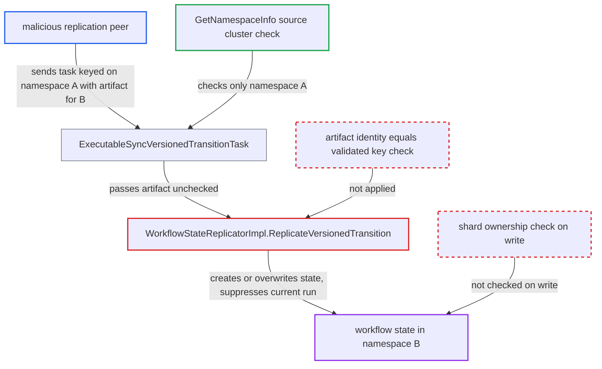

# Replication artifact's embedded namespace/workflow identity bypasses source-cluster namespace check

| Field | Value |
|---|---|
| ID | `find_01S4Gg5FX6VktB7axT2hMNmd` |
| Severity | **High** |
| Status | open |
| CWE | CWE-863 — Improper authorization |
| Created | 2026-10-27T21:16:08.888104Z |
| Claude Security | https://claude.ai/security/findings/find_01S4Gg5FX6VktB7axT2hMNmd |

## Description

A malicious or compromised replication peer can create or overwrite workflow state in a namespace it is not allowed to replicate, and can stop that namespace's running workflow. The peer must be configured as a replication peer for at least one namespace on the receiving cluster. `WorkflowStateReplicatorImpl.ReplicateVersionedTransition` takes the namespace, workflow and run from the peer's artifact. It never compares them with the task key that `GetNamespaceInfo` validated.

1. **malicious replication peer** sends a `SYNC_VERSIONED_TRANSITION_TASK` whose task key and artifact name different executions. The task is keyed on namespace A and workflow `w1`, but the artifact names namespace B, workflow `w2` and a new run; `w1` is picked offline so that both land on the same shard. ([`service/history/replication/executable_sync_versioned_transition_task.go:46-123`](https://github.com/cx-benchmark/temporal/blob/bf81a4c20009db89dc952592c9cfe770bafe66ee/service/history/replication/executable_sync_versioned_transition_task.go#L46-L123))
2. **the task `ExecutableSyncVersionedTransitionTask`** authorizes and routes the task using only the task-level key. `GetNamespaceInfo` checks that the source cluster is in namespace A's cluster list (default on via `ValidateReplicationTaskSourceCluster`), and the shard is chosen from the same key. ([`service/history/replication/executable_task.go:876-944`](https://github.com/cx-benchmark/temporal/blob/bf81a4c20009db89dc952592c9cfe770bafe66ee/service/history/replication/executable_task.go#L876-L944))
3. **the task `ExecutableSyncVersionedTransitionTask`** passes the whole artifact to `engine.ReplicateVersionedTransition`. It does not check that the artifact's embedded identity matches the validated key. ([`service/history/replication/executable_sync_versioned_transition_task.go:46-123`](https://github.com/cx-benchmark/temporal/blob/bf81a4c20009db89dc952592c9cfe770bafe66ee/service/history/replication/executable_sync_versioned_transition_task.go#L46-L123))
4. **the replicator `WorkflowStateReplicatorImpl`** locks and applies state under the identity found inside the artifact. `namespaceID`, `wid` and `rid` are read from the artifact's `ExecutionInfo` and `ExecutionState`, and the snapshot or mutation is then applied and persisted. ([`service/history/ndc/workflow_state_replicator.go:295-346`](https://github.com/cx-benchmark/temporal/blob/bf81a4c20009db89dc952592c9cfe770bafe66ee/service/history/ndc/workflow_state_replicator.go#L295-L346))
5. **the replicator `WorkflowStateReplicatorImpl`** builds the injected workflow for namespace B and persists it. The namespace entry comes from the artifact's `executionInfo.NamespaceId`; tasks are refreshed and `transactionMgr.CreateWorkflow` writes the state. ([`service/history/ndc/workflow_state_replicator.go:685-770`](https://github.com/cx-benchmark/temporal/blob/bf81a4c20009db89dc952592c9cfe770bafe66ee/service/history/ndc/workflow_state_replicator.go#L685-L770))
6. **the new-workflow dispatcher in `transaction_manager_new_workflow.go`** compares vector clocks supplied by the peer against the real current run. If the injected run wins, it becomes the current run. ([`service/history/ndc/transaction_manager_new_workflow.go:52-155`](https://github.com/cx-benchmark/temporal/blob/bf81a4c20009db89dc952592c9cfe770bafe66ee/service/history/ndc/transaction_manager_new_workflow.go#L52-L155))
7. **the workflow's `SuppressBy` method** terminates or zombifies the tenant's running workflow. The run is terminated if the last write was local, otherwise it becomes a zombie. ([`service/history/ndc/workflow.go:141-186`](https://github.com/cx-benchmark/temporal/blob/bf81a4c20009db89dc952592c9cfe770bafe66ee/service/history/ndc/workflow.go#L141-L186))

## Assessment

The attacker is a malicious or compromised remote cluster that is configured as a replication peer and is listed for at least one namespace A. It acts as the stream server the victim cluster connects to. It needs no action from any victim. It picks workflow ID `w1` offline so that the shard for namespace A and `w1` equals the shard of the target namespace B and workflow `w2`. A second way in exists: a peer that answers a `SyncWorkflowState` request with an artifact for another namespace reaches the same unchecked apply, through `SyncState` and `workflowresend.SyncWorkflowState`. In normal traffic both identities come from the same `taskInfo`, so a mismatch only arises from a malicious peer. The sibling `ExecutableWorkflowStateTask` takes its key from the embedded state, so it does not have this split.

Impact: The peer can create or overwrite mutable state and history for any known workflow ID in any namespace on the receiving cluster whose cluster list does not include it. It can make its injected run current and terminate or zombify the tenant's running workflow. Tasks regenerated from the injected state then act on it. Reading data back is limited: replication is push, and only the namespace's version histories and the existence of the workflow leak back, through the triggered `SyncWorkflowState` request.

## Recommendation

(1) `ReplicateVersionedTransition` and its callers (`ExecutableSyncVersionedTransitionTask.Execute`, `ExecutableTaskImpl.SyncState`, `workflowresend.SyncWorkflowState`) authorize one identity, the task key or request key. They then persist under another, the artifact's embedded `ExecutionInfo.NamespaceId/WorkflowId` and `ExecutionState.RunId`.

Fix criteria: The namespace, workflow and run used to lock and persist replicated state are the ones the caller validated. An artifact whose embedded identity differs is rejected as a non-retryable error. This covers the snapshot, the mutation and any new-run info. Test that a task keyed on shared namespace A whose artifact names namespace B on the same shard writes nothing under B. Test that a `SyncWorkflowState` response naming a different execution is refused.

(2) The shard write path has no defense in depth. It never checks that the namespace and workflow being created or updated hash to the shard performing the write.

Fix criteria: A replication apply for an execution whose `GetShardID(namespaceID, workflowID)` is not the current shard fails before anything is persisted. Test that an apply whose key maps to another shard is refused.

## Evidence

**https://github.com/cx-benchmark/temporal**

- [`service/history/ndc/workflow_state_replicator.go:295-346`](https://github.com/cx-benchmark/temporal/blob/bf81a4c20009db89dc952592c9cfe770bafe66ee/service/history/ndc/workflow_state_replicator.go#L295-L346)
- [`service/history/replication/executable_sync_versioned_transition_task.go:46-123`](https://github.com/cx-benchmark/temporal/blob/bf81a4c20009db89dc952592c9cfe770bafe66ee/service/history/replication/executable_sync_versioned_transition_task.go#L46-L123)
- [`service/history/replication/executable_task.go:876-944`](https://github.com/cx-benchmark/temporal/blob/bf81a4c20009db89dc952592c9cfe770bafe66ee/service/history/replication/executable_task.go#L876-L944)
- [`service/history/ndc/workflow_state_replicator.go:685-770`](https://github.com/cx-benchmark/temporal/blob/bf81a4c20009db89dc952592c9cfe770bafe66ee/service/history/ndc/workflow_state_replicator.go#L685-L770)
- [`service/history/ndc/transaction_manager_new_workflow.go:52-155`](https://github.com/cx-benchmark/temporal/blob/bf81a4c20009db89dc952592c9cfe770bafe66ee/service/history/ndc/transaction_manager_new_workflow.go#L52-L155)
- [`service/history/ndc/workflow.go:141-186`](https://github.com/cx-benchmark/temporal/blob/bf81a4c20009db89dc952592c9cfe770bafe66ee/service/history/ndc/workflow.go#L141-L186)
- [`service/history/replication/executable_task.go:815-838`](https://github.com/cx-benchmark/temporal/blob/bf81a4c20009db89dc952592c9cfe770bafe66ee/service/history/replication/executable_task.go#L815-L838)
- [`service/history/shard/context_impl.go:540-590`](https://github.com/cx-benchmark/temporal/blob/bf81a4c20009db89dc952592c9cfe770bafe66ee/service/history/shard/context_impl.go#L540-L590)
- [`common/dynamicconfig/constants.go:3059-3063`](https://github.com/cx-benchmark/temporal/blob/bf81a4c20009db89dc952592c9cfe770bafe66ee/common/dynamicconfig/constants.go#L3059-L3063)

