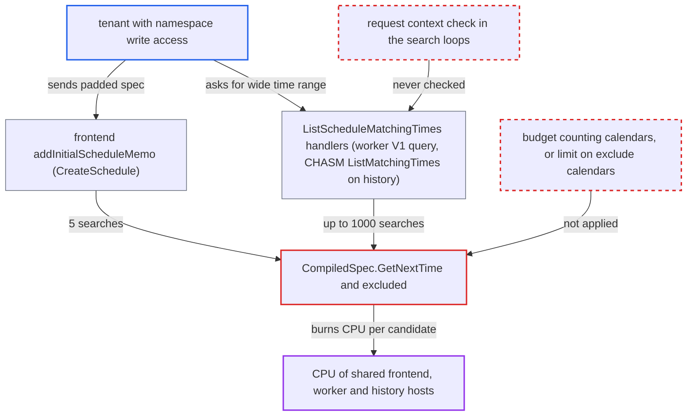

# Schedule next-time search CPU unbounded: iteration cap ignores exclude-calendar count

| Field | Value |
|---|---|
| ID | `find_012EPQLHG6CzM1Ni7JhgC7xc` |
| Severity | **High** |
| Status | open |
| CWE | CWE-407 — Inefficient Algorithmic Complexity |
| Created | 2026-10-27T21:14:08.192847Z |
| Claude Security | https://claude.ai/security/findings/find_012EPQLHG6CzM1Ni7JhgC7xc |

## Description

A tenant with write access to one namespace can keep a frontend, worker or history goroutine busy on a CPU core for minutes to hours with a single request of a few hundred KB. A handful of such requests can saturate hosts that every namespace shares. The iteration cap in `CompiledSpec.GetNextTime` counts candidate times, not the work done per candidate. Nothing limits how many exclude calendars a spec may hold. No data is disclosed or modified.

1. **attacker** sends one `CreateSchedule` request with a crafted spec. The spec has a 1-second `Interval`, about 100k non-matching (for example empty) exclude calendars listed first, and valid excludes listed last that leave one allowed second about every 11 days. ([`service/worker/scheduler/spec.go:156-211`](https://github.com/cx-benchmark/temporal/blob/bf81a4c20009db89dc952592c9cfe770bafe66ee/service/worker/scheduler/spec.go#L156-L211))
2. **`canonicalizeSpec`** accepts the spec and appends every `ExcludeCalendar` to `ExcludeStructuredCalendar`. It validates only `StructuredCalendar` ranges and intervals and puts no limit on the number of exclude or include calendars, so only the 4 MiB gRPC message size bounds them. ([`service/worker/scheduler/spec.go:156-211`](https://github.com/cx-benchmark/temporal/blob/bf81a4c20009db89dc952592c9cfe770bafe66ee/service/worker/scheduler/spec.go#L156-L211))
3. **the frontend `addInitialScheduleMemo`** runs `GetListInfoFromStartArgs` and `getFutureActionTimes(false, 5)` before forwarding the request to history. This makes 5 `GetNextTime` searches in the frontend process on the default V1 create path (`history.enableCHASMSchedulerCreation=false`), with no aggregate budget or context check. ([`service/frontend/workflow_handler.go:7320-7326`](https://github.com/cx-benchmark/temporal/blob/bf81a4c20009db89dc952592c9cfe770bafe66ee/service/frontend/workflow_handler.go#L7320-L7326))
4. **`GetNextTime`** steps one candidate second at a time and calls `excluded` on each. `excluded` runs `matches` on every exclude calendar until one matches, so each candidate costs time proportional to the padding, and a search needing about 1M candidates still ends under the `maxIterations` cap of 1,209,600. ([`service/worker/scheduler/spec.go:378-385`](https://github.com/cx-benchmark/temporal/blob/bf81a4c20009db89dc952592c9cfe770bafe66ee/service/worker/scheduler/spec.go#L378-L385))
5. **attacker** calls `ListScheduleMatchingTimes` over a very wide time range. The frontend only checks that the start and end are valid timestamps, so up to 1000 searches run per call, either in the V1 query handler on the worker or in CHASM `ListMatchingTimes` on history. ([`service/frontend/workflow_handler.go:7208-7219`](https://github.com/cx-benchmark/temporal/blob/bf81a4c20009db89dc952592c9cfe770bafe66ee/service/frontend/workflow_handler.go#L7208-L7219))
6. **the search loops** keep running after the client times out or disconnects. None of the loops checks the request context, so cancelling the request does not free the CPU core. ([`service/worker/scheduler/workflow.go:1286-1307`](https://github.com/cx-benchmark/temporal/blob/bf81a4c20009db89dc952592c9cfe770bafe66ee/service/worker/scheduler/workflow.go#L1286-L1307))

## Assessment

The attacker is a tenant with write access to one namespace, since `CreateSchedule` needs namespace write access. The default configuration is enough and no victim action is needed. One `CreateSchedule` with a padded spec makes the frontend run 5 searches in-process on the default V1 create path. A second way in is `ListScheduleMatchingTimes` over a wide range, which needs read access. That call runs up to 1000 searches in the V1 query handler on the shared worker service, or in CHASM `ListMatchingTimes` inside `ReadComponent` on history. The report also names `computeFutureActionTimes`, which runs up to `recentActionCount` searches for CHASM DescribeSchedule and on generator ticks. Without padding, one search still takes about a second.

Impact: The attacker can hold CPU cores on the frontend, worker or history hosts for minutes to hours per request, which denies service to every namespace on those hosts. The report says no data is disclosed or modified.

## Recommendation

(1) The budget in `GetNextTime` counts only candidate times. The cost per candidate grows with the number of exclude and include calendars, and nothing limits that number, so the cap does not bound the CPU spent on one search.

Fix criteria: Every ScheduleSpec accepted by `CreateSchedule` or `UpdateSchedule` keeps a single `GetNextTime` call to a small, fixed amount of work, whatever the spec contains. This can be done by limiting the number of calendars, excludes and ranges at validation, or by counting calendars evaluated in the budget. A spec padded with thousands of excludes is rejected or fails fast.

(2) `getFutureActionTimes`, `handleListMatchingTimesQuery`, CHASM `ListMatchingTimes` and `computeFutureActionTimes` run up to 5, 1000 or 10 independent searches per request. They have no total budget and do not check the request context.

Fix criteria: Each `CreateSchedule`, DescribeSchedule and `ListScheduleMatchingTimes` request has a total compute budget or honours its context deadline, and after that it returns an error or a partial result. A spec tuned to sit just under `scheduler.specMaxIterations` cannot make one RPC use more than a few CPU-seconds.

## Evidence

**https://github.com/cx-benchmark/temporal**

- [`service/worker/scheduler/spec.go:313-331`](https://github.com/cx-benchmark/temporal/blob/bf81a4c20009db89dc952592c9cfe770bafe66ee/service/worker/scheduler/spec.go#L313-L331)
- [`service/worker/scheduler/spec.go:378-385`](https://github.com/cx-benchmark/temporal/blob/bf81a4c20009db89dc952592c9cfe770bafe66ee/service/worker/scheduler/spec.go#L378-L385)
- [`service/worker/scheduler/spec.go:156-211`](https://github.com/cx-benchmark/temporal/blob/bf81a4c20009db89dc952592c9cfe770bafe66ee/service/worker/scheduler/spec.go#L156-L211)
- [`common/dynamicconfig/constants.go:3812-3818`](https://github.com/cx-benchmark/temporal/blob/bf81a4c20009db89dc952592c9cfe770bafe66ee/common/dynamicconfig/constants.go#L3812-L3818)
- [`service/frontend/workflow_handler.go:7320-7326`](https://github.com/cx-benchmark/temporal/blob/bf81a4c20009db89dc952592c9cfe770bafe66ee/service/frontend/workflow_handler.go#L7320-L7326)
- [`service/worker/scheduler/workflow.go:1228-1271`](https://github.com/cx-benchmark/temporal/blob/bf81a4c20009db89dc952592c9cfe770bafe66ee/service/worker/scheduler/workflow.go#L1228-L1271)
- [`service/worker/scheduler/workflow.go:1286-1307`](https://github.com/cx-benchmark/temporal/blob/bf81a4c20009db89dc952592c9cfe770bafe66ee/service/worker/scheduler/workflow.go#L1286-L1307)
- [`chasm/lib/scheduler/scheduler.go:784-828`](https://github.com/cx-benchmark/temporal/blob/bf81a4c20009db89dc952592c9cfe770bafe66ee/chasm/lib/scheduler/scheduler.go#L784-L828)
- [`service/frontend/workflow_handler.go:7208-7219`](https://github.com/cx-benchmark/temporal/blob/bf81a4c20009db89dc952592c9cfe770bafe66ee/service/frontend/workflow_handler.go#L7208-L7219)
- [`chasm/lib/scheduler/generator.go:84-115`](https://github.com/cx-benchmark/temporal/blob/bf81a4c20009db89dc952592c9cfe770bafe66ee/chasm/lib/scheduler/generator.go#L84-L115)

