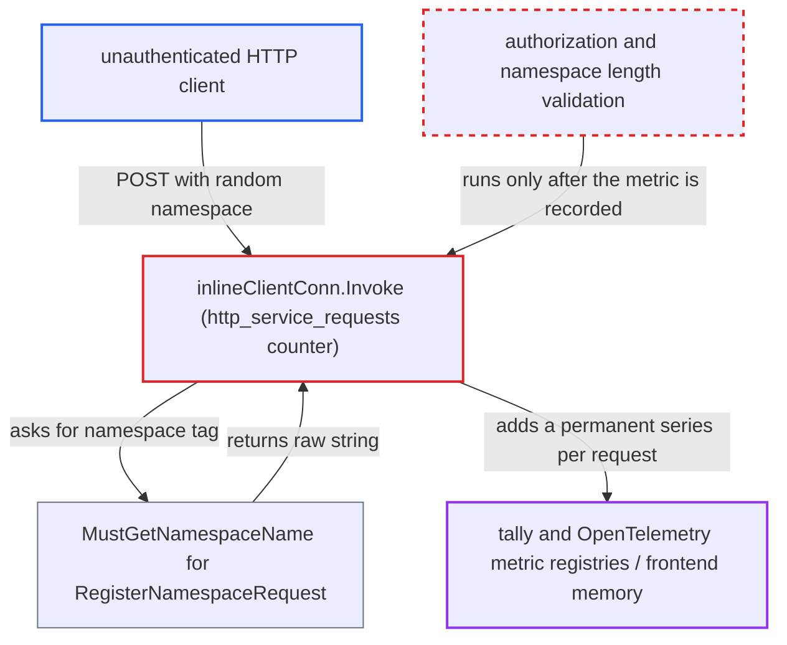

# Unauthenticated HTTP RegisterNamespace requests create unbounded namespace-tagged metric series

| Field | Value |
|---|---|
| ID | `find_01Vvz9moqygFDJmrm7H5K2v6` |
| Severity | **High** |
| Status | open |
| CWE | CWE-770 — Uncontrolled resource consumption |
| Created | 2026-10-27T21:35:46.382526Z |
| Claude Security | https://claude.ai/security/findings/find_01Vvz9moqygFDJmrm7H5K2v6 |

## Description

An unauthenticated client who can reach the frontend HTTP port can make the Temporal frontend create a new metric series on every request. Memory then grows without bound, and the frontend can be killed for out-of-memory, which takes down all tenants' frontend traffic. The cause is `inlineClientConn.Invoke`, which tags `http_service_requests` with the raw `namespace` string from a `RegisterNamespaceRequest` before authorization or validation runs. A metrics reporter must be configured.

1. **attacker** sends `POST /api/v1/namespaces` with a random `namespace` value in the body. No credentials are needed, and the value can be as long as the 4 MiB HTTP body cap (`rpc.MaxHTTPAPIRequestBytes`) allows.
2. **`GetNamespaceName` in the interceptor package** returns the raw `namespace` string for `RegisterNamespaceRequest`. For this request type only, it skips the namespace registry lookup. Other request types fall back to `_unknown_` when the registry does not resolve the name. ([`common/rpc/interceptor/namespace.go:40-43`](https://github.com/cx-benchmark/temporal/blob/bf81a4c20009db89dc952592c9cfe770bafe66ee/common/rpc/interceptor/namespace.go#L40-L43))
3. **`inlineClientConn.Invoke`** records `http_service_requests` tagged with that string. The counter is recorded before the gRPC interceptor chain is called, so the authorizer and the length check have not run yet. ([`service/frontend/http_api_server.go:431-438`](https://github.com/cx-benchmark/temporal/blob/bf81a4c20009db89dc952592c9cfe770bafe66ee/service/frontend/http_api_server.go#L431-L438))
4. **metrics handler** creates a permanent series for the new tag value. With the default tally framework, each distinct tag set becomes a permanent sub-scope and a Prometheus series. With OpenTelemetry, each value becomes a new data point, and no cardinality limit is configured on the `MeterProvider`. ([`common/metrics/tally_metrics_handler.go:180-188`](https://github.com/cx-benchmark/temporal/blob/bf81a4c20009db89dc952592c9cfe770bafe66ee/common/metrics/tally_metrics_handler.go#L180-L188))
5. **authorization interceptor** rejects the request afterwards. The rejection comes too late: the series already exists, and the attacker repeats the request with new names. ([`service/frontend/fx.go:308-338`](https://github.com/cx-benchmark/temporal/blob/bf81a4c20009db89dc952592c9cfe770bafe66ee/service/frontend/fx.go#L308-L338))

## Assessment

The attacker is any network client that can reach the frontend HTTP API port. The port is 7243 in the shipped config templates, and `frontend.httpAllowedHosts` defaults to match anything. No credentials and no victim action are needed. A metrics reporter (Prometheus or StatsD) must be configured, and the shipped template enables one only when `PROMETHEUS_ENDPOINT` is set. The attack works whether or not an authorizer is configured, including the default `noop_authorizer`, because the metric is recorded before authorization. The report assumes that `go.temporal.io/api` registers an HTTP binding for `RegisterNamespace` at `POST /namespaces` and `/api/v1/namespaces`. The generated gateway file is not in the checkout.

Impact: Repeated requests make the frontend heap grow without bound. Each request can pin up to about 4 MiB of tag string, and nothing evicts the series. The process can be killed for out-of-memory, which takes down frontend traffic for all tenants. With OpenTelemetry, if the pinned `go.opentelemetry.io/otel/sdk/metric v1.45.0` applies its default per-instrument cardinality limit, memory is capped. In that case attacker series crowd legitimate namespaces into the overflow bucket and the metric becomes useless. Operators' metrics are also polluted. No data is disclosed.

Subsequent-system impact: The series are exported through the Prometheus scrape endpoint or pushed to StatsD. The operator's metrics backend therefore receives an unbounded, attacker-controlled set of label values and can be degraded. The report does not say how much the backend can hold.

## Recommendation

(1) `inlineClientConn.Invoke` uses a request-supplied namespace string as a metric tag before the request is authorized or validated. `MustGetNamespaceName` passes `RegisterNamespaceRequest.namespace` through unvalidated.

Fix criteria: The `namespace` tag on `http_service_requests` only takes values from the set of registered namespaces, or a fixed placeholder such as `_unknown_`. A stream of unauthenticated `RegisterNamespace` HTTP requests with distinct names does not increase the number of distinct `namespace` tag values or the size of the tally or OpenTelemetry registries. To check, replay such requests and confirm that the metric series count stays constant.

(2) The metrics layer has no global limit on tag-value cardinality or length. Any single unguarded call site can therefore cause unbounded memory allocation.

Fix criteria: Tag values derived from request data are capped in length. The handler tree bounds the number of distinct tag sets it creates and overflows into a placeholder value. To check, exceed the bound and confirm that it produces a placeholder series rather than new entries.

## Evidence

**https://github.com/cx-benchmark/temporal**

- [`service/frontend/http_api_server.go:431-438`](https://github.com/cx-benchmark/temporal/blob/bf81a4c20009db89dc952592c9cfe770bafe66ee/service/frontend/http_api_server.go#L431-L438)
- [`common/rpc/interceptor/namespace.go:40-43`](https://github.com/cx-benchmark/temporal/blob/bf81a4c20009db89dc952592c9cfe770bafe66ee/common/rpc/interceptor/namespace.go#L40-L43)
- [`service/frontend/fx.go:308-338`](https://github.com/cx-benchmark/temporal/blob/bf81a4c20009db89dc952592c9cfe770bafe66ee/service/frontend/fx.go#L308-L338)
- [`common/authorization/interceptor.go:329-340`](https://github.com/cx-benchmark/temporal/blob/bf81a4c20009db89dc952592c9cfe770bafe66ee/common/authorization/interceptor.go#L329-L340)
- [`common/metrics/tally_metrics_handler.go:180-188`](https://github.com/cx-benchmark/temporal/blob/bf81a4c20009db89dc952592c9cfe770bafe66ee/common/metrics/tally_metrics_handler.go#L180-L188)
- [`common/metrics/otel_metrics_handler.go:218-230`](https://github.com/cx-benchmark/temporal/blob/bf81a4c20009db89dc952592c9cfe770bafe66ee/common/metrics/otel_metrics_handler.go#L218-L230)

