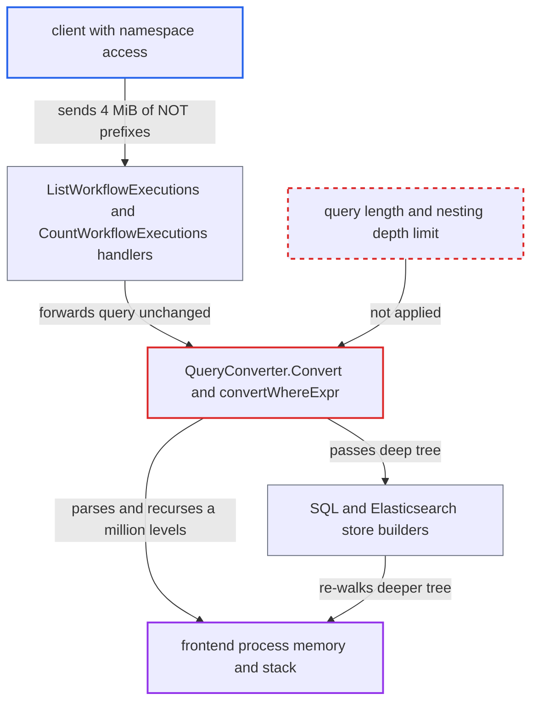

# Unbounded expression nesting in visibility queries drives unbounded recursion and memory in frontend

| Field | Value |
|---|---|
| ID | `find_01Rw2nYnWPgjEnXVshqnqQp4` |
| Severity | **High** |
| Status | open |
| CWE | CWE-674 — Uncontrolled Recursion |
| Created | 2026-10-27T21:17:47.011678Z |
| Claude Security | https://claude.ai/security/findings/find_01Rw2nYnWPgjEnXVshqnqQp4 |

## Description

A client that can reach the frontend gRPC port can crash the frontend or exhaust its memory with one request, so every namespace on that frontend loses service until restart. The attacker needs an existing namespace name. They need no credentials with the default noop authorizer, and namespace reader access with the default authorizer. The cause is `QueryConverter.Convert`, which parses and recurses over visibility queries with no limit on length or nesting depth.

1. **attacker** sends a `ListWorkflowExecutions` or `CountWorkflowExecutions` request with a huge query. The query is about 4 MiB of `NOT ` prefixes followed by one comparison, such as `WorkflowId = 'x'`, which is roughly a million levels of nesting. ([`service/frontend/workflow_handler.go:2826-2862`](https://github.com/cx-benchmark/temporal/blob/bf81a4c20009db89dc952592c9cfe770bafe66ee/service/frontend/workflow_handler.go#L2826-L2862))
2. **the frontend handler** forwards the query unchanged to the visibility store. `ListWorkflowExecutions` only clamps `PageSize` and records the query length as a metric, and the gRPC server's default 4 MiB receive limit is the only size bound. ([`common/rpc/rpc.go:131-145`](https://github.com/cx-benchmark/temporal/blob/bf81a4c20009db89dc952592c9cfe770bafe66ee/common/rpc/rpc.go#L131-L145))
3. **the store's query code** passes the raw query to `QueryConverter.Convert`. Both the SQL store and the Elasticsearch store hand `request.Query` straight to the converter. ([`common/persistence/visibility/store/sql/visibility_store.go:710-731`](https://github.com/cx-benchmark/temporal/blob/bf81a4c20009db89dc952592c9cfe770bafe66ee/common/persistence/visibility/store/sql/visibility_store.go#L710-L731))
4. **`convertWhereString`** calls `sqlparser.Parse` on the whole string. No length or nesting check exists, and the parser must shift every `NOT` before it can reduce, so its value stack grows by one entry per token. ([`common/persistence/visibility/store/query/converter.go:266-283`](https://github.com/cx-benchmark/temporal/blob/bf81a4c20009db89dc952592c9cfe770bafe66ee/common/persistence/visibility/store/query/converter.go#L266-L283))
5. **`convertWhereExpr`** recurses once per `NOT` through `convertNotExpr`. No depth counter exists, so the stack depth of one goroutine equals the attacker's nesting depth. ([`common/persistence/visibility/store/query/converter.go:354-427`](https://github.com/cx-benchmark/temporal/blob/bf81a4c20009db89dc952592c9cfe770bafe66ee/common/persistence/visibility/store/query/converter.go#L354-L427))
6. **the store builders** walk an even deeper tree and serialize it recursively. The SQL `BuildNotExpr` wraps each inner `NotExpr` in a `ParenExpr`, which doubles the depth that `sqlparser.String` formats. The Elasticsearch `BuildNotExpr` nests one `bool`/`must_not` query per `NOT`, which `boolQuery.Source()` and JSON encoding recurse through. ([`common/persistence/visibility/store/elasticsearch/query_converter.go:31-42`](https://github.com/cx-benchmark/temporal/blob/bf81a4c20009db89dc952592c9cfe770bafe66ee/common/persistence/visibility/store/elasticsearch/query_converter.go#L31-L42))
7. **the frontend process** runs out of memory or exceeds Go's 1 GB stack limit and terminates. `metrics.CapturePanic` recovers only panics, not a fatal stack overflow. ([`common/persistence/visibility/store/query/converter.go:208-215`](https://github.com/cx-benchmark/temporal/blob/bf81a4c20009db89dc952592c9cfe770bafe66ee/common/persistence/visibility/store/query/converter.go#L208-L215))

## Assessment

The attacker is any client that can reach the frontend gRPC port and names an existing namespace. With the shipped empty `authorizer` (noop) no credentials are needed. With the default authorizer, namespace reader access is enough. The entry points are `ListWorkflowExecutions` and `CountWorkflowExecutions`. `ScanWorkflowExecutions` reuses the same path as `ListWorkflowExecutions`. No victim action is needed. Deeply nested parentheses are probably not a working route, because the parser caps `(` nesting at 200, but `NOT` prefixes have no such cap. The report assumes `github.com/temporalio/sqlparser v0.1.0` has a value stack that grows without limit and no `NOT` nesting limit. It also assumes `olivere/elastic v7.0.32` and `encoding/json` serialize nested queries recursively without a depth limit. Those modules were not in the checkout.

Impact: One request makes the frontend use hundreds of MB to GBs of memory. On the Elasticsearch path it is expected to pass Go's 1 GB stack limit, which is a fatal error that kills the process. A few concurrent requests exhaust memory on either store, since the default allows 10 visibility RPS per namespace. Every namespace on that frontend loses service until restart, and repeating the request keeps it down. No data is read or changed.

## Recommendation

The visibility query converter accepts a caller-supplied query of any length and nesting. It parses, converts and serializes it with recursion and memory proportional to that nesting, so one request controls the frontend's stack and heap use.

Fix criteria: Queries longer than a configured maximum are rejected with `InvalidArgument` before `sqlparser.Parse` runs. Expressions nested deeper than a small fixed limit (`NOT`, parentheses, and `AND`/`OR` chains together) are rejected before conversion recurses further. `ListWorkflowExecutions` and `CountWorkflowExecutions` with about 4 MiB of `NOT ` prefixes before one comparison return `InvalidArgument` quickly on both SQL and Elasticsearch visibility, with bounded memory and no process termination.

## Evidence

**https://github.com/cx-benchmark/temporal**

- [`common/persistence/visibility/store/query/converter.go:266-283`](https://github.com/cx-benchmark/temporal/blob/bf81a4c20009db89dc952592c9cfe770bafe66ee/common/persistence/visibility/store/query/converter.go#L266-L283)
- [`common/persistence/visibility/store/query/converter.go:354-427`](https://github.com/cx-benchmark/temporal/blob/bf81a4c20009db89dc952592c9cfe770bafe66ee/common/persistence/visibility/store/query/converter.go#L354-L427)
- [`common/persistence/visibility/store/query/converter.go:208-215`](https://github.com/cx-benchmark/temporal/blob/bf81a4c20009db89dc952592c9cfe770bafe66ee/common/persistence/visibility/store/query/converter.go#L208-L215)
- [`common/persistence/visibility/store/sql/query_converter.go:86-98`](https://github.com/cx-benchmark/temporal/blob/bf81a4c20009db89dc952592c9cfe770bafe66ee/common/persistence/visibility/store/sql/query_converter.go#L86-L98)
- [`common/persistence/sql/sqlplugin/mysql/query_converter.go:139-141`](https://github.com/cx-benchmark/temporal/blob/bf81a4c20009db89dc952592c9cfe770bafe66ee/common/persistence/sql/sqlplugin/mysql/query_converter.go#L139-L141)
- [`common/persistence/visibility/store/elasticsearch/query_converter.go:31-42`](https://github.com/cx-benchmark/temporal/blob/bf81a4c20009db89dc952592c9cfe770bafe66ee/common/persistence/visibility/store/elasticsearch/query_converter.go#L31-L42)
- [`common/persistence/visibility/store/sql/visibility_store.go:710-731`](https://github.com/cx-benchmark/temporal/blob/bf81a4c20009db89dc952592c9cfe770bafe66ee/common/persistence/visibility/store/sql/visibility_store.go#L710-L731)
- [`common/persistence/visibility/store/elasticsearch/visibility_store.go:750-767`](https://github.com/cx-benchmark/temporal/blob/bf81a4c20009db89dc952592c9cfe770bafe66ee/common/persistence/visibility/store/elasticsearch/visibility_store.go#L750-L767)
- [`service/frontend/workflow_handler.go:2826-2862`](https://github.com/cx-benchmark/temporal/blob/bf81a4c20009db89dc952592c9cfe770bafe66ee/service/frontend/workflow_handler.go#L2826-L2862)
- [`common/rpc/rpc.go:131-145`](https://github.com/cx-benchmark/temporal/blob/bf81a4c20009db89dc952592c9cfe770bafe66ee/common/rpc/rpc.go#L131-L145)

