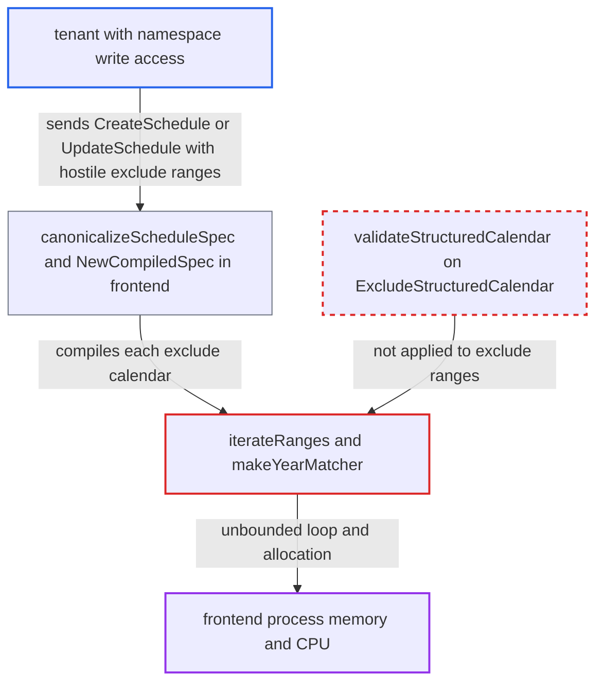

# Unvalidated ExcludeStructuredCalendar ranges exhaust frontend memory/CPU at schedule compile

| Field | Value |
|---|---|
| ID | `find_017VdxJtvUUvThg6BCyQcEDg` |
| Severity | **High** |
| Status | open |
| CWE | CWE-1284 — Improper Input Validation |
| Created | 2026-10-27T21:08:00.401411Z |
| Claude Security | https://claude.ai/security/findings/find_017VdxJtvUUvThg6BCyQcEDg |

## Description

A tenant with write access to one namespace can crash the shared frontend, which serves every namespace, with one small schedule request. Repeated requests keep it offline. The schedule spec check skips `ExcludeStructuredCalendar`, so its ranges reach the loop in `iterateRanges` unchecked. A negative `Step` or a very wide range then makes the loop run without bound.

1. **attacker with namespace write access** sends a `CreateScheduleRequest` or `UpdateScheduleRequest` with a hostile `ExcludeStructuredCalendar`. The spec holds either `Year: [{Start: 0, Step: -1}]` or many wide ranges such as `Second: [{Start: 0, End: 2147483647}]`. ([`service/frontend/workflow_handler.go:7233-7262`](https://github.com/cx-benchmark/temporal/blob/bf81a4c20009db89dc952592c9cfe770bafe66ee/service/frontend/workflow_handler.go#L7233-L7262))
2. **`canonicalizeSpec`** validates only `spec.StructuredCalendar`. `validateStructuredCalendar` is never run on `spec.ExcludeStructuredCalendar`, so out-of-domain bounds and a negative `Step` are not rejected. ([`service/worker/scheduler/spec.go:199-204`](https://github.com/cx-benchmark/temporal/blob/bf81a4c20009db89dc952592c9cfe770bafe66ee/service/worker/scheduler/spec.go#L199-L204))
3. **`NewCompiledSpec`** compiles each exclude calendar with `newCompiledCalendar`. This runs synchronously in the frontend request, before any other check could reject the spec. ([`service/worker/scheduler/spec.go:95-99`](https://github.com/cx-benchmark/temporal/blob/bf81a4c20009db89dc952592c9cfe770bafe66ee/service/worker/scheduler/spec.go#L95-L99))
4. **`iterateRanges`** loops over the raw `int32` values. It only fixes `step == 0` and `end < start`. With a negative `Step` the loop condition `start <= end` stays true in practice, and a wide range runs up to 2^32 times. ([`service/worker/scheduler/calendar.go:370-383`](https://github.com/cx-benchmark/temporal/blob/bf81a4c20009db89dc952592c9cfe770bafe66ee/service/worker/scheduler/calendar.go#L370-L383))
5. **`makeYearMatcher`** appends one `int16` per iterated value. With a negative `Step` the slice grows until the frontend process runs out of memory and is killed. A full `int32` range needs about 8 GiB plus growth copies. ([`service/worker/scheduler/calendar.go:351-368`](https://github.com/cx-benchmark/temporal/blob/bf81a4c20009db89dc952592c9cfe770bafe66ee/service/worker/scheduler/calendar.go#L351-L368))
6. **`makeBitMatcher`** evaluates `1 << i` for every value in the other fields. Values of 64 or more do nothing, so wide ranges only burn CPU, about 2^31 closure calls per range. A negative value panics, and `CapturePanic` turns that into an `Internal` error. ([`service/worker/scheduler/calendar.go:344-349`](https://github.com/cx-benchmark/temporal/blob/bf81a4c20009db89dc952592c9cfe770bafe66ee/service/worker/scheduler/calendar.go#L344-L349))

## Assessment

The attacker needs write access to one namespace, since `CreateSchedule` and `UpdateSchedule` are namespace-write APIs. They send the hostile `ExcludeStructuredCalendar` directly in the protobuf `ScheduleSpec`. Either API works, on V1 and CHASM schedules alike. No victim action is needed. No non-default setting is needed either, because `frontend.enableSchedules` defaults to `true`. The loop never checks the request context, so a client deadline or disconnect does not stop it.

Impact: One request can make the frontend run out of memory and be killed. Wide bit-field ranges can instead pin CPU cores. Repeated requests keep the frontend, shared by all namespaces, unavailable. Nothing is disclosed or modified.

## Recommendation

(1) `canonicalizeSpec` applies `validateStructuredCalendar` only to `StructuredCalendar`. Entries in `ExcludeStructuredCalendar` with out-of-domain bounds or a negative `Step` reach `iterateRanges`.

Fix criteria: Every `StructuredCalendarSpec` compiled by `newCompiledCalendar`, including each `ExcludeStructuredCalendar` entry, passes the same field-domain and `Step >= 0` checks. A `CreateSchedule` or `UpdateSchedule` whose exclude ranges fall outside their field's bounds or have a negative `Step` returns `InvalidArgument` promptly. It does so without large allocation.

(2) `iterateRanges` trusts its inputs. Its loop count and the allocation in the Year matcher grow with the raw `int32` values and a signed step.

Fix criteria: `iterateRanges` (or its callers) clamps iteration to the field's domain and refuses non-positive steps. No spec that reaches it can then cause more than about one field-width of iterations per range.

## Evidence

**https://github.com/cx-benchmark/temporal**

- [`service/worker/scheduler/spec.go:199-204`](https://github.com/cx-benchmark/temporal/blob/bf81a4c20009db89dc952592c9cfe770bafe66ee/service/worker/scheduler/spec.go#L199-L204)
- [`service/worker/scheduler/spec.go:95-99`](https://github.com/cx-benchmark/temporal/blob/bf81a4c20009db89dc952592c9cfe770bafe66ee/service/worker/scheduler/spec.go#L95-L99)
- [`service/worker/scheduler/calendar.go:370-383`](https://github.com/cx-benchmark/temporal/blob/bf81a4c20009db89dc952592c9cfe770bafe66ee/service/worker/scheduler/calendar.go#L370-L383)
- [`service/worker/scheduler/calendar.go:351-368`](https://github.com/cx-benchmark/temporal/blob/bf81a4c20009db89dc952592c9cfe770bafe66ee/service/worker/scheduler/calendar.go#L351-L368)
- [`service/worker/scheduler/calendar.go:344-349`](https://github.com/cx-benchmark/temporal/blob/bf81a4c20009db89dc952592c9cfe770bafe66ee/service/worker/scheduler/calendar.go#L344-L349)
- [`service/frontend/workflow_handler.go:7233-7262`](https://github.com/cx-benchmark/temporal/blob/bf81a4c20009db89dc952592c9cfe770bafe66ee/service/frontend/workflow_handler.go#L7233-L7262)

