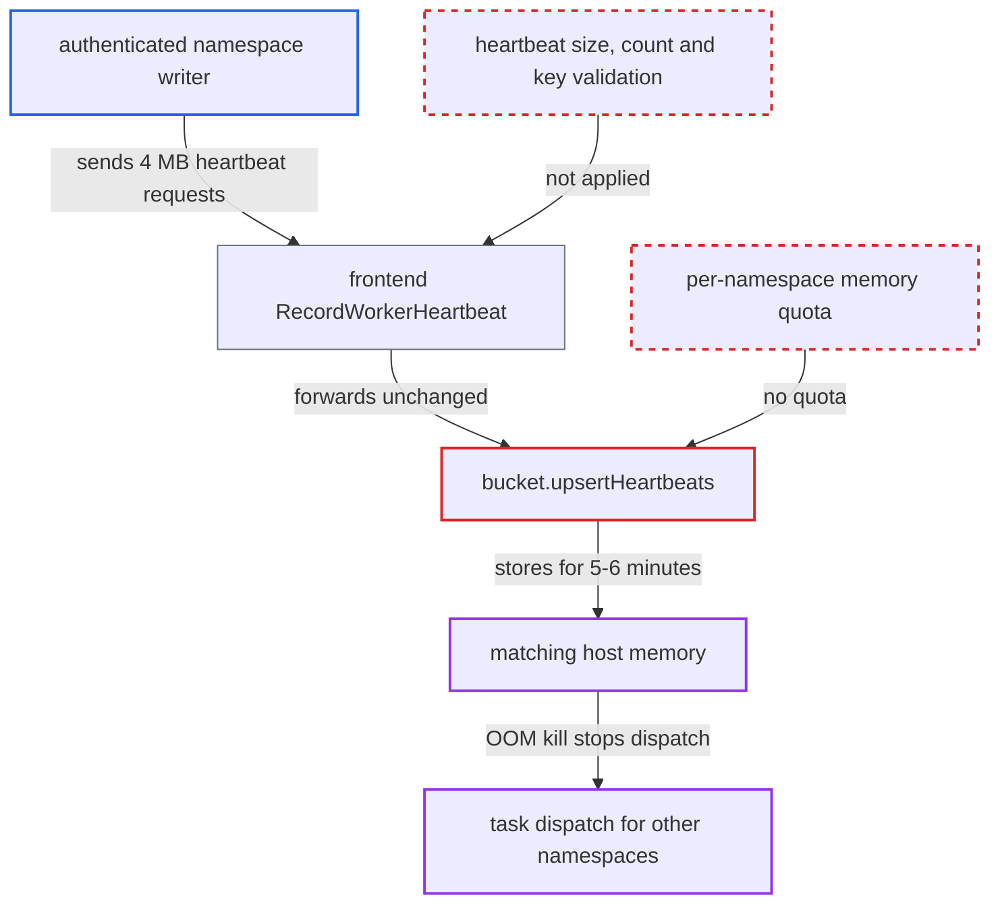

# Worker heartbeat registry retains unbounded tenant-supplied heartbeat data in matching memory

| Field | Value |
|---|---|
| ID | `find_01XPPDra1X26HxRkHmo6YkY4` |
| Severity | **High** |
| Status | open |
| CWE | CWE-770 — Resource exhaustion |
| Created | 2026-10-27T21:14:45.802062Z |
| Claude Security | https://claude.ai/security/findings/find_01XPPDra1X26HxRkHmo6YkY4 |

## Description

An authenticated user with write access to any namespace can exhaust memory on a matching host. The host can be OOM-killed, which stops task dispatch for every namespace it owns. This works with the default configuration, where `frontend.WorkerHeartbeatsEnabled` is true. The cause is `bucket.upsertHeartbeats`, which stores every heartbeat in memory with no limit on size, count or key, behind a frontend that only checks the feature flag.

1. **authenticated namespace writer** sends many `RecordWorkerHeartbeat` requests of about 4 MB each. Each heartbeat carries a fresh `WorkerInstanceKey` and bulky string fields, and the request rate stays under the request-count rate limits. ([`service/frontend/workflow_handler.go:7696-7718`](https://github.com/cx-benchmark/temporal/blob/bf81a4c20009db89dc952592c9cfe770bafe66ee/service/frontend/workflow_handler.go#L7696-L7718))
2. **frontend `RecordWorkerHeartbeat`** forwards the request to matching unchanged. It checks only the `frontend.WorkerHeartbeatsEnabled` flag, which defaults to true, and `ShutdownWorker` and `PollNexusTaskQueue` forward embedded heartbeats the same way. ([`service/frontend/workflow_handler.go:7696-7718`](https://github.com/cx-benchmark/temporal/blob/bf81a4c20009db89dc952592c9cfe770bafe66ee/service/frontend/workflow_handler.go#L7696-L7718))
3. **the matching handler** passes the whole heartbeat array to `RecordWorkerHeartbeats`. No validation of the array happens here. ([`service/matching/handler.go:609-619`](https://github.com/cx-benchmark/temporal/blob/bf81a4c20009db89dc952592c9cfe770bafe66ee/service/matching/handler.go#L609-L619))
4. **`bucket.upsertHeartbeats`** stores each heartbeat in process memory under the caller-chosen `WorkerInstanceKey`. It keeps the proto as `e.hb = hb` and checks no string lengths, repeated fields, key emptiness, entry count or per-namespace share. ([`service/matching/workers/registry_impl.go:112-145`](https://github.com/cx-benchmark/temporal/blob/bf81a4c20009db89dc952592c9cfe770bafe66ee/service/matching/workers/registry_impl.go#L112-L145))
5. **registry eviction** fails to release the data before the memory grows large. Entries expire only through the 5-minute TTL, and the 1,000,000-entry cap counts entries rather than bytes and never removes entries younger than `MinEvictAge` (1 min). ([`service/matching/workers/registry_impl.go:385-414`](https://github.com/cx-benchmark/temporal/blob/bf81a4c20009db89dc952592c9cfe770bafe66ee/service/matching/workers/registry_impl.go#L385-L414))
6. **the matching host** runs out of memory under the retained heartbeats. All heartbeats of a namespace go to the one host that owns its `not-applicable` partition, and that host also serves other namespaces' task queues. ([`client/matching/client_gen.go:917-935`](https://github.com/cx-benchmark/temporal/blob/bf81a4c20009db89dc952592c9cfe770bafe66ee/client/matching/client_gen.go#L917-L935))

## Assessment

The attacker needs a login with write access to any one namespace, since `RecordWorkerHeartbeat` is a namespace-level write call. The feature is on by default and no victim action is needed. The attacker repeatedly sends requests of up to the gRPC default of about 4 MB each, because the servers set no `MaxRecvMsgSize`. The limiters count requests (`frontend.namespaceRPS` 2400 per frontend, `matching.rps` 1200 per host), not bytes, so a few dozen requests per second pass. Retained memory grows roughly as request rate x 4 MB x 5-6 minutes, so tens of GB can be pinned. Besides `RecordWorkerHeartbeat`, the same data can be sent through heartbeats embedded in `ShutdownWorker` and `PollNexusTaskQueue`. A count-cap attack is not needed, because a few entries per request are enough. Once the namespace's host is exhausted, its heartbeat key moves to another host, which the attacker can exhaust in turn.

Impact: The matching host can be driven out of memory and OOM-killed. That stops task dispatch for every namespace whose partitions it owns. Short of a crash, a flood past the count cap also evicts other tenants' entries older than one minute. Their `ListWorkers`, `CountWorkers` and `DescribeWorker` views then intermittently drop workers, and the registry is used only for these reads. No data is disclosed or modified.

## Recommendation

(1) Heartbeats are accepted with no bound on the number per request, the size of each heartbeat or the validity of its key. One request can therefore place megabytes of attacker-chosen data in the registry.

Fix criteria: Requests on every path that carries heartbeats (`RecordWorkerHeartbeat`, `ShutdownWorker`, poll requests) are rejected or truncated when they exceed a maximum heartbeat count or a per-heartbeat or per-field size. They are also rejected when they lack a non-empty `WorkerInstanceKey`. A test confirms that a 4 MB heartbeat request is refused before any of it is stored.

(2) The registry has only a global entry-count cap that ignores bytes, cannot evict entries under one minute old, and evicts across tenants. One namespace can therefore pin unbounded memory and push out other tenants' entries.

Fix criteria: Registry memory held by one namespace is bounded, by entries and by bytes, with a per-namespace quota that rejects or evicts that namespace's own entries first. A test confirms that a namespace sending heartbeats at its full rate limit cannot raise matching memory beyond its quota. The same test confirms that it cannot cause another namespace's entries to be evicted.

## Evidence

**https://github.com/cx-benchmark/temporal**

- [`service/matching/workers/registry_impl.go:112-145`](https://github.com/cx-benchmark/temporal/blob/bf81a4c20009db89dc952592c9cfe770bafe66ee/service/matching/workers/registry_impl.go#L112-L145)
- [`service/matching/workers/registry_impl.go:385-414`](https://github.com/cx-benchmark/temporal/blob/bf81a4c20009db89dc952592c9cfe770bafe66ee/service/matching/workers/registry_impl.go#L385-L414)
- [`service/matching/handler.go:609-619`](https://github.com/cx-benchmark/temporal/blob/bf81a4c20009db89dc952592c9cfe770bafe66ee/service/matching/handler.go#L609-L619)
- [`service/frontend/workflow_handler.go:7696-7718`](https://github.com/cx-benchmark/temporal/blob/bf81a4c20009db89dc952592c9cfe770bafe66ee/service/frontend/workflow_handler.go#L7696-L7718)
- [`common/dynamicconfig/constants.go:1789-1807`](https://github.com/cx-benchmark/temporal/blob/bf81a4c20009db89dc952592c9cfe770bafe66ee/common/dynamicconfig/constants.go#L1789-L1807)
- [`common/dynamicconfig/constants.go:3899-3903`](https://github.com/cx-benchmark/temporal/blob/bf81a4c20009db89dc952592c9cfe770bafe66ee/common/dynamicconfig/constants.go#L3899-L3903)
- [`client/matching/client_gen.go:917-935`](https://github.com/cx-benchmark/temporal/blob/bf81a4c20009db89dc952592c9cfe770bafe66ee/client/matching/client_gen.go#L917-L935)
- [`common/dynamicconfig/constants.go:799-802`](https://github.com/cx-benchmark/temporal/blob/bf81a4c20009db89dc952592c9cfe770bafe66ee/common/dynamicconfig/constants.go#L799-L802)

