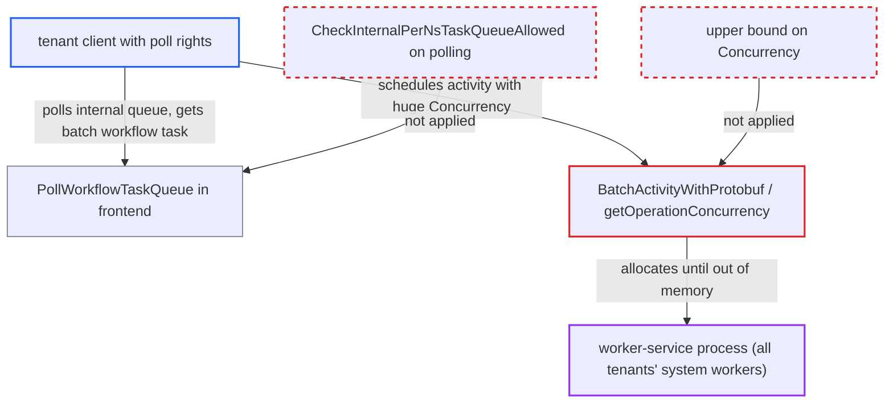

# Batch activity trusts attacker-reachable Concurrency, exhausting shared worker memory

| Field | Value |
|---|---|
| ID | `find_017B9hqjwAogJrWDNsXHiw56` |
| Severity | **Medium** |
| Status | open |
| CWE | CWE-770 — Resource exhaustion |
| Created | 2026-10-27T21:10:45.230298Z |
| Claude Security | https://claude.ai/security/findings/find_017B9hqjwAogJrWDNsXHiw56 |

## Description

An authenticated tenant client with poll rights in one namespace can crash the shared worker-service process. That stops system workers for every tenant on the host, and the crash repeats on each retry. The batch activity `BatchActivityWithProtobuf` takes `Concurrency` from its payload with no upper bound (`getOperationConcurrency`). Tenants can write that payload because the frontend lets them poll `temporal-sys-per-ns-tq`.

1. **the attacker (namespace client)** starts a batch operation through `StartBatchOperation`. This creates a system batch workflow in the attacker's own namespace on `temporal-sys-per-ns-tq`, and it never sets `Concurrency`. ([`service/frontend/workflow_handler.go:6056-6082`](https://github.com/cx-benchmark/temporal/blob/bf81a4c20009db89dc952592c9cfe770bafe66ee/service/frontend/workflow_handler.go#L6056-L6082))
2. **the attacker** long-polls `PollWorkflowTaskQueue` on `temporal-sys-per-ns-tq` with many pollers. The frontend validates the queue with `tqid.NormalizeAndValidate`, which does not apply `CheckInternalPerNsTaskQueueAllowed`, and matching adds no check, so the attacker can win the race against the server's two pollers and receive the workflow task. ([`service/frontend/workflow_handler.go:1145-1147`](https://github.com/cx-benchmark/temporal/blob/bf81a4c20009db89dc952592c9cfe770bafe66ee/service/frontend/workflow_handler.go#L1145-L1147))
3. **the attacker** completes the workflow task with a `ScheduleActivityTask` command for `BatchActivityWithProtobuf`. The command targets `temporal-sys-per-ns-tq`, carries the attacker's own namespace ID and name, sets `Concurrency` to a huge value such as `1<<40`, and sets a retry policy and timeouts the attacker chooses. ([`service/history/api/respondworkflowtaskcompleted/workflow_task_completed_handler.go:489-499`](https://github.com/cx-benchmark/temporal/blob/bf81a4c20009db89dc952592c9cfe770bafe66ee/service/history/api/respondworkflowtaskcompleted/workflow_task_completed_handler.go#L489-L499))
4. **history service** accepts the injected activity and delivers it to the server's per-namespace worker. `CheckInternalPerNsTaskQueueAllowed` allows an activity on the per-namespace queue whenever the parent workflow's task queue is itself internal, and here it is. ([`common/primitives/task_queues.go:57-71`](https://github.com/cx-benchmark/temporal/blob/bf81a4c20009db89dc952592c9cfe770bafe66ee/common/primitives/task_queues.go#L57-L71))
5. **the per-namespace worker** decodes the payload and passes `checkAndGetTargetNamespace`. The check only compares `NamespaceId` and `Request.Namespace` with the worker's own namespace, and the attacker used its own values, so no other field is validated. ([`service/worker/batcher/activities.go:394-414`](https://github.com/cx-benchmark/temporal/blob/bf81a4c20009db89dc952592c9cfe770bafe66ee/service/worker/batcher/activities.go#L394-L414))
6. **`getOperationConcurrency`** returns the attacker's `Concurrency` unchanged. Only values of 0 or less fall back to the configured `worker.batcherConcurrency` (default 5), and no upper bound exists. ([`service/worker/batcher/activities.go:599-604`](https://github.com/cx-benchmark/temporal/blob/bf81a4c20009db89dc952592c9cfe770bafe66ee/service/worker/batcher/activities.go#L599-L604))
7. **`processWorkflowsWithProactiveFetching`** allocates two channels and starts goroutines sized by `concurrency`. A value like `1<<40` asks for tens of TiB of channel buffer and ends in a fatal `runtime: out of memory`, while values in the tens of millions exhaust memory through goroutine stacks, so the worker-service process dies. ([`service/worker/batcher/activities.go:252-262`](https://github.com/cx-benchmark/temporal/blob/bf81a4c20009db89dc952592c9cfe770bafe66ee/service/worker/batcher/activities.go#L252-L262))

## Assessment

The attacker is an authenticated client with poll (Write) rights in one namespace. The batcher must be enabled, which is the default (`worker.enableNamespaceBatcher` defaults to true). The attacker has to win the race for the batch workflow task against the server's two pollers, so it uses many pollers. The attacker must use its own namespace ID and name so the namespace check passes. The retry policy and timeouts it sets make the task redelivered after each crash. The project itself treats the activity input as user-controlled, so the activity has to defend itself against crafted input.

Impact: The attacker can kill the worker-service process at will and again after every restart. That stops schedules, batch jobs, worker-deployment, deletion, archival and other system workers for all tenants on that host until an operator intervenes. In a single-binary deployment the co-located services die too. Nothing is disclosed or modified.

## Recommendation

(1) `getOperationConcurrency` in `service/worker/batcher/activities.go` accepts any positive `Concurrency` from the activity input. The attacker's payload therefore decides how many channel slots and goroutines the shared worker process allocates.

Fix criteria: The concurrency used by `processWorkflowsWithProactiveFetching` never exceeds an operator-controlled maximum (for example `BatcherConcurrency` or a dedicated max dynamic-config value), whatever `BatchOperationInput` carries. Other allocation-sized fields taken from the input are clamped the same way, and the heartbeat interval stays positive. Running the activity with `Concurrency` set to `1<<40` and to 50,000,000 uses the configured bound and neither crashes nor allocates in proportion to the input.

(2) System workflows run in tenant namespaces on `temporal-sys-per-ns-tq`. The frontend (`PollWorkflowTaskQueue` and `PollActivityTaskQueue` in `service/frontend/workflow_handler.go`) lets ordinary namespace clients poll that queue, so a tenant can author the activity input.

Fix criteria: Only the server's internal principal can poll or complete tasks on queues for which `primitives.IsInternalPerNsTaskQueue` is true. An external namespace client polling `temporal-sys-per-ns-tq` is rejected with InvalidArgument or PermissionDenied, so batch and scheduler workflow tasks can no longer be hijacked. Polling the queue with a namespace-scoped credential never returns a task.

## Evidence

**https://github.com/cx-benchmark/temporal**

- [`service/worker/batcher/activities.go:599-604`](https://github.com/cx-benchmark/temporal/blob/bf81a4c20009db89dc952592c9cfe770bafe66ee/service/worker/batcher/activities.go#L599-L604)
- [`service/worker/batcher/activities.go:252-262`](https://github.com/cx-benchmark/temporal/blob/bf81a4c20009db89dc952592c9cfe770bafe66ee/service/worker/batcher/activities.go#L252-L262)
- [`service/worker/batcher/activities.go:394-414`](https://github.com/cx-benchmark/temporal/blob/bf81a4c20009db89dc952592c9cfe770bafe66ee/service/worker/batcher/activities.go#L394-L414)
- [`service/worker/batcher/activities.go:514-523`](https://github.com/cx-benchmark/temporal/blob/bf81a4c20009db89dc952592c9cfe770bafe66ee/service/worker/batcher/activities.go#L514-L523)
- [`service/worker/batcher/activities_namespace_test.go:27-31`](https://github.com/cx-benchmark/temporal/blob/bf81a4c20009db89dc952592c9cfe770bafe66ee/service/worker/batcher/activities_namespace_test.go#L27-L31)
- [`service/frontend/workflow_handler.go:1145-1147`](https://github.com/cx-benchmark/temporal/blob/bf81a4c20009db89dc952592c9cfe770bafe66ee/service/frontend/workflow_handler.go#L1145-L1147)
- [`service/frontend/workflow_handler.go:6056-6082`](https://github.com/cx-benchmark/temporal/blob/bf81a4c20009db89dc952592c9cfe770bafe66ee/service/frontend/workflow_handler.go#L6056-L6082)
- [`service/history/api/respondworkflowtaskcompleted/workflow_task_completed_handler.go:489-499`](https://github.com/cx-benchmark/temporal/blob/bf81a4c20009db89dc952592c9cfe770bafe66ee/service/history/api/respondworkflowtaskcompleted/workflow_task_completed_handler.go#L489-L499)
- [`common/primitives/task_queues.go:57-71`](https://github.com/cx-benchmark/temporal/blob/bf81a4c20009db89dc952592c9cfe770bafe66ee/common/primitives/task_queues.go#L57-L71)
- [`service/worker/batcher/fx.go:100-108`](https://github.com/cx-benchmark/temporal/blob/bf81a4c20009db89dc952592c9cfe770bafe66ee/service/worker/batcher/fx.go#L100-L108)

