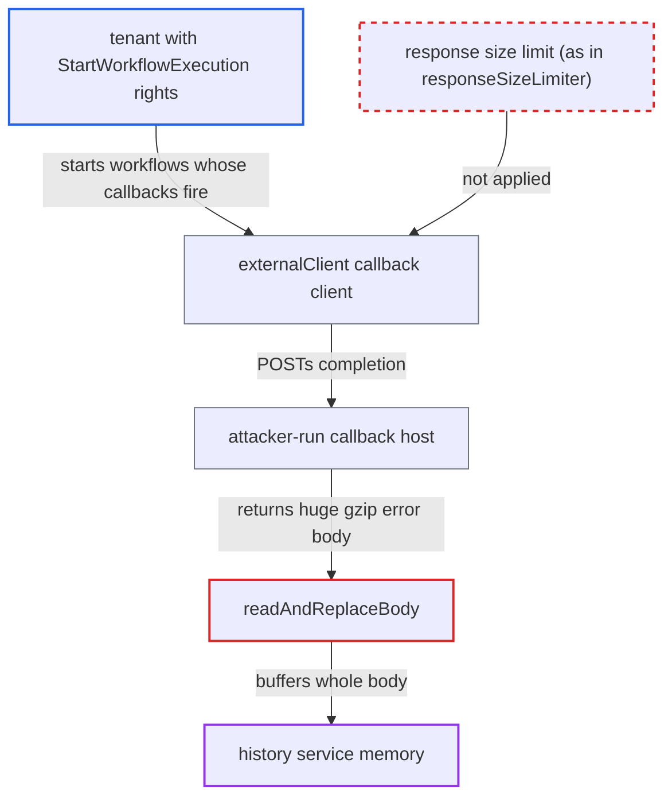

# CHASM callback client buffers unbounded error response bodies in history memory

| Field | Value |
|---|---|
| ID | `find_0116UM9wj89bo8Ry7bwcYu4k` |
| Severity | **Medium** |
| Status | open |
| CWE | CWE-770 — Uncontrolled resource consumption |
| Created | 2026-10-27T21:32:08.418685Z |
| Claude Security | https://claude.ai/security/findings/find_0116UM9wj89bo8Ry7bwcYu4k |

## Description

A tenant who can start workflows can exhaust the memory of the history service, which may get it killed. That host serves the shards of every namespace on it. The attack needs a namespace whose `callback.allowedAddresses` allows a host the attacker runs. The cause is that callback error responses are read in full with no byte limit, in `readAndReplaceBody` and the `externalClient` callback client.

1. **attacker** starts many workflows with Nexus completion callbacks that point at their own host. The namespace's `callback.allowedAddresses` must allow that host. The default is no rules. ([`chasm/lib/callback/config.go:88-100`](https://github.com/cx-benchmark/temporal/blob/bf81a4c20009db89dc952592c9cfe770bafe66ee/chasm/lib/callback/config.go#L88-L100))
2. **the router `routeRequest`** sends the callback to `externalClient.Do`. Every non-system callback URL takes this path, and it is the default path for external callbacks. ([`chasm/lib/callback/request.go:117-123`](https://github.com/cx-benchmark/temporal/blob/bf81a4c20009db89dc952592c9cfe770bafe66ee/chasm/lib/callback/request.go#L117-L123))
3. **the client `externalClient`** sends the request with no response-size limit. It is a plain HTTP client with no wrapper that caps the response body, unlike the Nexus start client. ([`chasm/lib/callback/fx.go:46-52`](https://github.com/cx-benchmark/temporal/blob/bf81a4c20009db89dc952592c9cfe770bafe66ee/chasm/lib/callback/fx.go#L46-L52))
4. **attacker's host** answers each POST with a 400 or 500 and a gzip body that inflates to gigabytes. The transport leaves `DisableCompression` false, so Go requests gzip and inflates the body while it is read. A few MB on the wire can become GBs in memory. ([`common/http_transport.go:23-52`](https://github.com/cx-benchmark/temporal/blob/bf81a4c20009db89dc952592c9cfe770bafe66ee/common/http_transport.go#L23-L52))
5. **the method `CompleteOperation`** passes the non-2xx response to `readAndReplaceBody`. Only 2xx bodies are discarded. Every other status is read before it is interpreted. ([`common/nexus/nexusrpc/completion.go:64-87`](https://github.com/cx-benchmark/temporal/blob/bf81a4c20009db89dc952592c9cfe770bafe66ee/common/nexus/nexusrpc/completion.go#L64-L87))
6. **the function `readAndReplaceBody`** reads the whole body into memory with `io.ReadAll`. Nothing bounds the bytes. The only limit is the `callback.request.timeout` deadline (default 10 s), which limits time and not size. ([`common/nexus/nexusrpc/client.go:404-412`](https://github.com/cx-benchmark/temporal/blob/bf81a4c20009db89dc952592c9cfe770bafe66ee/common/nexus/nexusrpc/client.go#L404-L412))
7. **the outbound queue** repeats the read for up to 100 concurrent attempts per destination. A 4xx answer is non-retryable and never trips the circuit breaker, so each new callback brings a fresh read. A 5xx answer is retried with no expiration. ([`chasm/lib/callback/invocable_outbound.go:67-112`](https://github.com/cx-benchmark/temporal/blob/bf81a4c20009db89dc952592c9cfe770bafe66ee/chasm/lib/callback/invocable_outbound.go#L67-L112))

## Assessment

The attacker is a tenant with `StartWorkflowExecution` rights in a namespace whose `callback.allowedAddresses` allows a host they run, such as their own callback receiver. The default is no rules, so this is a deployment precondition. They start many workflows with Nexus completion callbacks to that host and let them close. No victim action is needed. The report says the HSM path has the same read but is not used by default. The CHASM path is on by default, because `history.enableChasm` and `history.enableCHASMCallbacks` both default to `true`.

Impact: The attacker can make the history process buffer attacker-sized response bodies, up to 100 attempts at once per destination. This can exhaust its memory and get it killed by the OOM killer, so the service becomes unavailable. Nothing is disclosed or modified.

## Recommendation

(1) `externalClient` in `chasm/lib/callback/fx.go` has no response body limit, and `CompleteOperation` reads non-2xx bodies in full with `io.ReadAll` in `readAndReplaceBody`.

Fix criteria: Every byte read from a callback response is bounded by a fixed limit applied after transparent decompression, so gzip amplification is bounded too. To verify, point an allowlisted callback at a server that returns a 400 or 500 with a body (plain or gzip) far larger than the limit. The attempt must fail with a size error, and history memory per attempt must stay near the limit.

(2) A hostile destination can repeat the read on every retry, and on every new callback, without limit.

Fix criteria: An oversized callback response counts as a failure of that attempt, in the way `ErrResponseBodyTooLarge` is handled for Nexus starts. No retry or new callback reads more than the fixed limit.

## Evidence

**https://github.com/cx-benchmark/temporal**

- [`chasm/lib/callback/fx.go:46-52`](https://github.com/cx-benchmark/temporal/blob/bf81a4c20009db89dc952592c9cfe770bafe66ee/chasm/lib/callback/fx.go#L46-L52)
- [`common/nexus/nexusrpc/client.go:404-412`](https://github.com/cx-benchmark/temporal/blob/bf81a4c20009db89dc952592c9cfe770bafe66ee/common/nexus/nexusrpc/client.go#L404-L412)
- [`common/nexus/nexusrpc/completion.go:64-87`](https://github.com/cx-benchmark/temporal/blob/bf81a4c20009db89dc952592c9cfe770bafe66ee/common/nexus/nexusrpc/completion.go#L64-L87)
- [`chasm/lib/callback/request.go:117-123`](https://github.com/cx-benchmark/temporal/blob/bf81a4c20009db89dc952592c9cfe770bafe66ee/chasm/lib/callback/request.go#L117-L123)
- [`chasm/lib/callback/invocable_outbound.go:67-112`](https://github.com/cx-benchmark/temporal/blob/bf81a4c20009db89dc952592c9cfe770bafe66ee/chasm/lib/callback/invocable_outbound.go#L67-L112)
- [`chasm/lib/callback/tasks.go:142-148`](https://github.com/cx-benchmark/temporal/blob/bf81a4c20009db89dc952592c9cfe770bafe66ee/chasm/lib/callback/tasks.go#L142-L148)
- [`common/http_transport.go:23-52`](https://github.com/cx-benchmark/temporal/blob/bf81a4c20009db89dc952592c9cfe770bafe66ee/common/http_transport.go#L23-L52)
- [`chasm/lib/nexusoperation/fx.go:107-119`](https://github.com/cx-benchmark/temporal/blob/bf81a4c20009db89dc952592c9cfe770bafe66ee/chasm/lib/nexusoperation/fx.go#L107-L119)
- [`chasm/lib/callback/config.go:88-100`](https://github.com/cx-benchmark/temporal/blob/bf81a4c20009db89dc952592c9cfe770bafe66ee/chasm/lib/callback/config.go#L88-L100)
- [`common/dynamicconfig/constants.go:2496-2500`](https://github.com/cx-benchmark/temporal/blob/bf81a4c20009db89dc952592c9cfe770bafe66ee/common/dynamicconfig/constants.go#L2496-L2500)

