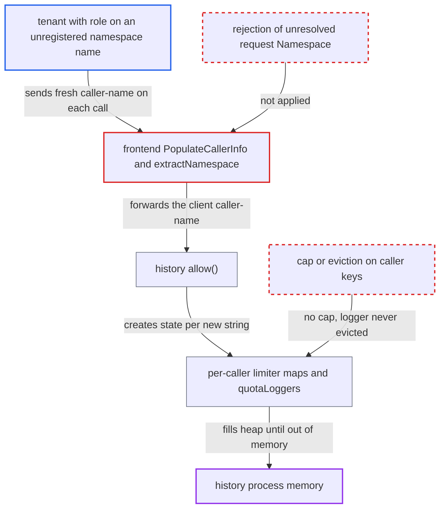

# Client-supplied caller-name header keys unbounded per-namespace limiter and logger state on history hosts

| Field | Value |
|---|---|
| ID | `find_01Gk9J8ouQSzbpGaBhmpdkWz` |
| Severity | **Medium** |
| Status | open |
| CWE | CWE-770 — Resource exhaustion |
| Created | 2026-10-27T22:00:08.794917Z |
| Claude Security | https://claude.ai/security/findings/find_01Gk9J8ouQSzbpGaBhmpdkWz |

## Description

A tenant with a role on a namespace name that is missing from the registry can exhaust memory on history hosts. It needs a task token whose namespace resolves, and the default authorizer must be in use. The frontend fails to overwrite a client-supplied `caller-name` when the resolved namespace name is empty, so history creates unbounded per-caller limiter and logger state for every new string.

1. **attacker** sends a task-token call such as `RecordActivityTaskHeartbeat` with an unregistered `Namespace`. The call carries `xdc-redirection: false` and a fresh random `caller-name`. The default authorizer allows it because the caller's role covers that namespace name. ([`common/authorization/interceptor.go:163-175`](https://github.com/cx-benchmark/temporal/blob/bf81a4c20009db89dc952592c9cfe770bafe66ee/common/authorization/interceptor.go#L163-L175))
2. **the validator `extractNamespace`** drops the NotFound error for the request `Namespace`. It does this when the task token's namespace ID resolves, so the request goes on with an empty resolved name. ([`common/rpc/interceptor/namespace_validator.go:295-319`](https://github.com/cx-benchmark/temporal/blob/bf81a4c20009db89dc952592c9cfe770bafe66ee/common/rpc/interceptor/namespace_validator.go#L295-L319))
3. **the check `checkNamespaceMatch`** returns nil for the missing request entry. `frontend.enableTokenNamespaceEnforcement` (default true) therefore never rejects the mismatch. ([`common/rpc/interceptor/namespace_validator.go:424-433`](https://github.com/cx-benchmark/temporal/blob/bf81a4c20009db89dc952592c9cfe770bafe66ee/common/rpc/interceptor/namespace_validator.go#L424-L433))
4. **the interceptor `PopulateCallerInfo`** sets the caller name to an empty string, which does not replace the client's value. `setIncomingMD` skips empty values, so the attacker's `caller-name` stays in the context. ([`common/rpc/interceptor/caller_info.go:54-77`](https://github.com/cx-benchmark/temporal/blob/bf81a4c20009db89dc952592c9cfe770bafe66ee/common/rpc/interceptor/caller_info.go#L54-L77))
5. **the frontend handler and `headers.Propagate`** forward the unchanged context and the surviving `caller-name` to history. History's server chain has no caller-info interceptor, so it trusts the value as the tenant identity. ([`common/rpc/grpc.go:127-137`](https://github.com/cx-benchmark/temporal/blob/bf81a4c20009db89dc952592c9cfe770bafe66ee/common/rpc/grpc.go#L127-L137))
6. **history `allow()`** uses the string as `quotas.Request.Caller`. The per-namespace and per-shard-per-namespace `MapRequestRateLimiterImpl` maps each build a `newPriorityRateLimiter` of seven `DynamicRateLimiterImpl`s for every unseen string. This happens before the limiter decides, so throttled calls allocate too. ([`common/persistence/client/quotas.go:131-224`](https://github.com/cx-benchmark/temporal/blob/bf81a4c20009db89dc952592c9cfe770bafe66ee/common/persistence/client/quotas.go#L131-L224))
7. **`LoggedNamespaceCalculator.GetQuota`** stores a `quotaLogger` with a cloned logger for the string and logs `Quota changed` at Info. The `quotaLoggers` map is never pruned, so this state lasts for the life of the process. ([`common/quotas/calculator/logged_calculator.go:64-103`](https://github.com/cx-benchmark/temporal/blob/bf81a4c20009db89dc952592c9cfe770bafe66ee/common/quotas/calculator/logged_calculator.go#L64-L103))

## Assessment

The attacker is a tenant on a deployment that uses the default authorizer. Its JWT carries a writer role on a namespace name missing from the registry. One example is a stale claim for a deleted namespace, or a name a namespace admin frees by running `DeleteNamespace`, which renames the namespace. The attacker also holds any task token whose namespace ID resolves. The task-token APIs affected are `RecordActivityTaskHeartbeat`, `RespondActivityTask*`, `RespondWorkflowTask*`, `RespondQueryTaskCompleted` and `RespondNexusTask*`. The attacker sets `xdc-redirection: false` to skip the redirection lookup. Under the shipped `noop` authorizer every caller is already system admin, so the role condition is trivially met. The attack needs no user interaction.

Impact: Each distinct caller string keeps two seven-limiter sets for at least an hour. It also keeps a `quotaLogger` and the string itself for the life of the process. History heap grows by roughly ten kilobytes or more per request, which the report puts at gigabytes within minutes at the admitted rate. The history process then runs out of memory, and its shards move to another host, where the attack continues. No data is read or modified.

## Recommendation

(1) `PopulateCallerInfo` relies on `SetCallerInfo`, which cannot clear a header. When the resolved namespace name is empty, a client-supplied `caller-name` and the other caller headers survive, and history trusts the value as the tenant identity.

Fix criteria: A client-originated `caller-name` never reaches a frontend handler or an internode call. It is removed at the frontend edge or replaced by the resolved name, and an unresolved namespace gives no caller name. A task-token request with an unregistered `Namespace` and a `caller-name` header reaches history with no such caller and creates no new limiter or logger entry.

(2) `extractNamespace` ignores a failed lookup of a non-empty request `Namespace` when a task token resolves. The request then runs with `EmptyName` in every name-keyed control, and token-namespace enforcement is skipped.

Fix criteria: A task-token request whose non-empty `Namespace` does not resolve, or resolves to a different namespace than the token's, is rejected before the handler runs. `RecordActivityTaskHeartbeat` with `Namespace="does-not-exist"` and a valid token is refused.

(3) History's per-tenant persistence state (the `MapRequestRateLimiterImpl` maps and `LoggedNamespaceCalculator.quotaLoggers`) is created for any string with no cap. The `quotaLoggers` map is never evicted.

Fix criteria: Per-tenant structures in the persistence client are keyed only on identities checked against the namespace registry (or the `system` caller). Every such map is bounded or evicted. A stream of distinct unknown caller strings does not grow these maps or emit a log line per value.

## Evidence

**https://github.com/cx-benchmark/temporal**

- [`common/rpc/interceptor/caller_info.go:54-77`](https://github.com/cx-benchmark/temporal/blob/bf81a4c20009db89dc952592c9cfe770bafe66ee/common/rpc/interceptor/caller_info.go#L54-L77)
- [`common/headers/headers.go:154-167`](https://github.com/cx-benchmark/temporal/blob/bf81a4c20009db89dc952592c9cfe770bafe66ee/common/headers/headers.go#L154-L167)
- [`common/rpc/interceptor/namespace_validator.go:295-319`](https://github.com/cx-benchmark/temporal/blob/bf81a4c20009db89dc952592c9cfe770bafe66ee/common/rpc/interceptor/namespace_validator.go#L295-L319)
- [`common/rpc/interceptor/namespace_validator.go:424-433`](https://github.com/cx-benchmark/temporal/blob/bf81a4c20009db89dc952592c9cfe770bafe66ee/common/rpc/interceptor/namespace_validator.go#L424-L433)
- [`common/persistence/persistence_rate_limited_clients.go:1146-1175`](https://github.com/cx-benchmark/temporal/blob/bf81a4c20009db89dc952592c9cfe770bafe66ee/common/persistence/persistence_rate_limited_clients.go#L1146-L1175)
- [`common/persistence/client/quotas.go:131-224`](https://github.com/cx-benchmark/temporal/blob/bf81a4c20009db89dc952592c9cfe770bafe66ee/common/persistence/client/quotas.go#L131-L224)
- [`common/quotas/map_request_rate_limiter_impl.go:93-163`](https://github.com/cx-benchmark/temporal/blob/bf81a4c20009db89dc952592c9cfe770bafe66ee/common/quotas/map_request_rate_limiter_impl.go#L93-L163)
- [`common/quotas/dynamic_rate_limiter_impl.go:28-40`](https://github.com/cx-benchmark/temporal/blob/bf81a4c20009db89dc952592c9cfe770bafe66ee/common/quotas/dynamic_rate_limiter_impl.go#L28-L40)
- [`service/history/fx.go:460-475`](https://github.com/cx-benchmark/temporal/blob/bf81a4c20009db89dc952592c9cfe770bafe66ee/service/history/fx.go#L460-L475)
- [`common/quotas/calculator/logged_calculator.go:64-103`](https://github.com/cx-benchmark/temporal/blob/bf81a4c20009db89dc952592c9cfe770bafe66ee/common/quotas/calculator/logged_calculator.go#L64-L103)
- [`common/rpc/grpc.go:127-137`](https://github.com/cx-benchmark/temporal/blob/bf81a4c20009db89dc952592c9cfe770bafe66ee/common/rpc/grpc.go#L127-L137)
- [`service/frontend/workflow_handler.go:1496-1544`](https://github.com/cx-benchmark/temporal/blob/bf81a4c20009db89dc952592c9cfe770bafe66ee/service/frontend/workflow_handler.go#L1496-L1544)
- [`service/history/shard/context_impl.go:2423-2441`](https://github.com/cx-benchmark/temporal/blob/bf81a4c20009db89dc952592c9cfe770bafe66ee/service/history/shard/context_impl.go#L2423-L2441)
- [`common/authorization/interceptor.go:163-175`](https://github.com/cx-benchmark/temporal/blob/bf81a4c20009db89dc952592c9cfe770bafe66ee/common/authorization/interceptor.go#L163-L175)
- [`common/persistence/persistence_metric_clients.go:1419-1424`](https://github.com/cx-benchmark/temporal/blob/bf81a4c20009db89dc952592c9cfe770bafe66ee/common/persistence/persistence_metric_clients.go#L1419-L1424)

