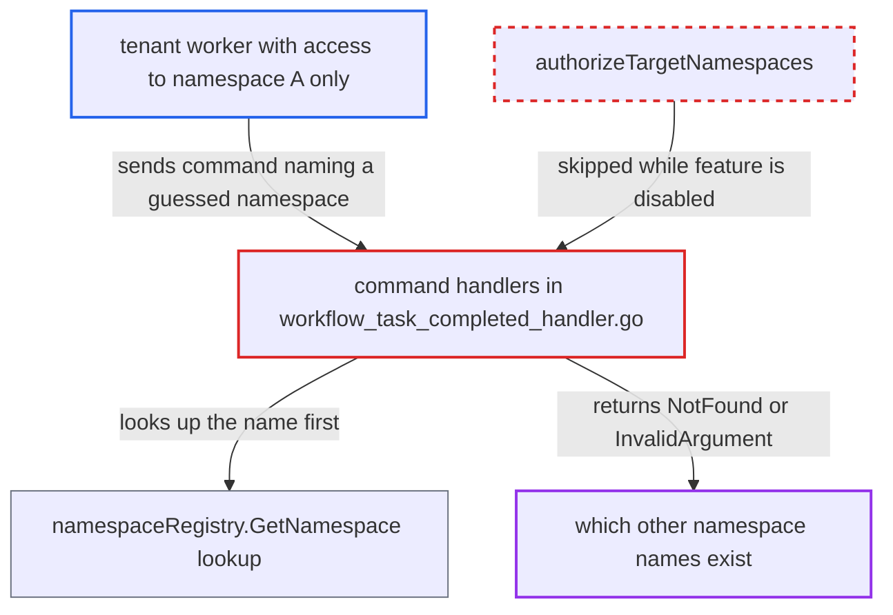

# Cross-namespace command handling reveals whether foreign namespace names exist

| Field | Value |
|---|---|
| ID | `find_01LsxKS2NQhk8Wc3Fsfn6XWq` |
| Severity | **Medium** |
| Status | open |
| CWE | CWE-203 — Observable Discrepancy |
| Created | 2026-10-27T21:18:05.430231Z |
| Claude Security | https://claude.ai/security/findings/find_01LsxKS2NQhk8Wc3Fsfn6XWq |

## Description

A tenant with write access to only its own namespace can test whether any other namespace name exists in the cluster. Under the default authorizer that information is otherwise withheld from it. The history handlers for `StartChildWorkflowExecution`, `SignalExternalWorkflowExecution` and `RequestCancelExternalWorkflowExecution` look up the attacker-chosen namespace and return the not-found error before the cross-namespace policy runs.

1. **attacker (worker or client with write access to namespace A)** starts a workflow in its own namespace and polls its workflow task. This gives the attacker a workflow task it can complete with its own chosen commands.
2. **attacker** calls `RespondWorkflowTaskCompleted` with a StartChild, SignalExternal or RequestCancelExternal command. The command's `namespace` attribute is a guessed name that belongs to another namespace.
3. **frontend `authorizeTargetNamespaces`** returns early without checking the target namespace. While `system.enableCrossNamespaceCommands` is false (the default), the target namespaces of commands are not authorized, so the guessed name reaches history. ([`common/authorization/interceptor.go:356-365`](https://github.com/cx-benchmark/temporal/blob/bf81a4c20009db89dc952592c9cfe770bafe66ee/common/authorization/interceptor.go#L356-L365))
4. **history command handlers** resolve the name with `namespaceRegistry.GetNamespace` and return any error unchanged. `handleCommandStartChildWorkflow`, `handleCommandRequestCancelExternalWorkflow` and `handleCommandSignalExternalWorkflow` all do this lookup before any policy check. ([`service/history/api/respondworkflowtaskcompleted/workflow_task_completed_handler.go:1274-1281`](https://github.com/cx-benchmark/temporal/blob/bf81a4c20009db89dc952592c9cfe770bafe66ee/service/history/api/respondworkflowtaskcompleted/workflow_task_completed_handler.go#L1274-L1281))
5. **`RespondWorkflowTaskCompleted` in `api.go`** returns `NamespaceNotFound` to the worker when the name does not exist. The handler error is passed back unchanged, as gRPC NotFound with the text `Namespace <name> is not found.`. ([`service/history/api/respondworkflowtaskcompleted/api.go:460-469`](https://github.com/cx-benchmark/temporal/blob/bf81a4c20009db89dc952592c9cfe770bafe66ee/service/history/api/respondworkflowtaskcompleted/api.go#L460-L469))
6. **`validateCrossNamespaceCall`** rejects the command with InvalidArgument `cross namespace commands are not allowed` when the name does exist. This policy runs only after a successful lookup, so only existing names reach it. The error is wrapped into the workflow-task-failure message returned to the worker. ([`service/history/api/command_attr_validator.go:585-599`](https://github.com/cx-benchmark/temporal/blob/bf81a4c20009db89dc952592c9cfe770bafe66ee/service/history/api/command_attr_validator.go#L585-L599))
7. **attacker** reads the error code and message to learn whether the name exists. NotFound means the namespace does not exist, and InvalidArgument means it does. The probe can be repeated without limit.

## Assessment

The attacker is a worker or client with write access to one namespace, running against a cluster with an enforcing authorizer. No victim action is needed. It works with the default `system.enableCrossNamespaceCommands=false`. Any of the three commands can be used as the probe: StartChild, SignalExternal or RequestCancelExternal. The attacker can try as many guessed names as it wants.

Impact: The attacker learns only whether a chosen namespace name exists in the cluster. It gets no workflow data, payloads or namespace configuration, and it cannot act on the foreign namespace because the command is still rejected. The only other state change is a workflow-task failure in its own namespace.

## Recommendation

The StartChild, SignalExternal and RequestCancelExternal command handlers resolve the attacker-supplied target namespace and return the registry's not-found error before the cross-namespace policy is applied. A worker can therefore tell a non-existent namespace from an existing one it may not target.

Fix criteria: A worker gets the same response for an existing foreign namespace it may not target and for a name that does not exist. With cross-namespace commands disabled, a foreign target is rejected the same way whether or not the name resolves. With them enabled, not-found and not-permitted give the same failure. To verify, send each of the three commands naming an existing and a non-existing foreign namespace, and check that the error code and message are identical.

## Evidence

**https://github.com/cx-benchmark/temporal**

- [`service/history/api/respondworkflowtaskcompleted/workflow_task_completed_handler.go:1274-1281`](https://github.com/cx-benchmark/temporal/blob/bf81a4c20009db89dc952592c9cfe770bafe66ee/service/history/api/respondworkflowtaskcompleted/workflow_task_completed_handler.go#L1274-L1281)
- [`service/history/api/respondworkflowtaskcompleted/workflow_task_completed_handler.go:1098-1104`](https://github.com/cx-benchmark/temporal/blob/bf81a4c20009db89dc952592c9cfe770bafe66ee/service/history/api/respondworkflowtaskcompleted/workflow_task_completed_handler.go#L1098-L1104)
- [`service/history/api/respondworkflowtaskcompleted/workflow_task_completed_handler.go:1387-1393`](https://github.com/cx-benchmark/temporal/blob/bf81a4c20009db89dc952592c9cfe770bafe66ee/service/history/api/respondworkflowtaskcompleted/workflow_task_completed_handler.go#L1387-L1393)
- [`service/history/api/command_attr_validator.go:585-599`](https://github.com/cx-benchmark/temporal/blob/bf81a4c20009db89dc952592c9cfe770bafe66ee/service/history/api/command_attr_validator.go#L585-L599)
- [`common/authorization/interceptor.go:356-365`](https://github.com/cx-benchmark/temporal/blob/bf81a4c20009db89dc952592c9cfe770bafe66ee/common/authorization/interceptor.go#L356-L365)
- [`service/history/api/respondworkflowtaskcompleted/api.go:460-469`](https://github.com/cx-benchmark/temporal/blob/bf81a4c20009db89dc952592c9cfe770bafe66ee/service/history/api/respondworkflowtaskcompleted/api.go#L460-L469)
- [`common/api/metadata.go:72-73`](https://github.com/cx-benchmark/temporal/blob/bf81a4c20009db89dc952592c9cfe770bafe66ee/common/api/metadata.go#L72-L73)

