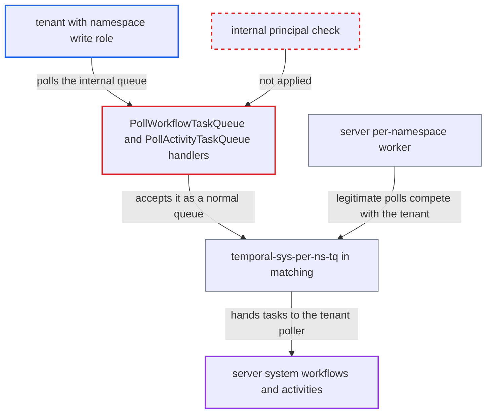

# Frontend lets tenant workers poll internal per-namespace system task queues

| Field | Value |
|---|---|
| ID | `find_01CMwCZcmLN65WovDHmuuiTn` |
| Severity | **Medium** |
| Status | open |
| CWE | CWE-862 — Missing Authorization |
| Created | 2026-10-27T21:35:27.013475Z |
| Claude Security | https://claude.ai/security/findings/find_01CMwCZcmLN65WovDHmuuiTn |

## Description

A tenant with the write role on a namespace can take over the server's own system workflows in that namespace (batch operations, schedules, worker deployments). It can also run server-side activities with inputs it chooses, and it can slow the server's own pollers. The poll handlers `PollWorkflowTaskQueue`, `PollActivityTaskQueue` and `PollNexusTaskQueue` validate the queue with `tqid.NormalizeAndValidate`, so they accept the internal queue `temporal-sys-per-ns-tq` from any caller. Cross-namespace data access was not found.

1. **tenant with namespace write role** opens many long polls on `temporal-sys-per-ns-tq`. `PollWorkflowTaskQueue` validates the queue name with `tqid.NormalizeAndValidate`, which only rejects the `/_sys/` prefix and never asks whether the queue is internal or whether the caller is the server. ([`service/frontend/workflow_handler.go:1145-1147`](https://github.com/cx-benchmark/temporal/blob/bf81a4c20009db89dc952592c9cfe770bafe66ee/service/frontend/workflow_handler.go#L1145-L1147))
2. **tenant with namespace write role** also polls for activity tasks on the same queue. `PollActivityTaskQueue` has the same gap, so the tenant can later take the server's activity tasks and their inputs. ([`service/frontend/workflow_handler.go:1400-1402`](https://github.com/cx-benchmark/temporal/blob/bf81a4c20009db89dc952592c9cfe770bafe66ee/service/frontend/workflow_handler.go#L1400-L1402))
3. **tenant with namespace write role** starts a batch operation or creates a schedule. Any namespace writer can do this, so a system workflow task on the internal queue is always available to take. ([`service/frontend/workflow_handler.go:6056-6082`](https://github.com/cx-benchmark/temporal/blob/bf81a4c20009db89dc952592c9cfe770bafe66ee/service/frontend/workflow_handler.go#L6056-L6082))
4. **matching service** gives the system workflow task to whichever poller is waiting. Matching picks pollers only by namespace, queue name and type, with no principal check, so a tenant poller can win against the server worker's two pollers. The report says the tenant usually wins this race and can retry. ([`service/matching/matching_engine.go:782-830`](https://github.com/cx-benchmark/temporal/blob/bf81a4c20009db89dc952592c9cfe770bafe66ee/service/matching/matching_engine.go#L782-L830))
5. **tenant worker** answers with its own commands, including `ScheduleActivityTask` for server-registered activities. History accepts `ScheduleActivityTask` onto the per-namespace queue when the workflow runs there, so the tenant chooses the activity, its input and its options. ([`chasm/lib/activity/validator.go:66-68`](https://github.com/cx-benchmark/temporal/blob/bf81a4c20009db89dc952592c9cfe770bafe66ee/chasm/lib/activity/validator.go#L66-L68))
6. **server per-namespace worker** runs the scheduled activities with the server's internal identity. The worker runs in the shared worker-service process with internal claims and 1000 concurrent activity slots, so the tenant's crafted activities run with server privileges. ([`service/worker/pernamespaceworker.go:465-520`](https://github.com/cx-benchmark/temporal/blob/bf81a4c20009db89dc952592c9cfe770bafe66ee/service/worker/pernamespaceworker.go#L465-L520))
7. **tenant worker** completes the server's activity tasks with crafted results. These results feed back into the server's own workflow code. ([`service/frontend/workflow_handler.go:1400-1402`](https://github.com/cx-benchmark/temporal/blob/bf81a4c20009db89dc952592c9cfe770bafe66ee/service/frontend/workflow_handler.go#L1400-L1402))

## Assessment

The attacker is a tenant with the namespace write role, the same role the default authorizer requires for these polls. No other setting or victim action is needed. The attacker polls `temporal-sys-per-ns-tq` in its own namespace and then starts a batch operation or creates a schedule to produce a system workflow task. `PollNexusTaskQueue` has the same missing check, but the report lists it only for completeness of the fix. The report does not describe a Nexus-specific attack.

Impact: The tenant gains write control over the server-managed schedule, batch and deployment state in its own namespace. This bypasses the frontend validators and limits, and the work runs with the server's internal identity. It can run any activity registered on the shared worker with inputs it chooses. The report links this to unbounded allocations and loops in the shared worker-service process, which can degrade system workflows of every namespace on that worker. The tenant can also use up the `internal_per_ns` poll budget and throttle the server's own worker. Every activity is bound to the worker's own namespace, and the tenant reads only its own system workflows' inputs.

## Recommendation

(1) `PollWorkflowTaskQueue`, `PollActivityTaskQueue` and `PollNexusTaskQueue` validate the queue with `tqid.NormalizeAndValidate`, which does not consult `primitives.IsInternalPerNsTaskQueue`. External principals can therefore take tasks from queues reserved for the server's per-namespace worker.

Fix criteria: A poll on an internal per-namespace queue is rejected unless the authenticated principal is the server's internal principal. This includes sticky polls, which are judged by `NormalName`. The server's own per-namespace worker still receives its tasks. A tenant `PollWorkflowTaskQueue` or `PollActivityTaskQueue` on `temporal-sys-per-ns-tq` returns an error. Batch, schedule and deployment system workflows still make progress.

(2) The `internal_per_ns` concurrency budget in `ConcurrentRequestLimitInterceptor` is shared between the server's per-namespace worker and any tenant pollers. Tenant polls can therefore throttle the server's own pollers for that namespace.

Fix criteria: Either external polls on internal queues are rejected, so the budget is effectively server-only, or the budget is keyed by principal type. In both cases tenant traffic cannot exhaust the server worker's slots.

## Evidence

**https://github.com/cx-benchmark/temporal**

- [`service/frontend/workflow_handler.go:1145-1147`](https://github.com/cx-benchmark/temporal/blob/bf81a4c20009db89dc952592c9cfe770bafe66ee/service/frontend/workflow_handler.go#L1145-L1147)
- [`service/frontend/workflow_handler.go:1400-1402`](https://github.com/cx-benchmark/temporal/blob/bf81a4c20009db89dc952592c9cfe770bafe66ee/service/frontend/workflow_handler.go#L1400-L1402)
- [`service/frontend/workflow_handler.go:6489-6491`](https://github.com/cx-benchmark/temporal/blob/bf81a4c20009db89dc952592c9cfe770bafe66ee/service/frontend/workflow_handler.go#L6489-L6491)
- [`common/tqid/task_queue_validator.go:63-85`](https://github.com/cx-benchmark/temporal/blob/bf81a4c20009db89dc952592c9cfe770bafe66ee/common/tqid/task_queue_validator.go#L63-L85)
- [`common/primitives/task_queues.go:11-22`](https://github.com/cx-benchmark/temporal/blob/bf81a4c20009db89dc952592c9cfe770bafe66ee/common/primitives/task_queues.go#L11-L22)
- [`common/rpc/interceptor/concurrent_request_limit.go:160-180`](https://github.com/cx-benchmark/temporal/blob/bf81a4c20009db89dc952592c9cfe770bafe66ee/common/rpc/interceptor/concurrent_request_limit.go#L160-L180)
- [`service/matching/matching_engine.go:782-830`](https://github.com/cx-benchmark/temporal/blob/bf81a4c20009db89dc952592c9cfe770bafe66ee/service/matching/matching_engine.go#L782-L830)
- [`service/worker/pernamespaceworker.go:465-520`](https://github.com/cx-benchmark/temporal/blob/bf81a4c20009db89dc952592c9cfe770bafe66ee/service/worker/pernamespaceworker.go#L465-L520)
- [`chasm/lib/activity/validator.go:66-68`](https://github.com/cx-benchmark/temporal/blob/bf81a4c20009db89dc952592c9cfe770bafe66ee/chasm/lib/activity/validator.go#L66-L68)
- [`service/frontend/workflow_handler.go:6056-6082`](https://github.com/cx-benchmark/temporal/blob/bf81a4c20009db89dc952592c9cfe770bafe66ee/service/frontend/workflow_handler.go#L6056-L6082)
- [`service/frontend/workflow_handler.go:6246-6283`](https://github.com/cx-benchmark/temporal/blob/bf81a4c20009db89dc952592c9cfe770bafe66ee/service/frontend/workflow_handler.go#L6246-L6283)

