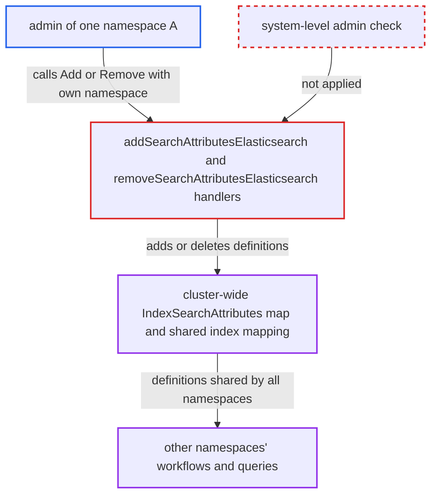

# Namespace admin can alter cluster-wide Elasticsearch search attributes via OperatorService

| Field | Value |
|---|---|
| ID | `find_015mZbUG36hxzUF6wpxnkHBG` |
| Severity | **Medium** |
| Status | open |
| CWE | CWE-863 — Incorrect Authorization |
| Created | 2026-10-27T21:09:24.105912Z |
| Claude Security | https://claude.ai/security/findings/find_015mZbUG36hxzUF6wpxnkHBG |

## Description

A user who is admin of just one namespace can add or remove custom search attributes for every namespace on the cluster. Removing them makes other tenants' workflow starts, searches and running workflows fail. This needs Elasticsearch visibility and the shipped `default` authorizer. The cause is that `AddSearchAttributes` and `RemoveSearchAttributes` are authorized as namespace-level admin calls, but their Elasticsearch handlers change cluster-wide state.

1. **namespace admin of `A`** lists the current custom search attributes. The attacker calls `ListSearchAttributes` to learn which attribute names exist before choosing what to remove or add.
2. **namespace admin of `A`** calls `OperatorService/RemoveSearchAttributes` or `AddSearchAttributes` with `namespace` set to `A`. The call goes to the public frontend gRPC or HTTP API, and `A` is the one namespace where the attacker holds `RoleAdmin`. ([`common/api/metadata.go:196-197`](https://github.com/cx-benchmark/temporal/blob/bf81a4c20009db89dc952592c9cfe770bafe66ee/common/api/metadata.go#L196-L197))
3. **the authorization interceptor** takes the target namespace from the request. `target.Namespace` is the caller-supplied `GetNamespace()`, so the caller decides which namespace is checked. ([`common/authorization/interceptor.go:164-172`](https://github.com/cx-benchmark/temporal/blob/bf81a4c20009db89dc952592c9cfe770bafe66ee/common/authorization/interceptor.go#L164-L172))
4. **the namespace validator** accepts the request because namespace `A` exists. For these requests the namespace is optional and only has to exist, so nothing ties it to the resource being changed. ([`common/rpc/interceptor/namespace_validator.go:367-376`](https://github.com/cx-benchmark/temporal/blob/bf81a4c20009db89dc952592c9cfe770bafe66ee/common/rpc/interceptor/namespace_validator.go#L367-L376))
5. **the default authorizer** grants the call as a namespace-admin call. For `ScopeNamespace` the role is `claims.System | claims.Namespaces[target.Namespace]`, and the admin claim on `A` meets `AccessAdmin`. ([`common/authorization/default_authorizer.go:51-54`](https://github.com/cx-benchmark/temporal/blob/bf81a4c20009db89dc952592c9cfe770bafe66ee/common/authorization/default_authorizer.go#L51-L54))
6. **the handler `removeSearchAttributesElasticsearch`** deletes the named custom attributes from the cluster-wide map and saves it. The handler ignores `request.Namespace`, and `SaveSearchAttributes` overwrites `ClusterMetadata.IndexSearchAttributes[indexName]`, which all namespaces share. `addSearchAttributesElasticsearch` likewise adds fields to the shared index mapping through `PutMapping`. ([`service/frontend/operator_handler.go:380-414`](https://github.com/cx-benchmark/temporal/blob/bf81a4c20009db89dc952592c9cfe770bafe66ee/service/frontend/operator_handler.go#L380-L414))
7. **other namespaces' requests and workflows** fail because the attribute no longer resolves. Write validation looks definitions up by index, and an `UpsertWorkflowSearchAttributes` command using a removed attribute fails its workflow task with `BAD_SEARCH_ATTRIBUTES`. ([`service/history/api/command_attr_validator.go:365-367`](https://github.com/cx-benchmark/temporal/blob/bf81a4c20009db89dc952592c9cfe770bafe66ee/service/history/api/command_attr_validator.go#L365-L367))

## Assessment

The attacker is an authenticated tenant holding only `RoleAdmin` on its own namespace `A`. The cluster must use Elasticsearch visibility with the shipped `default` authorizer and claim mapper. The attacker reaches the public frontend gRPC or HTTP API and calls `AddSearchAttributes` or `RemoveSearchAttributes` with its own namespace. No victim action is needed and no defence has to be evaded. The SQL visibility path only edits the caller's own namespace aliases and is not affected. The `AdminService` search-attribute APIs are cluster-scoped and are not affected either.

Impact: The attacker controls the cluster-wide custom search-attribute definitions and can repeat the change at will. Removed attributes break other namespaces until a system admin re-adds them: starts and signal-with-start calls that carry them fail, list queries that use them fail, and running workflows that upsert them stop progressing. Added attributes permanently extend the shared mapping. No workflow data or payloads are disclosed or altered.

## Recommendation

With Elasticsearch visibility, `addSearchAttributesElasticsearch` and `removeSearchAttributesElasticsearch` change cluster-wide state: the cluster metadata `IndexSearchAttributes` and the shared index mapping. The request is authorized only as a namespace-scoped admin call on a namespace the caller chose, so the authorized scope does not cover the resource changed.

Fix criteria: A caller whose only privilege is admin on namespace `A` gets PermissionDenied from Add/RemoveSearchAttributes whenever the call would change cluster-level search-attribute definitions or the shared Elasticsearch mapping. Only a system-level admin can make that change. Testing with an `A:admin` token against an Elasticsearch-backed cluster shows the cluster metadata map and the index mapping unchanged. A system admin still succeeds. Namespace admins can still use the SQL per-namespace alias path.

## Evidence

**https://github.com/cx-benchmark/temporal**

- [`common/api/metadata.go:196-197`](https://github.com/cx-benchmark/temporal/blob/bf81a4c20009db89dc952592c9cfe770bafe66ee/common/api/metadata.go#L196-L197)
- [`service/frontend/operator_handler.go:380-414`](https://github.com/cx-benchmark/temporal/blob/bf81a4c20009db89dc952592c9cfe770bafe66ee/service/frontend/operator_handler.go#L380-L414)
- [`service/frontend/operator_handler.go:198-244`](https://github.com/cx-benchmark/temporal/blob/bf81a4c20009db89dc952592c9cfe770bafe66ee/service/frontend/operator_handler.go#L198-L244)
- [`common/authorization/default_authorizer.go:51-54`](https://github.com/cx-benchmark/temporal/blob/bf81a4c20009db89dc952592c9cfe770bafe66ee/common/authorization/default_authorizer.go#L51-L54)
- [`common/authorization/interceptor.go:164-172`](https://github.com/cx-benchmark/temporal/blob/bf81a4c20009db89dc952592c9cfe770bafe66ee/common/authorization/interceptor.go#L164-L172)
- [`common/rpc/interceptor/namespace_validator.go:367-376`](https://github.com/cx-benchmark/temporal/blob/bf81a4c20009db89dc952592c9cfe770bafe66ee/common/rpc/interceptor/namespace_validator.go#L367-L376)
- [`common/searchattribute/manager.go:165-189`](https://github.com/cx-benchmark/temporal/blob/bf81a4c20009db89dc952592c9cfe770bafe66ee/common/searchattribute/manager.go#L165-L189)
- [`common/searchattribute/validator.go:93-96`](https://github.com/cx-benchmark/temporal/blob/bf81a4c20009db89dc952592c9cfe770bafe66ee/common/searchattribute/validator.go#L93-L96)
- [`common/searchattribute/mapper.go:73-88`](https://github.com/cx-benchmark/temporal/blob/bf81a4c20009db89dc952592c9cfe770bafe66ee/common/searchattribute/mapper.go#L73-L88)
- [`service/history/api/command_attr_validator.go:365-367`](https://github.com/cx-benchmark/temporal/blob/bf81a4c20009db89dc952592c9cfe770bafe66ee/service/history/api/command_attr_validator.go#L365-L367)

