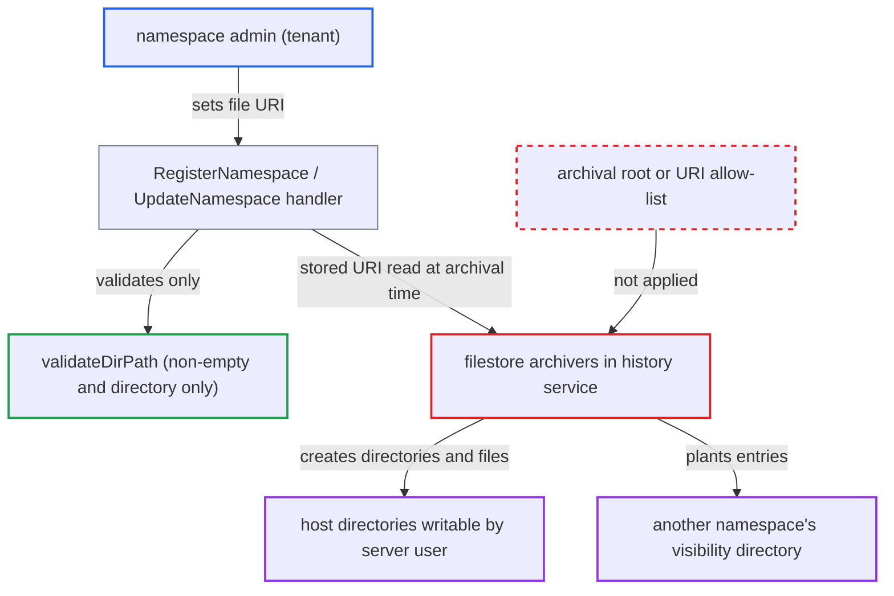

# Namespace admin's filestore archival URI selects arbitrary host directories for server writes and probing

| Field | Value |
|---|---|
| ID | `find_01UibsT5BQ6scQnX3FgntQZd` |
| Severity | **Medium** |
| Status | open |
| CWE | CWE-73 — External control of file path |
| Created | 2026-10-27T21:10:45.149429Z |
| Claude Security | https://claude.ai/security/findings/find_01UibsT5BQ6scQnX3FgntQZd |

## Description

A tenant who is admin of its own namespace can make the server create directories and JSON files anywhere the server user can write. It can also break another namespace's archived-visibility listing if it knows that namespace's ID. Impact is limited: the attacker cannot pick file names or overwrite files. The cause is that `validateDirPath` and the filestore archivers accept any `file://` archival path.

1. **namespace admin** calls `UpdateNamespace` or `RegisterNamespace` with archival enabled and a chosen `file://` URI. The handler takes `HistoryArchivalUri` and `VisibilityArchivalUri` straight from the request, and a namespace-level admin passes the `AccessAdmin` check by default. ([`service/frontend/namespace_handler.go:466-500`](https://github.com/cx-benchmark/temporal/blob/bf81a4c20009db89dc952592c9cfe770bafe66ee/service/frontend/namespace_handler.go#L466-L500))
2. **`validateDirPath`** accepts the path as long as it is non-empty and is either absent or an existing directory. No base directory, operator allow-list or path cleaning applies, and the handler only delegates to the archiver's `ValidateURI`. ([`common/archiver/filestore/util.go:182-197`](https://github.com/cx-benchmark/temporal/blob/bf81a4c20009db89dc952592c9cfe770bafe66ee/common/archiver/filestore/util.go#L182-L197))
3. **`ArchivalConfigState.GetNextState`** stores the submitted URI unchanged. This happens when the namespace never had a URI, which is the case for every namespace under the shipped defaults because the default state is `disabled`. ([`common/namespace/archival_config_state_machine.go:185-216`](https://github.com/cx-benchmark/temporal/blob/bf81a4c20009db89dc952592c9cfe770bafe66ee/common/namespace/archival_config_state_machine.go#L185-L216))
4. **the history service** reads the stored URI when one of the attacker's workflows closes and passes it to the archiver. No further validation is done at task time. ([`service/history/archival_queue_task_executor.go:171-188`](https://github.com/cx-benchmark/temporal/blob/bf81a4c20009db89dc952592c9cfe770bafe66ee/service/history/archival_queue_task_executor.go#L171-L188))
5. **the history archiver** runs `os.MkdirAll` on `URI.Path()` and writes a `<hash>_<version>.history` file there. `writeFile` removes, creates and then `Chmod`s the file to the configured mode, which is `0666` in the shipped config. ([`common/archiver/filestore/util.go:53-78`](https://github.com/cx-benchmark/temporal/blob/bf81a4c20009db89dc952592c9cfe770bafe66ee/common/archiver/filestore/util.go#L53-L78))
6. **the visibility archiver** creates and writes files under `path.Join(URI.Path(), namespaceID)`. If the attacker sets the URI to a victim's visibility directory, its entries land in that victim's archive. ([`common/archiver/filestore/visibility_archiver.go:100-118`](https://github.com/cx-benchmark/temporal/blob/bf81a4c20009db89dc952592c9cfe770bafe66ee/common/archiver/filestore/visibility_archiver.go#L100-L118))
7. **`sortAndFilterFiles`** fails the whole query on the foreign entry. This breaks the victim's `ListArchivedWorkflowExecutions` until an operator cleans the directory. ([`common/archiver/filestore/visibility_archiver.go:255-268`](https://github.com/cx-benchmark/temporal/blob/bf81a4c20009db89dc952592c9cfe770bafe66ee/common/archiver/filestore/visibility_archiver.go#L255-L268))

## Assessment

The attacker is a tenant holding the namespace-admin role for its own namespace, with no victim action needed. It calls `RegisterNamespace` or `UpdateNamespace` with archival enabled and a `file://` URI of its choice. Filestore archival is enabled cluster-wide in the binary's default embedded config, which is used when `temporal-server start` runs without flags, as `docker/scripts/sh/entrypoint.sh` does. The files are written when one of the attacker's workflows closes. Validation also works as a probe of the frontend host's filesystem. `validateDirPath` returns `errDirectoryExpected`, a raw `Stat` error (such as permission denied or not a directory) or success. The default `frontend.maskInternalErrorDetails` hides the message but adds `farm.Fingerprint32(err.Error())`, so the cases can still be told apart. A failed validation stores nothing, so the probe can be repeated. Attacking another namespace's archive also requires knowing that namespace's ID.

Impact: The attacker can make the server create directories and hashed-name JSON files (the content is JSONPB of its own workflows) anywhere the server user can write. It can learn whether host paths are files, unreadable or not directories, but cannot read them. It cannot choose file names or overwrite existing files. It can break another namespace's archived-visibility listing given its ID, or create archival tasks that retry forever. The report rates each effect as limited.

## Recommendation

(1) `validateDirPath` and the filestore archivers trust the namespace URI path as any absolute host directory, so a value a namespace admin sets decides where the history service creates directories and files.

Fix criteria: After cleaning and symlink resolution, a `file://` archival path must resolve inside an operator-configured archival root. Paths outside it are rejected at `RegisterNamespace`/`UpdateNamespace` and at Archive/Get/Query time. A test confirms that `file:///etc/x` or a sibling namespace's directory is rejected and that no directory is created on archival.

(2) The namespace handler accepts and stores any archival URI from a namespace-scoped admin, with no operator-approved destination list.

Fix criteria: Only system-level roles may set a non-default archival URI, or the server enforces an operator allow-list of URI prefixes. A test confirms that a `<ns>:admin` token setting a custom URI is denied, while the cluster default or an allow-listed URI is accepted.

(3) URI validation returns distinct errors for different host path states, and the masked frontend error still carries a deterministic hash of the message.

Fix criteria: A rejected archival path gets the same response whatever the host path's state. A test confirms that probing an existing file, an unreadable directory and a not-a-directory path returns identical errors, hash included.

## Evidence

**https://github.com/cx-benchmark/temporal**

- [`common/archiver/filestore/util.go:182-197`](https://github.com/cx-benchmark/temporal/blob/bf81a4c20009db89dc952592c9cfe770bafe66ee/common/archiver/filestore/util.go#L182-L197)
- [`common/archiver/filestore/history_archiver.go:171-181`](https://github.com/cx-benchmark/temporal/blob/bf81a4c20009db89dc952592c9cfe770bafe66ee/common/archiver/filestore/history_archiver.go#L171-L181)
- [`common/archiver/filestore/util.go:53-78`](https://github.com/cx-benchmark/temporal/blob/bf81a4c20009db89dc952592c9cfe770bafe66ee/common/archiver/filestore/util.go#L53-L78)
- [`common/archiver/filestore/visibility_archiver.go:100-118`](https://github.com/cx-benchmark/temporal/blob/bf81a4c20009db89dc952592c9cfe770bafe66ee/common/archiver/filestore/visibility_archiver.go#L100-L118)
- [`service/frontend/namespace_handler.go:466-500`](https://github.com/cx-benchmark/temporal/blob/bf81a4c20009db89dc952592c9cfe770bafe66ee/service/frontend/namespace_handler.go#L466-L500)
- [`common/namespace/archival_config_state_machine.go:185-216`](https://github.com/cx-benchmark/temporal/blob/bf81a4c20009db89dc952592c9cfe770bafe66ee/common/namespace/archival_config_state_machine.go#L185-L216)
- [`service/frontend/namespace_handler.go:1308-1334`](https://github.com/cx-benchmark/temporal/blob/bf81a4c20009db89dc952592c9cfe770bafe66ee/service/frontend/namespace_handler.go#L1308-L1334)
- [`common/authorization/default_authorizer.go:48-64`](https://github.com/cx-benchmark/temporal/blob/bf81a4c20009db89dc952592c9cfe770bafe66ee/common/authorization/default_authorizer.go#L48-L64)
- [`common/config/config_template_embedded.yaml:358-381`](https://github.com/cx-benchmark/temporal/blob/bf81a4c20009db89dc952592c9cfe770bafe66ee/common/config/config_template_embedded.yaml#L358-L381)
- [`service/history/archival_queue_task_executor.go:171-188`](https://github.com/cx-benchmark/temporal/blob/bf81a4c20009db89dc952592c9cfe770bafe66ee/service/history/archival_queue_task_executor.go#L171-L188)
- [`common/util.go:411-416`](https://github.com/cx-benchmark/temporal/blob/bf81a4c20009db89dc952592c9cfe770bafe66ee/common/util.go#L411-L416)
- [`common/archiver/filestore/visibility_archiver.go:255-268`](https://github.com/cx-benchmark/temporal/blob/bf81a4c20009db89dc952592c9cfe770bafe66ee/common/archiver/filestore/visibility_archiver.go#L255-L268)

