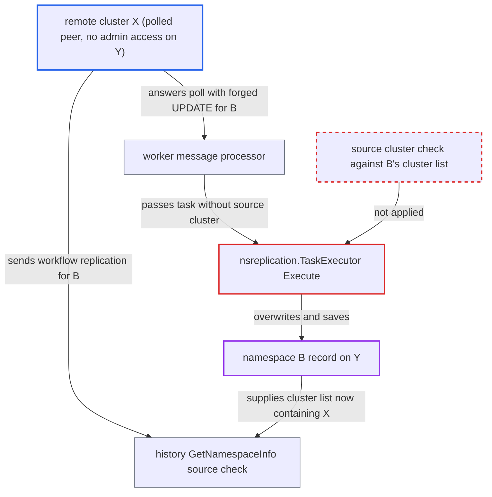

# Namespace replication applies a peer's update to namespaces the peer is not a member of

| Field | Value |
|---|---|
| ID | `find_01My68Rknuhqk2KhSA9jhaa4` |
| Severity | **Medium** |
| Status | open |
| CWE | CWE-346 — Origin validation error |
| Created | 2026-10-27T21:34:14.898325Z |
| Claude Security | https://claude.ai/security/findings/find_01My68Rknuhqk2KhSA9jhaa4 |

## Description

A remote cluster that Y polls can rewrite the replication settings of a global namespace it does not belong to. It can change which clusters are members, which cluster is active, and the retention, archival and state settings. It needs to know the namespace's name and ID, and it must be a peer that Y's worker polls but that holds no admin access on Y. The cause is that `nsreplication.TaskExecutor` applies namespace UPDATE tasks without checking which cluster sent them.

1. **the replicator in `replicator.go`** starts a message processor for every enabled remote cluster. This happens whatever namespaces that cluster shares with Y, so a peer that has nothing to do with namespace B is still polled. ([`service/worker/replicator/replicator.go:150-172`](https://github.com/cx-benchmark/temporal/blob/bf81a4c20009db89dc952592c9cfe770bafe66ee/service/worker/replicator/replicator.go#L150-L172))
2. **the message processor** polls `GetNamespaceReplicationMessages` on the peer X and loops over every task returned. The whole response comes from X, and `p.sourceCluster` is used only for metrics and logs. ([`service/worker/replicator/replication_message_processor.go:172-192`](https://github.com/cx-benchmark/temporal/blob/bf81a4c20009db89dc952592c9cfe770bafe66ee/service/worker/replicator/replication_message_processor.go#L172-L192))
3. **cluster X** answers with an UPDATE task for the unrelated global namespace B. The task carries B's name and ID, `Clusters=[Y,X]`, `ActiveClusterName=X`, and config and failover versions higher than B's current ones.
4. **`handleReplicationTask`** calls `namespaceTaskExecutor.Execute(ctx, attr)` without the source cluster. `Execute` has no source-cluster parameter, so later code cannot know that X sent the task. ([`service/worker/replicator/replication_message_processor.go:338-350`](https://github.com/cx-benchmark/temporal/blob/bf81a4c20009db89dc952592c9cfe770bafe66ee/service/worker/replicator/replication_message_processor.go#L338-L350))
5. **`shouldProcessTask`** admits the UPDATE for the existing global namespace. It checks only that the name resolves to the task's ID. It never compares the sender with B's current `ReplicationConfig.Clusters`. ([`common/namespace/nsreplication/replication_task_executor.go:163-195`](https://github.com/cx-benchmark/temporal/blob/bf81a4c20009db89dc952592c9cfe770bafe66ee/common/namespace/nsreplication/replication_task_executor.go#L163-L195))
6. **`handleNamespaceUpdateReplicationTask`** overwrites B's record with X's values and saves it. With a higher `ConfigVersion` it replaces `Info`, `Config`, `BadBinaries` and `ReplicationConfig.Clusters`. With a higher `FailoverVersion` it replaces `ActiveClusterName`, `State`, `FailoverVersion` and `FailoverHistory`. It then saves the result with `metadataManager.UpdateNamespace`. ([`common/namespace/nsreplication/replication_task_executor.go:368-424`](https://github.com/cx-benchmark/temporal/blob/bf81a4c20009db89dc952592c9cfe770bafe66ee/common/namespace/nsreplication/replication_task_executor.go#L368-L424))
7. **the history check in `GetNamespaceInfo`** accepts X's workflow replication tasks for B. The check trusts `ClusterNames()`, which returns the saved cluster list, and X has now written itself into that list. ([`service/history/replication/executable_task.go:881-893`](https://github.com/cx-benchmark/temporal/blob/bf81a4c20009db89dc952592c9cfe770bafe66ee/service/history/replication/executable_task.go#L881-L893))
8. **the active-namespace API on Y** rejects B's requests with NamespaceNotActive. B is now passive on Y because `ActiveClusterName` is X, so B's tenants cannot write on Y. ([`service/history/api/namespace.go:21-30`](https://github.com/cx-benchmark/temporal/blob/bf81a4c20009db89dc952592c9cfe770bafe66ee/service/history/api/namespace.go#L21-L30))

## Assessment

The attacker runs a remote cluster X that Y's operator registered and enabled, and that Y's worker polls every second. X holds no admin credential on Y. It knows the name and ID of a global namespace B, for example because X was once a member of B. Examples where this gain is real are one-way replication, a peer whose Y credentials were revoked, or a peer that an authorizer limits to replication RPCs. No victim action is needed. The same executor is also reached from `EagerNamespaceRefresher` and from namespace DLQ merge. Y's own namespace feed in `admin_handler.go` lists every global namespace, but only for callers with AdminService access on Y. Under the default authorizer that access is system admin, which already gives up B.

Impact: X can set B's cluster list, active cluster, failover version, retention, archival settings, bad binaries and state on Y. After that, X can create or overwrite B's workflows on Y through workflow replication. B becomes passive on Y, so its tenants' writes fail with NamespaceNotActive. A DEPRECATED state or a very small retention makes this worse. The report establishes no data-reading gain, because reading B's history back needs X to open a stream to Y, and that needs AdminService access on Y.

## Recommendation

(1) `nsreplication.TaskExecutor` applies namespace UPDATE tasks for an existing global namespace without knowing or checking which cluster produced them. A peer outside the namespace's cluster list can therefore rewrite its replication config and metadata.

Fix criteria: Every caller passes the source cluster. The callers are the worker message processor, the history `EagerNamespaceRefresher` and namespace DLQ merge. For an existing namespace, a task from a cluster that is not in the namespace's current local `ReplicationConfig.Clusters` is skipped and logged. An UPDATE for B returned by a polled peer that is absent from B's list leaves B's record unchanged. Updates from member clusters still apply.

(2) Replicated cluster lists and active cluster names are saved without the cluster-metadata validation that `UpdateNamespace` applies.

Fix criteria: A replicated task is rejected before `CreateNamespace` or `UpdateNamespace` if it names an unknown or disabled cluster, or if its active cluster is outside its own cluster list. A test with a task whose `ActiveClusterName` is not in `Clusters` confirms the rejection.

## Evidence

**https://github.com/cx-benchmark/temporal**

- [`common/namespace/nsreplication/replication_task_executor.go:163-195`](https://github.com/cx-benchmark/temporal/blob/bf81a4c20009db89dc952592c9cfe770bafe66ee/common/namespace/nsreplication/replication_task_executor.go#L163-L195)
- [`common/namespace/nsreplication/replication_task_executor.go:368-424`](https://github.com/cx-benchmark/temporal/blob/bf81a4c20009db89dc952592c9cfe770bafe66ee/common/namespace/nsreplication/replication_task_executor.go#L368-L424)
- [`service/worker/replicator/replication_message_processor.go:172-192`](https://github.com/cx-benchmark/temporal/blob/bf81a4c20009db89dc952592c9cfe770bafe66ee/service/worker/replicator/replication_message_processor.go#L172-L192)
- [`service/worker/replicator/replication_message_processor.go:338-350`](https://github.com/cx-benchmark/temporal/blob/bf81a4c20009db89dc952592c9cfe770bafe66ee/service/worker/replicator/replication_message_processor.go#L338-L350)
- [`service/worker/replicator/replicator.go:150-172`](https://github.com/cx-benchmark/temporal/blob/bf81a4c20009db89dc952592c9cfe770bafe66ee/service/worker/replicator/replicator.go#L150-L172)
- [`service/history/replication/executable_task.go:881-893`](https://github.com/cx-benchmark/temporal/blob/bf81a4c20009db89dc952592c9cfe770bafe66ee/service/history/replication/executable_task.go#L881-L893)
- [`common/namespace/replication_resolver.go:93-101`](https://github.com/cx-benchmark/temporal/blob/bf81a4c20009db89dc952592c9cfe770bafe66ee/common/namespace/replication_resolver.go#L93-L101)
- [`service/history/api/namespace.go:21-30`](https://github.com/cx-benchmark/temporal/blob/bf81a4c20009db89dc952592c9cfe770bafe66ee/service/history/api/namespace.go#L21-L30)
- [`common/namespace/nsreplication/replication_admitter.go:27-42`](https://github.com/cx-benchmark/temporal/blob/bf81a4c20009db89dc952592c9cfe770bafe66ee/common/namespace/nsreplication/replication_admitter.go#L27-L42)

