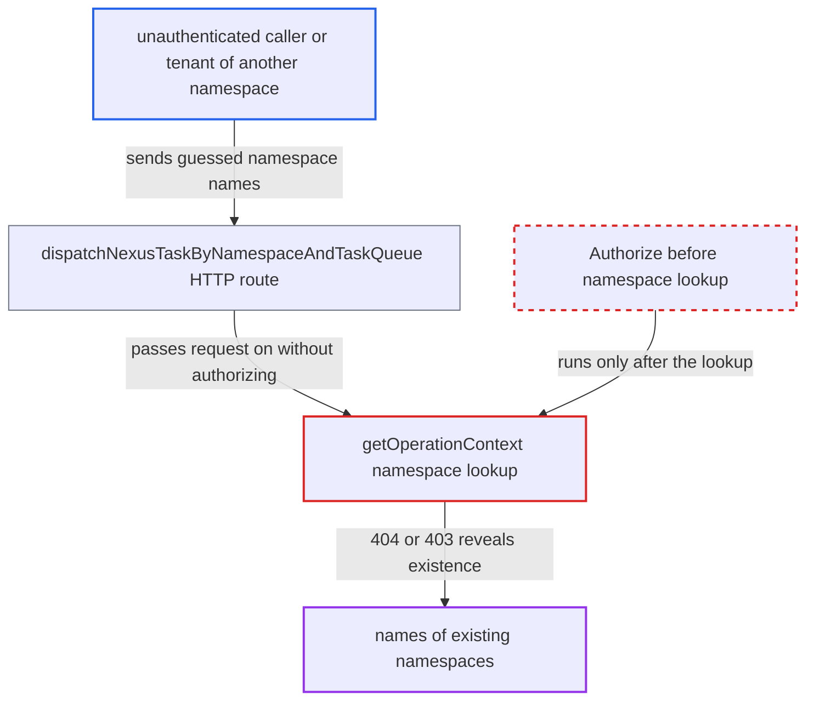

# Nexus by-namespace HTTP route reveals namespace existence before authorization

| Field | Value |
|---|---|
| ID | `find_016EFv3oBzQmrYMm9nUmKQMZ` |
| Severity | **Medium** |
| Status | open |
| CWE | CWE-204 — Observable response discrepancy |
| Created | 2026-10-27T21:36:06.245740Z |
| Claude Security | https://claude.ai/security/findings/find_016EFv3oBzQmrYMm9nUmKQMZ |

## Description

A caller with no credentials, or with a token for a different namespace, can find out which namespace names exist on the cluster. The Nexus by-namespace HTTP route answers 404 for an unknown name and 403 for a known one. This matters only where an enforcing authorizer is configured. The cause is that `getOperationContext` looks up the namespace and returns a name-specific not-found error before `interceptRequest` calls `Authorize`.

1. **attacker** sends a POST to the by-namespace Nexus route with a guessed namespace name. The request goes to `/namespaces/{namespace}/task-queues/{task_queue}/nexus-services/{service}/{operation}` with no credentials or with a token for another namespace. ([`service/frontend/nexus_operation_http_handler.go:157-198`](https://github.com/cx-benchmark/temporal/blob/bf81a4c20009db89dc952592c9cfe770bafe66ee/service/frontend/nexus_operation_http_handler.go#L157-L198))
2. **the parser `parseTLSAndAuthInfo`** lets the request continue without credentials. It sets claims only when auth info exists, so with no `Authorization` header and no client certificate it returns no error and `nc.claims` stays nil. ([`service/frontend/nexus_operation_http_handler.go:331-354`](https://github.com/cx-benchmark/temporal/blob/bf81a4c20009db89dc952592c9cfe770bafe66ee/service/frontend/nexus_operation_http_handler.go#L331-L354))
3. **the handler `StartOperation`** calls `getOperationContext` before any authorization. `CancelOperation` has the same order, and `interceptRequest` runs only later. ([`service/frontend/nexus_handler.go:429-431`](https://github.com/cx-benchmark/temporal/blob/bf81a4c20009db89dc952592c9cfe770bafe66ee/service/frontend/nexus_handler.go#L429-L431))
4. **the function `getOperationContext`** looks up the namespace and returns not-found for an unknown name. It returns `HandlerErrorTypeNotFound` with the message `namespace not found: "<name>"`, which the server maps to HTTP 404. ([`service/frontend/nexus_handler.go:406-414`](https://github.com/cx-benchmark/temporal/blob/bf81a4c20009db89dc952592c9cfe770bafe66ee/service/frontend/nexus_handler.go#L406-L414))
5. **the function `interceptRequest`** denies the caller only when the namespace exists. `Authorize` fails with `HandlerErrorTypeUnauthorized` `permission denied`, which the server maps to HTTP 403. ([`service/frontend/nexus_handler.go:173-191`](https://github.com/cx-benchmark/temporal/blob/bf81a4c20009db89dc952592c9cfe770bafe66ee/service/frontend/nexus_handler.go#L173-L191))
6. **attacker** reads the status code to learn whether the name exists. A 404 means the name is absent and a 403 means it exists, and the probe can be repeated freely. ([`common/nexus/nexusrpc/server.go:144-147`](https://github.com/cx-benchmark/temporal/blob/bf81a4c20009db89dc952592c9cfe770bafe66ee/common/nexus/nexusrpc/server.go#L144-L147))

## Assessment

The attacker is an unauthenticated network client, or a tenant of another namespace, and needs no victim. The cluster must use an enforcing authorizer such as the `default` one. The attacker sends `POST /namespaces/<guess>/task-queues/x/nexus-services/s/op` to the frontend HTTP port (7243 by default), with no credentials or with their own token. Under the default authorizer, a caller with nil claims, or with no role on that namespace, is denied. Where the authorizer setting is empty, which is the shipped template default, the noop authorizer allows everything and the discrepancy discloses nothing.

Impact: The attacker learns which namespace names (tenant identifiers) exist on the cluster. Callers without a role on a namespace otherwise have no sanctioned way to learn this. No namespace configuration, workflow data or payloads are exposed, and nothing is modified because the request is still denied. Unknown names also cause extra persistence reads before any authorization, but these are bounded per request.

## Recommendation

On the by-namespace Nexus route, `getOperationContext` resolves the namespace and returns a name-specific `NotFound` before `interceptRequest` calls `Authorize`. Namespace existence is therefore visible to callers who hold no credential, or no role, for that namespace.

Fix criteria: A caller the authorizer would deny gets the same status code, message and headers on this route whether or not the namespace exists. The namespace-specific not-found response is returned only after `Authorize` has allowed the caller for that namespace name. To verify, send anonymous requests, and requests with another namespace's token, for an existing and a non-existing namespace under the default authorizer. The responses must be indistinguishable.

## Evidence

**https://github.com/cx-benchmark/temporal**

- [`service/frontend/nexus_handler.go:406-414`](https://github.com/cx-benchmark/temporal/blob/bf81a4c20009db89dc952592c9cfe770bafe66ee/service/frontend/nexus_handler.go#L406-L414)
- [`service/frontend/nexus_handler.go:429-431`](https://github.com/cx-benchmark/temporal/blob/bf81a4c20009db89dc952592c9cfe770bafe66ee/service/frontend/nexus_handler.go#L429-L431)
- [`service/frontend/nexus_handler.go:173-191`](https://github.com/cx-benchmark/temporal/blob/bf81a4c20009db89dc952592c9cfe770bafe66ee/service/frontend/nexus_handler.go#L173-L191)
- [`service/frontend/nexus_operation_http_handler.go:157-198`](https://github.com/cx-benchmark/temporal/blob/bf81a4c20009db89dc952592c9cfe770bafe66ee/service/frontend/nexus_operation_http_handler.go#L157-L198)
- [`service/frontend/nexus_operation_http_handler.go:331-354`](https://github.com/cx-benchmark/temporal/blob/bf81a4c20009db89dc952592c9cfe770bafe66ee/service/frontend/nexus_operation_http_handler.go#L331-L354)
- [`common/nexus/nexusrpc/server.go:144-147`](https://github.com/cx-benchmark/temporal/blob/bf81a4c20009db89dc952592c9cfe770bafe66ee/common/nexus/nexusrpc/server.go#L144-L147)
- [`common/authorization/default_authorizer.go:35-43`](https://github.com/cx-benchmark/temporal/blob/bf81a4c20009db89dc952592c9cfe770bafe66ee/common/authorization/default_authorizer.go#L35-L43)
- [`service/frontend/fx.go:316-330`](https://github.com/cx-benchmark/temporal/blob/bf81a4c20009db89dc952592c9cfe770bafe66ee/service/frontend/fx.go#L316-L330)
- [`common/authorization/authorizer.go:64-68`](https://github.com/cx-benchmark/temporal/blob/bf81a4c20009db89dc952592c9cfe770bafe66ee/common/authorization/authorizer.go#L64-L68)

