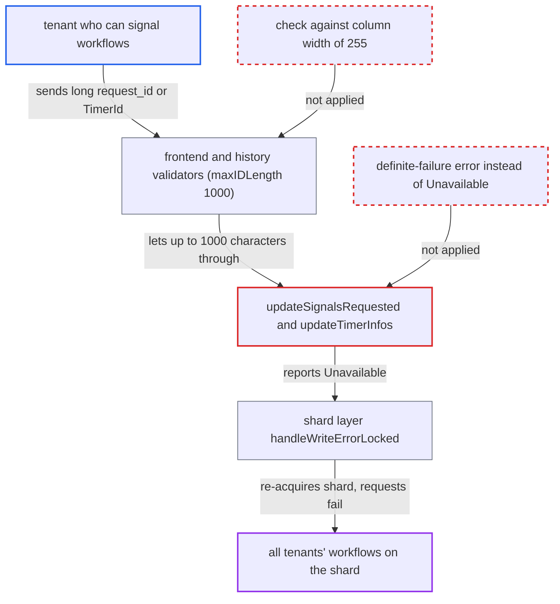

# Oversized signal request_id or timer_id fails SQL VARCHAR(255) write as Unavailable, forcing shard re-acquisition

| Field | Value |
|---|---|
| ID | `find_01PFVMihEqNKn4WS74BBmP2P` |
| Severity | **Medium** |
| Status | open |
| CWE | CWE-755 — Improper error handling |
| Created | 2026-10-27T21:51:29.813437Z |
| Claude Security | https://claude.ai/security/findings/find_01PFVMihEqNKn4WS74BBmP2P |

## Description

A tenant who can signal workflows in one namespace can degrade service for every tenant on the same history shard. This applies to clusters on MySQL 8 or PostgreSQL that run the shipped dynamic config. An oversized signal `request_id` or timer `TimerId` makes the database write fail. `updateSignalsRequested` and `updateTimerInfos` report that failure as `Unavailable`, which makes the shard re-acquire itself.

1. **the attacker (a tenant)** starts a workflow on each target shard. The shard is chosen by `hash(namespaceID, workflowID)`, so the attacker needs a workflow on every shard they want to disrupt.
2. **the attacker** sends `SignalWorkflowExecution` with a `request_id` of 256 to 1000 bytes, or completes a workflow task with a `StartTimer` `TimerId` of that length. The frontend and history validators check these values only against `limit.maxIDLength`, which defaults to 1000, so the value is accepted. ([`service/frontend/workflow_handler.go:2359-2361`](https://github.com/cx-benchmark/temporal/blob/bf81a4c20009db89dc952592c9cfe770bafe66ee/service/frontend/workflow_handler.go#L2359-L2361))
3. **the history service** puts the value into `UpsertSignalRequestedIDs` or `UpsertTimerInfos`. A signal `request_id` is persisted this way while `history.enableCHASMSignalBacklinks` stays at its default `false`. A `TimerId` becomes the key of the timer info map. ([`service/history/workflow/mutable_state_impl.go:2558-2576`](https://github.com/cx-benchmark/temporal/blob/bf81a4c20009db89dc952592c9cfe770bafe66ee/service/history/workflow/mutable_state_impl.go#L2558-L2576))
4. **the database** rejects the write because the key column is `VARCHAR(255)`. MySQL 8 raises error 1406 under its default `STRICT_TRANS_TABLES`, because the DSN sets no `sql_mode`. PostgreSQL raises SQLSTATE 22001. ([`schema/mysql/v8/temporal/schema.sql:239-294`](https://github.com/cx-benchmark/temporal/blob/bf81a4c20009db89dc952592c9cfe770bafe66ee/schema/mysql/v8/temporal/schema.sql#L239-L294))
5. **the functions `updateSignalsRequested` and `updateTimerInfos`** turn the driver error into `serviceerror.Unavailable`. `applyWorkflowMutationTx` wraps it again and `txExecute` returns it unchanged after rollback, so a request-caused failure looks like an outage with an unknown outcome. ([`common/persistence/sql/execution_state_non_map.go:15-54`](https://github.com/cx-benchmark/temporal/blob/bf81a4c20009db89dc952592c9cfe770bafe66ee/common/persistence/sql/execution_state_non_map.go#L15-L54))
6. **the shard layer (`handleWriteErrorLocked`)** moves the shard to `Acquiring` and renews its range. `Unavailable` is not a 'definitely not committed' error type, so the shard drains in-flight requests and bumps `RangeId` with `UpdateShard`. ([`service/history/shard/context_impl.go:1503-1553`](https://github.com/cx-benchmark/temporal/blob/bf81a4c20009db89dc952592c9cfe770bafe66ee/service/history/shard/context_impl.go#L1503-L1553))
7. **the shard (`errorByState`)** answers every namespace's requests with `ErrShardStatusUnknown` until re-acquisition finishes. The persistence retry layer and the frontend's history client retry `Unavailable`, so the doomed write is repeated and triggers another re-acquisition. ([`service/history/shard/context_impl.go:1132-1146`](https://github.com/cx-benchmark/temporal/blob/bf81a4c20009db89dc952592c9cfe770bafe66ee/service/history/shard/context_impl.go#L1132-L1146))

## Assessment

The attacker is a tenant allowed to signal workflows in one namespace. The cluster must use MySQL 8 or PostgreSQL with the shipped dynamic config. That config, `config/dynamicconfig/docker.yaml`, is empty, so `limit.maxIDLength` stays at 1000. Only the developer file `development-sql.yaml` lowers it to 255. There are two ways in. One is a `request_id` of 256 to 1000 bytes on `SignalWorkflowExecution` or `SignalWithStartWorkflowExecution`. The other is a `StartTimer` `TimerId` of the same length, sent by completing a workflow task. The attacker must have a workflow on each shard they want to hit, and a cheap request loop keeps the shard cycling. No victim action is needed. SQLite does not enforce the VARCHAR width and is not affected.

Impact: The attacker can keep history shards cycling through re-acquisition. While a shard is re-acquiring, every tenant's workflow operations on it fail with `ErrShardStatusUnknown`. The template default is 4 shards. No data is disclosed or corrupted, because the write is rolled back and the stale history nodes are ignored on read.

## Recommendation

(1) `updateSignalsRequested` and `updateTimerInfos`, and their callers in `applyWorkflowMutationTx` and `applyWorkflowSnapshotTx*`, turn request-caused constraint violations (MySQL 1406, PostgreSQL 22001) into `serviceerror.Unavailable`. The shard layer treats that as an unknown-outcome write and re-acquires the shard for all tenants.

Fix criteria: A width or constraint violation raised while writing request-supplied keys to `signals_requested_sets` or `timer_info_maps` reaches the shard as a definite failure. `handleWriteErrorLocked` lists that failure as 'not committed', and `IsPersistenceTransientError` does not retry it. A 1406 or 22001 error from `ReplaceIntoSignalsRequestedSets` or `ReplaceIntoTimerInfoMaps` leaves the shard `Acquired` with an unchanged `RangeId`.

(2) Signal request IDs and timer IDs are validated against `limit.maxIDLength` (default 1000, unchanged by the shipped `docker.yaml`). The SQL schemas store them in `VARCHAR(255)` key columns, so the frontend and history accept values the store cannot persist.

Fix criteria: On SQL-backed clusters under the shipped configuration, a signal `request_id` or `StartTimer` `TimerId` longer than the column width is rejected with InvalidArgument (or a failed workflow task) before any persistence write. A 300-byte signal `request_id` and a 300-byte `TimerId` are both rejected, and the shard's `range_id` does not change.

## Evidence

**https://github.com/cx-benchmark/temporal**

- [`common/persistence/sql/execution_state_non_map.go:15-54`](https://github.com/cx-benchmark/temporal/blob/bf81a4c20009db89dc952592c9cfe770bafe66ee/common/persistence/sql/execution_state_non_map.go#L15-L54)
- [`common/persistence/sql/execution_state_map.go:107-148`](https://github.com/cx-benchmark/temporal/blob/bf81a4c20009db89dc952592c9cfe770bafe66ee/common/persistence/sql/execution_state_map.go#L107-L148)
- [`common/persistence/sql/execution_util.go:85-142`](https://github.com/cx-benchmark/temporal/blob/bf81a4c20009db89dc952592c9cfe770bafe66ee/common/persistence/sql/execution_util.go#L85-L142)
- [`common/persistence/sql/common.go:53-82`](https://github.com/cx-benchmark/temporal/blob/bf81a4c20009db89dc952592c9cfe770bafe66ee/common/persistence/sql/common.go#L53-L82)
- [`schema/mysql/v8/temporal/schema.sql:239-294`](https://github.com/cx-benchmark/temporal/blob/bf81a4c20009db89dc952592c9cfe770bafe66ee/schema/mysql/v8/temporal/schema.sql#L239-L294)
- [`schema/postgresql/v12/temporal/schema.sql:239-294`](https://github.com/cx-benchmark/temporal/blob/bf81a4c20009db89dc952592c9cfe770bafe66ee/schema/postgresql/v12/temporal/schema.sql#L239-L294)
- [`schema/mysql/v8/temporal/versioned/v1.8/manifest.json:1-9`](https://github.com/cx-benchmark/temporal/blob/bf81a4c20009db89dc952592c9cfe770bafe66ee/schema/mysql/v8/temporal/versioned/v1.8/manifest.json#L1-L9)
- [`common/dynamicconfig/constants.go:551-556`](https://github.com/cx-benchmark/temporal/blob/bf81a4c20009db89dc952592c9cfe770bafe66ee/common/dynamicconfig/constants.go#L551-L556)
- [`common/config/config_template_embedded.yaml:392-393`](https://github.com/cx-benchmark/temporal/blob/bf81a4c20009db89dc952592c9cfe770bafe66ee/common/config/config_template_embedded.yaml#L392-L393)
- [`service/frontend/workflow_handler.go:2359-2361`](https://github.com/cx-benchmark/temporal/blob/bf81a4c20009db89dc952592c9cfe770bafe66ee/service/frontend/workflow_handler.go#L2359-L2361)
- [`service/history/api/signalworkflow/api.go:97-99`](https://github.com/cx-benchmark/temporal/blob/bf81a4c20009db89dc952592c9cfe770bafe66ee/service/history/api/signalworkflow/api.go#L97-L99)
- [`service/history/workflow/mutable_state_impl.go:2558-2576`](https://github.com/cx-benchmark/temporal/blob/bf81a4c20009db89dc952592c9cfe770bafe66ee/service/history/workflow/mutable_state_impl.go#L2558-L2576)
- [`service/history/api/command_attr_validator.go:141-162`](https://github.com/cx-benchmark/temporal/blob/bf81a4c20009db89dc952592c9cfe770bafe66ee/service/history/api/command_attr_validator.go#L141-L162)
- [`service/history/shard/context_impl.go:1503-1553`](https://github.com/cx-benchmark/temporal/blob/bf81a4c20009db89dc952592c9cfe770bafe66ee/service/history/shard/context_impl.go#L1503-L1553)
- [`service/history/shard/context_impl.go:1132-1146`](https://github.com/cx-benchmark/temporal/blob/bf81a4c20009db89dc952592c9cfe770bafe66ee/service/history/shard/context_impl.go#L1132-L1146)
- [`service/history/shard/context_impl.go:650-658`](https://github.com/cx-benchmark/temporal/blob/bf81a4c20009db89dc952592c9cfe770bafe66ee/service/history/shard/context_impl.go#L650-L658)
- [`common/persistence/client/factory.go:270-278`](https://github.com/cx-benchmark/temporal/blob/bf81a4c20009db89dc952592c9cfe770bafe66ee/common/persistence/client/factory.go#L270-L278)

