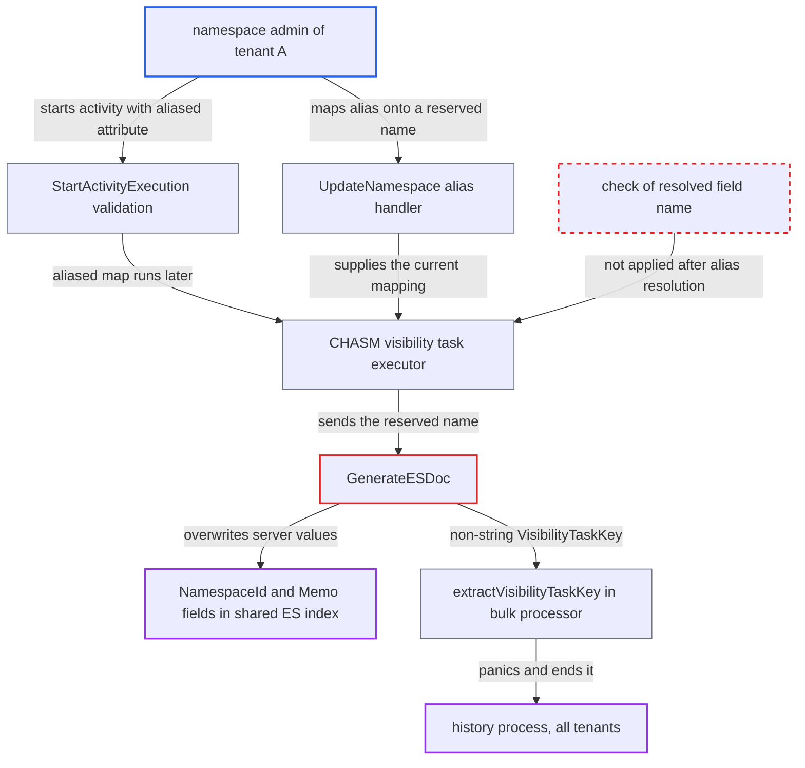

# Remapped CHASM search-attribute alias overwrites reserved Elasticsearch fields (NamespaceId, VisibilityTaskKey)

| Field | Value |
|---|---|
| ID | `find_011eX3Y22fnT34jmW8QupF5D` |
| Severity | **Medium** |
| Status | open |
| CWE | CWE-915 — Mass assignment |
| Created | 2026-10-27T21:18:47.657199Z |
| Claude Security | https://claude.ai/security/findings/find_011eX3Y22fnT34jmW8QupF5D |

## Description

A namespace admin on a cluster using Elasticsearch visibility can overwrite server-owned fields in a visibility document. This can move a record into another namespace's visibility, break that namespace's list pages, or crash the history hosts for every tenant. The cause is `GenerateESDoc`, which copies search attributes over reserved fields such as `NamespaceId` and `VisibilityTaskKey`, and an alias can be remapped to those names after validation.

1. **namespace admin** maps an alias `X` to a valid field through `UpdateNamespace`. The handler accepts any field key and checks only that alias and field are unique, so the admin can pick a real field such as the predefined Bool `TemporalSchedulePaused`. ([`service/frontend/namespace_handler.go:1247-1268`](https://github.com/cx-benchmark/temporal/blob/bf81a4c20009db89dc952592c9cfe770bafe66ee/service/frontend/namespace_handler.go#L1247-L1268))
2. **namespace admin** calls `StartActivityExecution` with `X=true`. Validation runs on an unaliased copy of the search attributes, so the request passes, but the original aliased map is what gets stored. ([`chasm/lib/activity/validator.go:314-335`](https://github.com/cx-benchmark/temporal/blob/bf81a4c20009db89dc952592c9cfe770bafe66ee/chasm/lib/activity/validator.go#L314-L335))
3. **`NewStandaloneActivity`** stores the aliased search attributes in the CHASM visibility component. `NewVisibilityWithData` checks only `sadefs.IsReserved` on the alias, so nothing re-checks the field the alias points to. ([`chasm/lib/activity/activity.go:165-168`](https://github.com/cx-benchmark/temporal/blob/bf81a4c20009db89dc952592c9cfe770bafe66ee/chasm/lib/activity/activity.go#L165-L168))
4. **namespace admin** deletes the mapping and maps `VisibilityTaskKey`, `NamespaceId` or `Memo` to `X`. This is the same `UpdateNamespace` call as before, and it accepts reserved names as field keys. ([`service/frontend/namespace_handler.go:1247-1268`](https://github.com/cx-benchmark/temporal/blob/bf81a4c20009db89dc952592c9cfe770bafe66ee/service/frontend/namespace_handler.go#L1247-L1268))
5. **namespace admin** terminates the activity, which triggers the CHASM visibility task. The task resolves `X` with the namespace's current mapping and passes the reserved field name on without validating it. ([`service/history/visibility_queue_task_executor.go:417-426`](https://github.com/cx-benchmark/temporal/blob/bf81a4c20009db89dc952592c9cfe770bafe66ee/service/history/visibility_queue_task_executor.go#L417-L426))
6. **visibility manager and `Decode`** let the reserved name through and decode its value with the payload's own type. The manager drops only `sadefs.IsSystem` names, and `Decode` accepts names missing from the type map, so the attacker chooses both the key and the Go type of the value. ([`common/persistence/visibility/visibility_manager_impl.go:513-520`](https://github.com/cx-benchmark/temporal/blob/bf81a4c20009db89dc952592c9cfe770bafe66ee/common/persistence/visibility/visibility_manager_impl.go#L513-L520))
7. **`GenerateESDoc`** writes the attacker's value over the server-set field with `doc[saName] = saValue`. This happens after the reserved fields were set, so `NamespaceId`, `Memo`, `MemoEncoding` or `VisibilityTaskKey` gets the attacker's value. ([`common/persistence/visibility/store/elasticsearch/visibility_store.go:979-985`](https://github.com/cx-benchmark/temporal/blob/bf81a4c20009db89dc952592c9cfe770bafe66ee/common/persistence/visibility/store/elasticsearch/visibility_store.go#L979-L985))
8. **bulk processor `extractVisibilityTaskKey`** panics on a non-string `VisibilityTaskKey`. It does an unchecked `k.(string)` inside the bulk `Before` callback, which is passed to olivere unwrapped, so the panic ends the history process. ([`common/persistence/visibility/store/elasticsearch/processor.go:315-321`](https://github.com/cx-benchmark/temporal/blob/bf81a4c20009db89dc952592c9cfe770bafe66ee/common/persistence/visibility/store/elasticsearch/processor.go#L315-L321))

## Assessment

The attacker is an admin of one namespace (`UpdateNamespace` needs namespace-level admin access). The cluster must use Elasticsearch visibility, which is compiled into the default build (build tag `!temporal_minimal`) and can be selected through `ENABLE_ES` in the shipped config template. The attacker needs a standalone activity and the ability to change the alias mapping between starting and terminating it. The report names CHASM executions as affected: standalone activities, Nexus operations and V2 schedules. The steps show the standalone activity route.

Impact: The attacker can move their own record into another namespace's slice of the shared index, so it shows in that namespace's List, Count and UI. A non-string `Memo` makes every list page containing the record fail for the victim namespace. A non-string `VisibilityTaskKey` crashes the history process, and the un-acked task re-runs on whichever host takes the shard, so history hosts crash-loop for all tenants. Existing victim records cannot be altered, because the document id uses a server-generated run id. Confidentiality is not affected.

## Recommendation

(1) `GenerateESDoc` lets a search attribute named like a reserved or system document field (`NamespaceId`, `VisibilityTaskKey`, `Memo`, `MemoEncoding`, `WorkflowId`, ...) replace the server-controlled value. The manager's write filter drops only `sadefs.IsSystem` names.

Fix criteria: Reserved and system field names are never taken from `request.SearchAttributes` when the ES document is built, and the manager's write filter drops `sadefs.IsReserved` names as well as `IsSystem`. Indexing a request whose search attributes contain `NamespaceId` or `VisibilityTaskKey` keys leaves the stored document with the request's namespace ID and task key, and the extra keys are dropped or rejected.

(2) CHASM visibility tasks resolve stored aliases with the namespace's current mapping and index the result without checking the resolved field name against the search attribute type map.

Fix criteria: After alias resolution in the visibility task executor, a field name that is not a defined custom or predefined search attribute is dropped, or the task fails, before the request reaches the store. Remapping an alias to `NamespaceId` after an activity start leaves the indexed document unchanged.

(3) `UpdateNamespace` accepts `CustomSearchAttributeAliases` whose field key is not a registered custom search attribute, so an alias can be mapped onto reserved or system field names.

Fix criteria: The namespace handler rejects alias mappings whose field key is reserved, is a system name, or is not in the cluster's custom search attribute definitions. `UpdateNamespace` with `{"NamespaceId": "X"}` returns InvalidArgument.

(4) `extractVisibilityTaskKey` in the bulk processor does an unchecked type assertion on the `VisibilityTaskKey` read back from the document, so a non-string value panics on the bulk worker goroutine.

Fix criteria: The bulk processor tolerates a non-string `VisibilityTaskKey` by logging it and NACKing instead of panicking. A bulk request whose body carries a numeric `VisibilityTaskKey` does not terminate the process.

## Evidence

**https://github.com/cx-benchmark/temporal**

- [`common/persistence/visibility/store/elasticsearch/visibility_store.go:979-985`](https://github.com/cx-benchmark/temporal/blob/bf81a4c20009db89dc952592c9cfe770bafe66ee/common/persistence/visibility/store/elasticsearch/visibility_store.go#L979-L985)
- [`service/history/visibility_queue_task_executor.go:417-426`](https://github.com/cx-benchmark/temporal/blob/bf81a4c20009db89dc952592c9cfe770bafe66ee/service/history/visibility_queue_task_executor.go#L417-L426)
- [`service/frontend/namespace_handler.go:1247-1268`](https://github.com/cx-benchmark/temporal/blob/bf81a4c20009db89dc952592c9cfe770bafe66ee/service/frontend/namespace_handler.go#L1247-L1268)
- [`chasm/lib/activity/validator.go:314-335`](https://github.com/cx-benchmark/temporal/blob/bf81a4c20009db89dc952592c9cfe770bafe66ee/chasm/lib/activity/validator.go#L314-L335)
- [`chasm/lib/activity/activity.go:165-168`](https://github.com/cx-benchmark/temporal/blob/bf81a4c20009db89dc952592c9cfe770bafe66ee/chasm/lib/activity/activity.go#L165-L168)
- [`common/persistence/visibility/visibility_manager_impl.go:513-520`](https://github.com/cx-benchmark/temporal/blob/bf81a4c20009db89dc952592c9cfe770bafe66ee/common/persistence/visibility/visibility_manager_impl.go#L513-L520)
- [`common/searchattribute/encode.go:71-95`](https://github.com/cx-benchmark/temporal/blob/bf81a4c20009db89dc952592c9cfe770bafe66ee/common/searchattribute/encode.go#L71-L95)
- [`common/persistence/visibility/store/elasticsearch/processor.go:315-321`](https://github.com/cx-benchmark/temporal/blob/bf81a4c20009db89dc952592c9cfe770bafe66ee/common/persistence/visibility/store/elasticsearch/processor.go#L315-L321)
- [`common/persistence/visibility/store/elasticsearch/client/client_v7.go:236-247`](https://github.com/cx-benchmark/temporal/blob/bf81a4c20009db89dc952592c9cfe770bafe66ee/common/persistence/visibility/store/elasticsearch/client/client_v7.go#L236-L247)
- [`common/persistence/visibility/store/elasticsearch/visibility_store.go:1049-1053`](https://github.com/cx-benchmark/temporal/blob/bf81a4c20009db89dc952592c9cfe770bafe66ee/common/persistence/visibility/store/elasticsearch/visibility_store.go#L1049-L1053)

