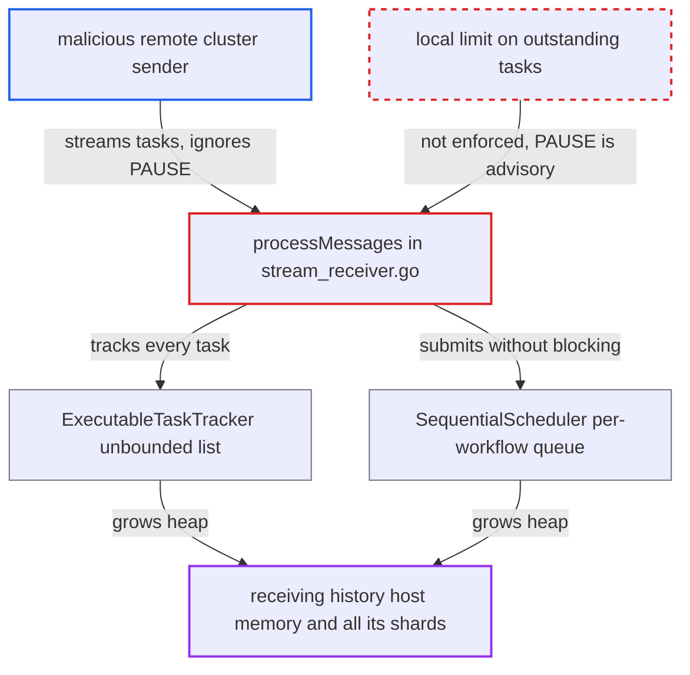

# Replication stream receiver enforces no local bound on outstanding tasks from a remote sender

| Field | Value |
|---|---|
| ID | `find_01Gf6XQzTTijiDDB1Jjo6PLm` |
| Severity | **Medium** |
| Status | open |
| CWE | CWE-770 — Allocation of Resources Without Limits |
| Created | 2026-10-27T21:17:46.937326Z |
| Claude Security | https://claude.ai/security/findings/find_01Gf6XQzTTijiDDB1Jjo6PLm |

## Description

A malicious or compromised remote cluster that this cluster receives replication from can exhaust the memory of the receiving history host. The host is then killed, which stops every shard on it, including namespaces not replicated with the attacker. The cause is that `processMessages` tracks and queues every incoming task with no local limit, and the only limit is a `PAUSE` request that the sender can ignore.

1. **remote cluster sender** opens a replication stream and sends tasks for one workflow key. The tasks have UNSPECIFIED or HIGH priority and increasing IDs, for a namespace shared with the victim cluster. That first-message priority also makes the receiver use single-stack mode, the default, in which no flow-control command is sent. ([`service/history/replication/stream_receiver.go:273-351`](https://github.com/cx-benchmark/temporal/blob/bf81a4c20009db89dc952592c9cfe770bafe66ee/service/history/replication/stream_receiver.go#L273-L351))
2. **remote cluster sender** makes the first task for that workflow key stall. It fails the `SyncNamespaceFromSourceCluster` or resend calls the task makes back to it. The task then gets a retryable error and is retried with backoff for up to 80 attempts or 10 minutes, while tasks of one workflow key run strictly one at a time. ([`service/history/replication/executable_task.go:876-903`](https://github.com/cx-benchmark/temporal/blob/bf81a4c20009db89dc952592c9cfe770bafe66ee/service/history/replication/executable_task.go#L876-L903))
3. **receiver `processMessages`** reads every batch and tracks and submits each task. It keeps the sender-supplied task proto and event blobs. It never checks how many tasks are outstanding and never drops tasks or closes the stream. ([`service/history/replication/stream_receiver.go:392-497`](https://github.com/cx-benchmark/temporal/blob/bf81a4c20009db89dc952592c9cfe770bafe66ee/service/history/replication/stream_receiver.go#L392-L497))
4. **`ExecutableTaskTracker`** appends each task to an unbounded list. Entries leave the list only when a task is acked or nacked, and the stalled task never completes. ([`service/history/replication/executable_task_tracker.go:67-109`](https://github.com/cx-benchmark/temporal/blob/bf81a4c20009db89dc952592c9cfe770bafe66ee/service/history/replication/executable_task_tracker.go#L67-L109))
5. **`SequentialScheduler.Submit`** appends tasks to the existing per-workflow queue without blocking. Only creating a new queue blocks, so tasks for the same key meet no backpressure. The HIGH scheduler's 1000-slot channel is drained straight into this call, so it does not slow the receiver either. ([`common/tasks/sequential_scheduler.go:107-141`](https://github.com/cx-benchmark/temporal/blob/bf81a4c20009db89dc952592c9cfe770bafe66ee/common/tasks/sequential_scheduler.go#L107-L141))
6. **remote cluster sender** keeps streaming large tasks and ignores `PAUSE`. The flow controller turns `history.ReplicationReceiverMaxOutstandingTaskCount` (default 500) into a `PAUSE` command, but this is only a request to the sender and the receiver does not enforce it. `ReplicationStreamMaxLifetime` defaults to 0, so the stream is never recycled. ([`service/history/replication/stream_receiver_flow_controller.go:43-66`](https://github.com/cx-benchmark/temporal/blob/bf81a4c20009db89dc952592c9cfe770bafe66ee/service/history/replication/stream_receiver_flow_controller.go#L43-L66))
7. **history host** runs out of memory and is OOM-killed. Memory per stream is bounded only by what the sender does, and the kill takes down every shard on the host. ([`common/dynamicconfig/constants.go:3224-3232`](https://github.com/cx-benchmark/temporal/blob/bf81a4c20009db89dc952592c9cfe770bafe66ee/common/dynamicconfig/constants.go#L3224-L3232))

## Assessment

The attacker is a malicious or compromised remote cluster that this cluster streams replication from. It needs no user interaction, but it must be a cluster the victim already accepts replication from, on a network the report treats as trusted. It sends tasks for one workflow key of a namespace shared with the victim, stalls the first one, and keeps streaming large tasks. The attack works in single-stack mode, which is the default because `EnableReplicationTaskTieredProcessing` is false and the sender picks the mode by the priority of its first message. In tiered mode the receiver does send `PAUSE`, but a sender that ignores it or never receives it still gets the same result.

Impact: The receiving history host runs out of memory and is OOM-killed. Every shard on that host stops processing workflows, including namespaces not replicated with the attacker's cluster, until the shards move. The attack can repeat on the next host the shard lands on. The report states no data disclosure or modification.

## Recommendation

The receiver has no enforced local bound on outstanding replication tasks or bytes per stream. The outstanding-task limit is only a `PAUSE` request to the sender, and in single-stack mode it is not sent at all. The per-workflow sequential queue also accepts tasks without limit.

Fix criteria: Memory held per replication stream is bounded whatever the sender does. Once the outstanding task count (and ideally bytes) passes the configured limit, the receiver stops reading from the stream so gRPC flow control pushes back, or it closes the stream. A test shows that a sender that ignores `PAUSE` and streams tasks for a single stalled workflow key cannot grow the receiver's tracked task count beyond the limit, in both single-stack and tiered modes.

## Evidence

**https://github.com/cx-benchmark/temporal**

- [`service/history/replication/stream_receiver.go:392-497`](https://github.com/cx-benchmark/temporal/blob/bf81a4c20009db89dc952592c9cfe770bafe66ee/service/history/replication/stream_receiver.go#L392-L497)
- [`service/history/replication/stream_receiver.go:273-351`](https://github.com/cx-benchmark/temporal/blob/bf81a4c20009db89dc952592c9cfe770bafe66ee/service/history/replication/stream_receiver.go#L273-L351)
- [`service/history/replication/stream_receiver_flow_controller.go:43-66`](https://github.com/cx-benchmark/temporal/blob/bf81a4c20009db89dc952592c9cfe770bafe66ee/service/history/replication/stream_receiver_flow_controller.go#L43-L66)
- [`service/history/replication/executable_task_tracker.go:67-109`](https://github.com/cx-benchmark/temporal/blob/bf81a4c20009db89dc952592c9cfe770bafe66ee/service/history/replication/executable_task_tracker.go#L67-L109)
- [`common/tasks/sequential_scheduler.go:107-141`](https://github.com/cx-benchmark/temporal/blob/bf81a4c20009db89dc952592c9cfe770bafe66ee/common/tasks/sequential_scheduler.go#L107-L141)
- [`common/tasks/interleaved_weighted_round_robin.go:140-156`](https://github.com/cx-benchmark/temporal/blob/bf81a4c20009db89dc952592c9cfe770bafe66ee/common/tasks/interleaved_weighted_round_robin.go#L140-L156)
- [`service/history/replication/executable_task.go:263-278`](https://github.com/cx-benchmark/temporal/blob/bf81a4c20009db89dc952592c9cfe770bafe66ee/service/history/replication/executable_task.go#L263-L278)
- [`service/history/replication/executable_task.go:876-903`](https://github.com/cx-benchmark/temporal/blob/bf81a4c20009db89dc952592c9cfe770bafe66ee/service/history/replication/executable_task.go#L876-L903)
- [`common/dynamicconfig/constants.go:3224-3232`](https://github.com/cx-benchmark/temporal/blob/bf81a4c20009db89dc952592c9cfe770bafe66ee/common/dynamicconfig/constants.go#L3224-L3232)

