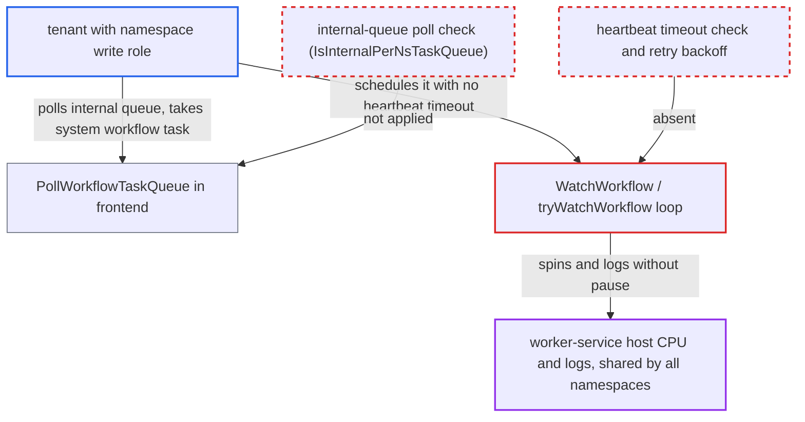

# Scheduler WatchWorkflow activity busy-loops when scheduled without heartbeat timeout

| Field | Value |
|---|---|
| ID | `find_01UHFXZE8Z6ZUxNQoPDZSGqZ` |
| Severity | **Medium** |
| Status | open |
| CWE | CWE-834 — Excessive iteration |
| Created | 2026-10-27T21:35:27.096533Z |
| Claude Security | https://claude.ai/security/findings/find_01UHFXZE8Z6ZUxNQoPDZSGqZ |

## Description

A tenant with the namespace write role can make the server's shared worker process spin at full CPU and flood its logs. This slows or stops system workflows for every namespace on that host. The attack works because `tryWatchWorkflow` and `WatchWorkflow` assume a 65s heartbeat timeout and retry instantly on a deadline error. The frontend also lets tenants poll the internal queue `temporal-sys-per-ns-tq`, so they can schedule the activity without that timeout.

1. **Tenant with namespace write role** opens many workflow task long polls on `temporal-sys-per-ns-tq` in its own namespace. `PollWorkflowTaskQueue` validates the queue name without the user-defined-queue check, so it accepts an internal per-namespace queue from an external caller. ([`service/frontend/workflow_handler.go:1145-1147`](https://github.com/cx-benchmark/temporal/blob/bf81a4c20009db89dc952592c9cfe770bafe66ee/service/frontend/workflow_handler.go#L1145-L1147))
2. **Tenant** calls `StartBatchOperation` or `CreateSchedule` to create a system workflow. This puts a workflow task on `temporal-sys-per-ns-tq` in the tenant's namespace, and matching can hand it to one of the tenant's pollers instead of the server worker's two pollers. ([`service/frontend/workflow_handler.go:6056-6082`](https://github.com/cx-benchmark/temporal/blob/bf81a4c20009db89dc952592c9cfe770bafe66ee/service/frontend/workflow_handler.go#L6056-L6082))
3. **Tenant's poller** answers the workflow task with `ScheduleActivityTask` commands naming `WatchWorkflow`. The commands use task queue `temporal-sys-per-ns-tq`, a long StartToClose, no heartbeat timeout and input `{LongPoll:true, Execution:{WorkflowId:"any"}}`, and history accepts them because the parent workflow runs on that queue and the heartbeat timeout is optional. ([`chasm/lib/activity/validator.go:66-68`](https://github.com/cx-benchmark/temporal/blob/bf81a4c20009db89dc952592c9cfe770bafe66ee/chasm/lib/activity/validator.go#L66-L68))
4. **Server's per-namespace worker** runs each `WatchWorkflow` activity. The scheduler registers `WatchWorkflow` on every namespace's system worker, and the worker allows up to 1000 concurrent activity executions. ([`service/worker/scheduler/fx.go:138-142`](https://github.com/cx-benchmark/temporal/blob/bf81a4c20009db89dc952592c9cfe770bafe66ee/service/worker/scheduler/fx.go#L138-L142))
5. **`tryWatchWorkflow`** creates a long-poll context that is already expired. The timeout is the heartbeat timeout minus 5 seconds, which is negative when no heartbeat timeout is set (or it is 5s or less), so `PollMutableState` fails at once with `context.DeadlineExceeded` and an unthrottled error line is logged. ([`service/worker/scheduler/activities.go:109-142`](https://github.com/cx-benchmark/temporal/blob/bf81a4c20009db89dc952592c9cfe770bafe66ee/service/worker/scheduler/activities.go#L109-L142))
6. **`WatchWorkflow`** retries immediately with `continue` on every deadline error. There is no sleep or backoff, and the retry wrapper returns the error without making the RPC, so the loop spins at full CPU and logs on each pass until the attacker's StartToClose deadline ends it. ([`service/worker/scheduler/activities.go:207-231`](https://github.com/cx-benchmark/temporal/blob/bf81a4c20009db89dc952592c9cfe770bafe66ee/service/worker/scheduler/activities.go#L207-L231))

## Assessment

The attacker is a tenant with the namespace write role. The report names this as the only access needed. It opens many `PollWorkflowTaskQueue` long polls on `temporal-sys-per-ns-tq` (up to 1200 per frontend instance under the `internal_per_ns` budget). Then it calls `StartBatchOperation` or `CreateSchedule`. `StartBatchOperation` is available by default because `EnableBatcherNamespace` defaults to true. `CreateSchedule` is an equivalent way to get the first task. Matching must give that first task to the tenant's poller instead of the server worker's two pollers. The tenant wins this race most of the time and can retry. `WorkerEnableScheduler` defaults to true, so `WatchWorkflow` is registered whether or not the tenant uses schedules. The analysis assumes `go.temporal.io/sdk v1.49.0` semantics. The sibling code `batcher.processWorkflowsWithProactiveFetching` has a similar flaw with a tiny `ActivityHeartbeatTimeout`, but it is bounded by the batch's duration and is only context.

Impact: The attacker can pin worker-service CPU and flood its logs. Each hijacked activity is a goroutine spinning without a pause and writing one error log line per iteration for as long as the chosen StartToClose allows. A few dozen are enough to saturate the host. That process serves the system workers of every namespace assigned to it, so the outage crosses tenant boundaries. No data is read or changed. The only cap is 1000 concurrent activity executions per worker.

## Recommendation

(1) `tryWatchWorkflow` and `WatchWorkflow` derive their pacing from the task's heartbeat timeout and retry a deadline error immediately. An activity task with no heartbeat timeout, or a tiny one, becomes an unbounded tight loop in the shared worker process.

Fix criteria: A `WatchWorkflow` activity scheduled with any heartbeat timeout value, including none, never iterates faster than a bounded minimum interval and does not log unthrottled on each iteration. For example, it rejects or fails non-retryably when the timeout cannot give a positive poll window, and it backs off on repeated `DeadlineExceeded`. Check by scheduling the activity with no heartbeat timeout and `LongPoll:true` and observing bounded CPU and log output.

(2) The frontend poll handlers admit external callers on internal per-namespace task queues. This lets a tenant receive system workflow tasks and write the crafted activity schedule.

Fix criteria: `PollWorkflowTaskQueue`, `PollActivityTaskQueue` and `PollNexusTaskQueue` refuse polls whose normal task queue name satisfies `primitives.IsInternalPerNsTaskQueue`, unless the caller is the server's internal principal. A tenant poll on `temporal-sys-per-ns-tq` is rejected, and the per-namespace worker still receives its tasks.

## Evidence

**https://github.com/cx-benchmark/temporal**

- [`service/worker/scheduler/activities.go:109-142`](https://github.com/cx-benchmark/temporal/blob/bf81a4c20009db89dc952592c9cfe770bafe66ee/service/worker/scheduler/activities.go#L109-L142)
- [`service/worker/scheduler/activities.go:207-231`](https://github.com/cx-benchmark/temporal/blob/bf81a4c20009db89dc952592c9cfe770bafe66ee/service/worker/scheduler/activities.go#L207-L231)
- [`common/backoff/retry.go:68-101`](https://github.com/cx-benchmark/temporal/blob/bf81a4c20009db89dc952592c9cfe770bafe66ee/common/backoff/retry.go#L68-L101)
- [`service/frontend/workflow_handler.go:1145-1147`](https://github.com/cx-benchmark/temporal/blob/bf81a4c20009db89dc952592c9cfe770bafe66ee/service/frontend/workflow_handler.go#L1145-L1147)
- [`chasm/lib/activity/validator.go:66-68`](https://github.com/cx-benchmark/temporal/blob/bf81a4c20009db89dc952592c9cfe770bafe66ee/chasm/lib/activity/validator.go#L66-L68)
- [`service/worker/scheduler/fx.go:138-142`](https://github.com/cx-benchmark/temporal/blob/bf81a4c20009db89dc952592c9cfe770bafe66ee/service/worker/scheduler/fx.go#L138-L142)
- [`service/worker/pernamespaceworker.go:482-502`](https://github.com/cx-benchmark/temporal/blob/bf81a4c20009db89dc952592c9cfe770bafe66ee/service/worker/pernamespaceworker.go#L482-L502)
- [`service/frontend/workflow_handler.go:6056-6082`](https://github.com/cx-benchmark/temporal/blob/bf81a4c20009db89dc952592c9cfe770bafe66ee/service/frontend/workflow_handler.go#L6056-L6082)

