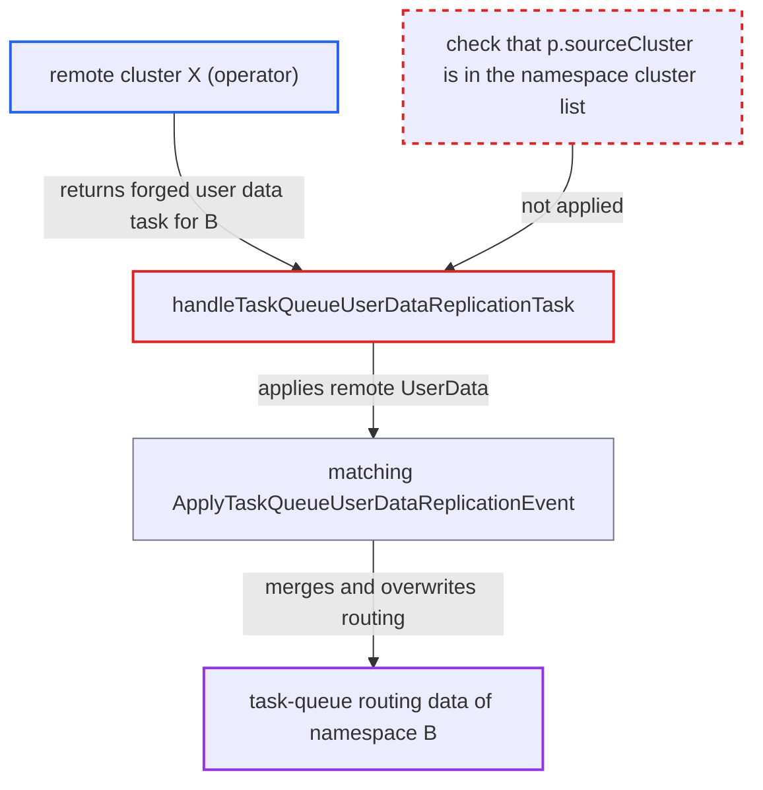

# Task queue user data replication accepted from a peer outside the namespace's cluster list

| Field | Value |
|---|---|
| ID | `find_01UWWQqmkLKWewS7DvCrsqM5` |
| Severity | **Medium** |
| Status | open |
| CWE | CWE-346 — Origin validation error |
| Created | 2026-10-27T21:34:14.956240Z |
| Claude Security | https://claude.ai/security/findings/find_01UWWQqmkLKWewS7DvCrsqM5 |

## Description

An operator of a remote cluster `X` that the local cluster `Y` polls can rewrite the task-queue routing of any global namespace `B` on `Y`, even when `X` is not in `B`'s cluster list. This can strand `B`'s workflow and activity tasks until an operator repairs the data. The attacker needs to know `B`'s namespace ID and task queue names. The cause is `handleTaskQueueUserDataReplicationTask`, which never compares `p.sourceCluster` with the namespace's `ClusterNames()`.

1. **the worker on cluster `Y`** polls every enabled remote cluster for replication tasks. A `replicationMessageProcessor` is started for each enabled remote cluster, so peers outside a namespace's cluster list are polled too. ([`service/worker/replicator/replicator.go:155-179`](https://github.com/cx-benchmark/temporal/blob/bf81a4c20009db89dc952592c9cfe770bafe66ee/service/worker/replicator/replicator.go#L155-L179))
2. **remote cluster `X`** returns a forged `REPLICATION_TASK_TYPE_TASK_QUEUE_USER_DATA` task for namespace `B`. The task carries `B`'s namespace ID, a far-future HLC clock and a routing config whose current version no worker polls. `X` writes this response itself and needs no credential on `Y` for this direction. ([`service/worker/replicator/replication_message_processor.go:172-185`](https://github.com/cx-benchmark/temporal/blob/bf81a4c20009db89dc952592c9cfe770bafe66ee/service/worker/replicator/replication_message_processor.go#L172-L185))
3. **the handler `handleTaskQueueUserDataReplicationTask`** accepts the task and passes the remote `UserData` to matching. It only checks that the namespace named by the remote `NamespaceId` exists and is global. It never checks that `p.sourceCluster` is in that namespace's cluster list. ([`service/worker/replicator/replication_message_processor.go:368-420`](https://github.com/cx-benchmark/temporal/blob/bf81a4c20009db89dc952592c9cfe770bafe66ee/service/worker/replicator/replication_message_processor.go#L368-L420))
4. **matching `ApplyTaskQueueUserDataReplicationEvent`** merges the incoming data into the stored data and persists it. It does no namespace or cluster check, and the merge runs with `TaskQueueLimitPerBuildId: 0`, so there is no per-build-id limit. ([`service/matching/matching_engine.go:2534-2621`](https://github.com/cx-benchmark/temporal/blob/bf81a4c20009db89dc952592c9cfe770bafe66ee/service/matching/matching_engine.go#L2534-L2621))
5. **the merge in `selectTaskQueueUserData`** makes the incoming record the base because its HLC clock is greater. The peer's assignment and redirect rules replace the local ones, and deployments that exist only in the incoming data are added outright. ([`service/matching/task_queue_user_data_merge.go:40-112`](https://github.com/cx-benchmark/temporal/blob/bf81a4c20009db89dc952592c9cfe770bafe66ee/service/matching/task_queue_user_data_merge.go#L40-L112))
6. **the routing code in `task_queue_partition_manager.go`** sends the namespace's tasks to the injected version. Even unversioned tasks go to the current deployment version found in the routing config, so a version that no worker polls leaves the tasks unprocessed. ([`service/matching/task_queue_partition_manager.go:2224-2300`](https://github.com/cx-benchmark/temporal/blob/bf81a4c20009db89dc952592c9cfe770bafe66ee/service/matching/task_queue_partition_manager.go#L2224-L2300))

## Assessment

The attacker operates a remote cluster `X` that is registered and enabled on `Y`. `X` is not in global namespace `B`'s cluster list and holds no admin credential on `Y`. The attacker must know `B`'s namespace ID and a task queue name. No victim action is needed, because `Y` polls `X` on its own. The report assumes a trusted network inside the deployment. A peer that also pulls from `Y` needs AdminService access, which under the default authorizer is system admin, and could get the same result through `AddOrUpdateRemoteCluster`. The `NAMESPACE_TASK` branch of the same poller lacks the same source check.

Impact: The peer overwrites `B`'s versioning and routing metadata: assignment and redirect rules, version sets and routing config. Workflow and activity tasks on each targeted task queue, unversioned ones included, go to a version no worker polls. No `B` worker receives them until an operator repairs the user data. The peer cannot change workflow state, tasks reach only `B`'s own workers, and nothing is disclosed.

## Recommendation

The receiver `handleTaskQueueUserDataReplicationTask` trusts a task because the namespace it names exists and is global. It does not check whether the polled source cluster is a replication member of that namespace, so any connected peer can write any global namespace's routing data.

Fix criteria: A `TASK_QUEUE_USER_DATA` task is applied only when `p.sourceCluster` is in the cluster list of the task's namespace. Otherwise it is dropped and metered as not admitted, as the local-namespace case is. To verify, replay a user-data task for a namespace whose cluster list excludes the polled peer. Matching must not be called and the stored user data must be unchanged. Tasks from member clusters must still apply.

## Evidence

**https://github.com/cx-benchmark/temporal**

- [`service/worker/replicator/replication_message_processor.go:368-420`](https://github.com/cx-benchmark/temporal/blob/bf81a4c20009db89dc952592c9cfe770bafe66ee/service/worker/replicator/replication_message_processor.go#L368-L420)
- [`service/worker/replicator/replicator.go:155-179`](https://github.com/cx-benchmark/temporal/blob/bf81a4c20009db89dc952592c9cfe770bafe66ee/service/worker/replicator/replicator.go#L155-L179)
- [`service/worker/replicator/replication_message_processor.go:172-185`](https://github.com/cx-benchmark/temporal/blob/bf81a4c20009db89dc952592c9cfe770bafe66ee/service/worker/replicator/replication_message_processor.go#L172-L185)
- [`service/matching/matching_engine.go:2534-2621`](https://github.com/cx-benchmark/temporal/blob/bf81a4c20009db89dc952592c9cfe770bafe66ee/service/matching/matching_engine.go#L2534-L2621)
- [`service/matching/task_queue_user_data_merge.go:40-112`](https://github.com/cx-benchmark/temporal/blob/bf81a4c20009db89dc952592c9cfe770bafe66ee/service/matching/task_queue_user_data_merge.go#L40-L112)
- [`service/matching/task_queue_partition_manager.go:2224-2300`](https://github.com/cx-benchmark/temporal/blob/bf81a4c20009db89dc952592c9cfe770bafe66ee/service/matching/task_queue_partition_manager.go#L2224-L2300)
- [`service/history/replication/executable_task.go:881-893`](https://github.com/cx-benchmark/temporal/blob/bf81a4c20009db89dc952592c9cfe770bafe66ee/service/history/replication/executable_task.go#L881-L893)

