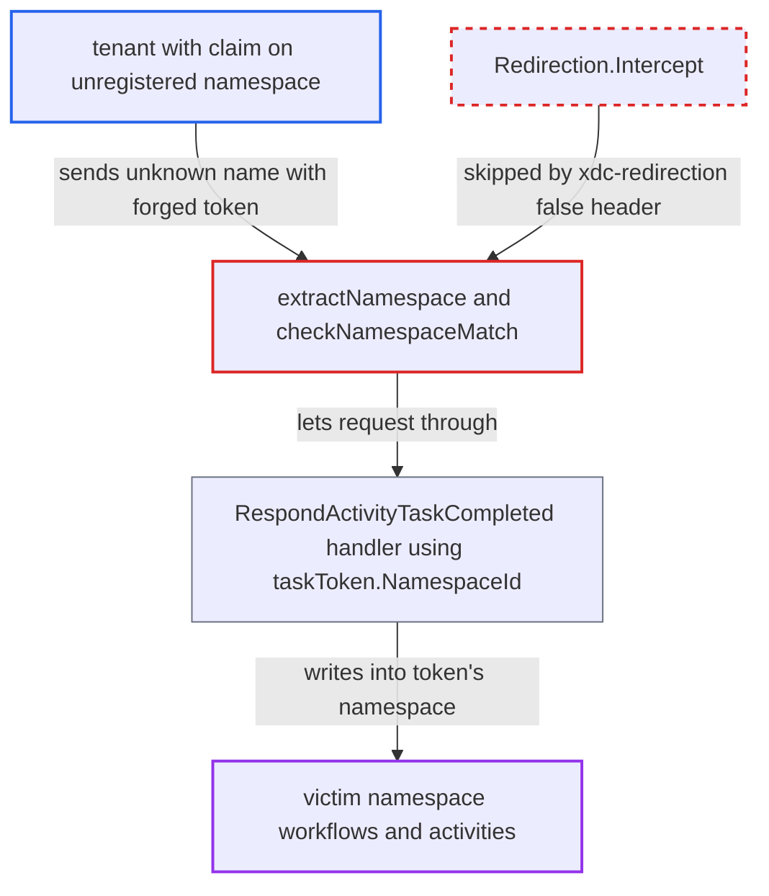

# Task-token requests naming an unregistered namespace bypass namespace-match check, enabling cross-namespace writes

| Field | Value |
|---|---|
| ID | `find_01PpKHkkBpqP5mcACpo3RKjD` |
| Severity | **Medium** |
| Status | open |
| CWE | CWE-863 — Authorization bypass |
| Created | 2026-10-27T22:14:02.413239Z |
| Claude Security | https://claude.ai/security/findings/find_01PpKHkkBpqP5mcACpo3RKjD |

## Description

An authenticated tenant with write or admin rights on a namespace name that is not registered on the cluster can force-complete, fail, cancel or heartbeat activities in another tenant's workflows. They can also fail that tenant's workflow tasks. The attacker needs the victim's namespace ID and a workflow and activity ID. The cause is that `extractNamespace` drops the lookup error for an unknown request name, so `checkNamespaceMatch` never compares it with the task token's namespace.

1. **Tenant admin** obtains a claim on a namespace name that is not registered. One way is to delete its own namespace `X` with `OperatorService/DeleteNamespace`, which needs only namespace admin. The registry then drops the name `X`, but the externally issued JWT still lists it. ([`common/api/metadata.go:199`](https://github.com/cx-benchmark/temporal/blob/bf81a4c20009db89dc952592c9cfe770bafe66ee/common/api/metadata.go#L199))
2. **Attacker** sends `RespondActivityTaskCompleted` with `Namespace` set to `X` and a forged task token. The task token is an unsigned protobuf, so it can name the victim's `namespace_id`, the `workflow_id` and the `activity_id`. The request also carries the gRPC metadata `xdc-redirection: false`. ([`service/frontend/workflow_handler.go:1682-1746`](https://github.com/cx-benchmark/temporal/blob/bf81a4c20009db89dc952592c9cfe770bafe66ee/service/frontend/workflow_handler.go#L1682-L1746))
3. **authorization interceptor** authorizes the call against the raw request `Namespace` string. The default authorizer does an exact lookup of `claims.Namespaces[target.Namespace]` with no registry check, so the claim on `X` passes. ([`common/authorization/interceptor.go:163-176`](https://github.com/cx-benchmark/temporal/blob/bf81a4c20009db89dc952592c9cfe770bafe66ee/common/authorization/interceptor.go#L163-L176))
4. **`extractNamespace`** discards the not-found error for the unknown request name. The token's namespace resolves, so the function returns it and leaves the request's namespace entry nil. ([`common/rpc/interceptor/namespace_validator.go:295-318`](https://github.com/cx-benchmark/temporal/blob/bf81a4c20009db89dc952592c9cfe770bafe66ee/common/rpc/interceptor/namespace_validator.go#L295-L318))
5. **`checkNamespaceMatch`** returns nil because the request namespace entry is nil. The `frontend.enableTokenNamespaceEnforcement` comparison is skipped exactly when the request name is unknown. The flag's default of `true` does not help. ([`common/rpc/interceptor/namespace_validator.go:424-432`](https://github.com/cx-benchmark/temporal/blob/bf81a4c20009db89dc952592c9cfe770bafe66ee/common/rpc/interceptor/namespace_validator.go#L424-L432))
6. **`Redirection.Intercept`** is skipped because of the `xdc-redirection: false` header. This is the only interceptor that would reject an unknown request namespace, and the client controls the header. ([`common/rpc/interceptor/redirection.go:416-428`](https://github.com/cx-benchmark/temporal/blob/bf81a4c20009db89dc952592c9cfe770bafe66ee/common/rpc/interceptor/redirection.go#L416-L428))
7. **the handler `RespondActivityTaskCompleted`** forwards the call to history using `taskToken.NamespaceId`. The handler never reads `request.Namespace`, so the write targets the victim's namespace. ([`service/frontend/workflow_handler.go:1682-1746`](https://github.com/cx-benchmark/temporal/blob/bf81a4c20009db89dc952592c9cfe770bafe66ee/service/frontend/workflow_handler.go#L1682-L1746))
8. **the history service** force-completes the pending activity with the attacker's result. With `scheduled_event_id` set to 0 and an `activity_id`, the completion is treated as by-ID and the started and attempt checks are skipped. An empty `run_id` resolves to the current run. ([`service/history/api/respondactivitytaskcompleted/api.go:66-92`](https://github.com/cx-benchmark/temporal/blob/bf81a4c20009db89dc952592c9cfe770bafe66ee/service/history/api/respondactivitytaskcompleted/api.go#L66-L92))

## Assessment

The attacker is an authenticated tenant whose JWT grants write or admin on a name `X` that is not registered on this cluster. One way to get this is to delete its own namespace `X` with `OperatorService/DeleteNamespace`, which namespace admin permits. Other ways are a claim issued before the namespace was registered, or a multi-cell token that lists namespaces registered on another cluster. The attacker also needs the victim namespace's ID (a UUID) and a workflow ID and activity ID in it. The attacker sends the header `xdc-redirection: false`. Besides `RespondActivityTaskCompleted`, the same flaw affects `RespondActivityTaskFailed`, `RespondActivityTaskCanceled`, `RecordActivityTaskHeartbeat` and `RespondWorkflowTaskFailed`.

Impact: The attacker can inject activity results, failures, cancellations and heartbeat details into another tenant's workflow histories, which drives that tenant's workflow logic with forged data. The attacker can also fail the victim's workflow tasks, and with cause `GRPC_MESSAGE_TOO_LARGE` terminate the workflow if the workflow task token fields match. Responses carry no victim payloads, but the difference between NotFound and other errors lets the attacker probe which workflow and activity IDs exist. `RespondWorkflowTaskCompleted` is not affected. `RespondQueryTaskCompleted` and `RespondNexusTaskCompleted/Failed` share the validator fallback but need a UUID task ID generated by matching, so they are not practically forgeable.

## Recommendation

(1) `extractNamespace` treats a request namespace name that fails to resolve as no request namespace when a task token is present. `checkNamespaceMatch` then never compares it with the token's namespace.

Fix criteria: For any request carrying a task token, a non-empty `Namespace` must resolve to a registered namespace whose ID equals the token's namespace ID. Otherwise the request is rejected, whatever the request-name lookup error was. Send a task-token request with an unknown `Namespace` and a token naming an existing namespace, with and without `xdc-redirection: false`. It must fail with namespace-not-found or token-mismatch and never reach the handler.

(2) Authorization is decided on the raw request `Namespace` string, while the token-bearing handlers act on `taskToken.NamespaceId`. Only a later interceptor tries to reconcile the two, and authorization knows nothing about the token.

Fix criteria: The namespace used for the authorization decision of a task-token request is the namespace the handler will act on (the token's), or the handlers act on the namespace the request was authorized for. A request authorized for namespace X cannot cause a history write in any other namespace. This holds for all token-bearing APIs, including `RespondActivityTask*`, `RecordActivityTaskHeartbeat`, `RespondWorkflowTaskFailed`, `RespondQueryTaskCompleted` and `RespondNexusTask*`.

## Evidence

**https://github.com/cx-benchmark/temporal**

- [`common/rpc/interceptor/namespace_validator.go:295-318`](https://github.com/cx-benchmark/temporal/blob/bf81a4c20009db89dc952592c9cfe770bafe66ee/common/rpc/interceptor/namespace_validator.go#L295-L318)
- [`common/rpc/interceptor/namespace_validator.go:424-432`](https://github.com/cx-benchmark/temporal/blob/bf81a4c20009db89dc952592c9cfe770bafe66ee/common/rpc/interceptor/namespace_validator.go#L424-L432)
- [`common/authorization/interceptor.go:163-176`](https://github.com/cx-benchmark/temporal/blob/bf81a4c20009db89dc952592c9cfe770bafe66ee/common/authorization/interceptor.go#L163-L176)
- [`service/frontend/fx.go:312-340`](https://github.com/cx-benchmark/temporal/blob/bf81a4c20009db89dc952592c9cfe770bafe66ee/service/frontend/fx.go#L312-L340)
- [`common/rpc/interceptor/redirection.go:416-428`](https://github.com/cx-benchmark/temporal/blob/bf81a4c20009db89dc952592c9cfe770bafe66ee/common/rpc/interceptor/redirection.go#L416-L428)
- [`service/frontend/workflow_handler.go:1682-1746`](https://github.com/cx-benchmark/temporal/blob/bf81a4c20009db89dc952592c9cfe770bafe66ee/service/frontend/workflow_handler.go#L1682-L1746)
- [`service/history/api/respondactivitytaskcompleted/api.go:66-92`](https://github.com/cx-benchmark/temporal/blob/bf81a4c20009db89dc952592c9cfe770bafe66ee/service/history/api/respondactivitytaskcompleted/api.go#L66-L92)
- [`common/api/metadata.go:199`](https://github.com/cx-benchmark/temporal/blob/bf81a4c20009db89dc952592c9cfe770bafe66ee/common/api/metadata.go#L199)
- [`common/dynamicconfig/constants.go:995-999`](https://github.com/cx-benchmark/temporal/blob/bf81a4c20009db89dc952592c9cfe770bafe66ee/common/dynamicconfig/constants.go#L995-L999)

