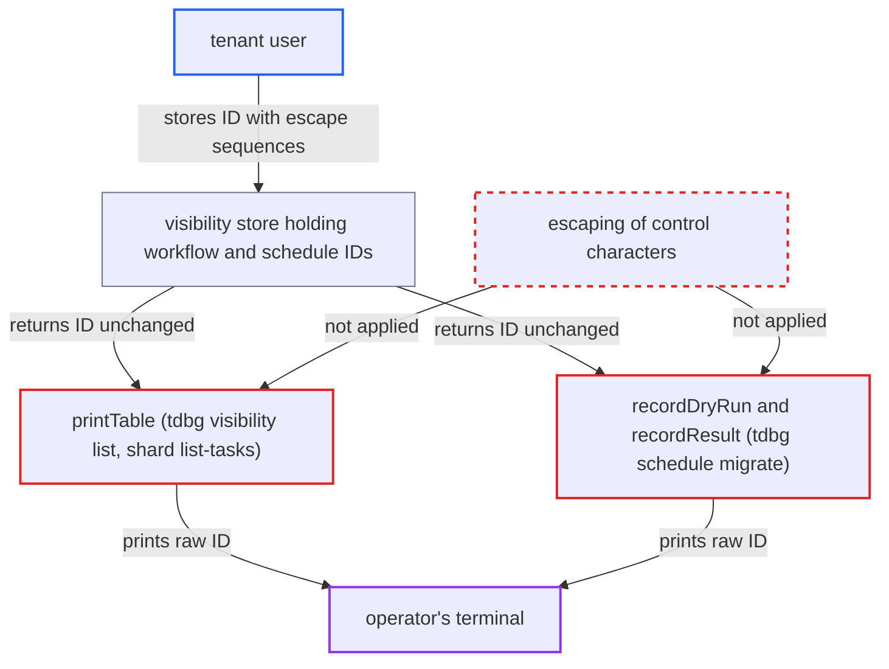

# tdbg writes tenant-controlled identifiers to operator terminal without neutralizing escape sequences

| Field | Value |
|---|---|
| ID | `find_01T8VYCMTutRs4WG44MwBfzA` |
| Severity | **Medium** |
| Status | open |
| CWE | CWE-150 — Terminal escape injection |
| Created | 2026-10-27T21:09:24.169311Z |
| Claude Security | https://claude.ai/security/findings/find_01T8VYCMTutRs4WG44MwBfzA |

## Description

A tenant user can make `tdbg` show false or hidden output on an operator's terminal. This works through a workflow ID or schedule ID that contains escape sequences or newlines. It needs only a tenant account and a routine operator listing. The frontend checks these IDs only for being non-empty and within the length limit, and `printTable` and several `%s` print lines in `tdbg` write them raw.

1. **tenant user** starts a workflow or creates a schedule whose ID contains escape sequences or newlines. `ValidateWorkflowID` only checks that the ID is non-empty and within the length limit, so ESC, CR, LF and BEL are accepted and stored unchanged. ([`chasm/lib/workflow/validator.go:51-61`](https://github.com/cx-benchmark/temporal/blob/bf81a4c20009db89dc952592c9cfe770bafe66ee/chasm/lib/workflow/validator.go#L51-L61))
2. **visibility store** returns the stored ID to `tdbg` as the tenant wrote it. The admin `ListExecutions` path sets `BusinessId` to `storeExecution.WorkflowID` without any transformation. ([`common/persistence/visibility/visibility_manager_impl.go:366-410`](https://github.com/cx-benchmark/temporal/blob/bf81a4c20009db89dc952592c9cfe770bafe66ee/common/persistence/visibility/visibility_manager_impl.go#L366-L410))
3. **operator** runs a routine `tdbg visibility list`, or a `tdbg schedule migrate --from-visibility` dry run, or `tdbg schedule audit`, in an interactive terminal. Without `-n`, the visibility listing spans namespaces, so the tenant's row is shown among rows from other namespaces. ([`tools/tdbg/visibility_commands.go:25-70`](https://github.com/cx-benchmark/temporal/blob/bf81a4c20009db89dc952592c9cfe770bafe66ee/tools/tdbg/visibility_commands.go#L25-L70))
4. **`printTable`** writes the ID into a table cell without filtering control characters. It formats each field with `fmt.Sprintf("%v")` and hands it to `tablewriter`, which does not sanitize cell content. ([`tools/tdbg/util.go:245-284`](https://github.com/cx-benchmark/temporal/blob/bf81a4c20009db89dc952592c9cfe770bafe66ee/tools/tdbg/util.go#L245-L284))
5. **`recordDryRun` and `recordResult`** print the schedule ID with a bare `%s`. In `--from-visibility` mode the schedule ID is the tenant-chosen workflow ID with the scheduler prefix trimmed, so embedded newlines can forge or hide dry-run lines. ([`tools/tdbg/commands.go:1481-1501`](https://github.com/cx-benchmark/temporal/blob/bf81a4c20009db89dc952592c9cfe770bafe66ee/tools/tdbg/commands.go#L1481-L1501))
6. **operator's terminal** interprets the sequences instead of showing them as text. It can move the cursor, erase or overwrite lines, and show injected lines, so the operator sees rows or dry-run results that differ from the real data.

## Assessment

The attacker is an authenticated tenant user who can start a workflow or create a schedule. They put ANSI/OSC escape sequences or newlines in the ID. Later an operator runs a routine command in an interactive terminal: `tdbg visibility list` (default table view), `tdbg schedule migrate --from-visibility` (the dry-run, result and failure lines), `tdbg schedule audit` (progress and warning lines on stderr, including `entry.ID` and the retry `opName`, unless `--quiet` is given), or `tdbg shard list-tasks` with `--print-json=false`. The visibility listing is more exposed without `-n`, because it then spans namespaces. The operator needs to do nothing beyond the routine listing. JSON outputs, `%q` call sites, the single-schedule migrate path, and fields formatted by proto `String()` are not affected.

Impact: The attacker controls how `tdbg` output looks on the operator's terminal. They can erase, overwrite or inject lines, including rows from other namespaces in a listing or a migration dry run, and so mislead the operator about what exists or will be migrated. The RPCs of `tdbg` and the server's state are unchanged. Window title changes, OSC 8 hyperlinks and OSC 52 clipboard writes depend on the terminal, and the code does not establish them. The report rates this low severity because `tdbg` is treated as operator-trusted.

## Recommendation

`tdbg` writes strings from server responses that tenants control to the terminal without neutralizing control characters or escape sequences. This happens in `printTable`, the `%s` dry-run, result and failure lines in `migrateSummary`, the `scheduleaudit` progress lines, and the shard and visibility listings.

Fix criteria: Every string from a server response that `tdbg` writes to stdout or stderr in plain-text or table form has C0/C1 control characters and ESC-introduced sequences escaped or stripped, through one helper or with `%q`-style quoting. To verify, create a workflow and a schedule whose IDs contain `\x1b[2K\x1b[1A` and `\n[dry-run] would migrate x/y`. Then run `tdbg visibility list` and `tdbg schedule migrate --from-visibility`. The sequences must appear escaped and literal, with no cursor movement and no extra lines.

## Evidence

**https://github.com/cx-benchmark/temporal**

- [`tools/tdbg/util.go:245-284`](https://github.com/cx-benchmark/temporal/blob/bf81a4c20009db89dc952592c9cfe770bafe66ee/tools/tdbg/util.go#L245-L284)
- [`tools/tdbg/visibility_commands.go:25-70`](https://github.com/cx-benchmark/temporal/blob/bf81a4c20009db89dc952592c9cfe770bafe66ee/tools/tdbg/visibility_commands.go#L25-L70)
- [`tools/tdbg/commands.go:1481-1501`](https://github.com/cx-benchmark/temporal/blob/bf81a4c20009db89dc952592c9cfe770bafe66ee/tools/tdbg/commands.go#L1481-L1501)
- [`tools/tdbg/commands.go:1314-1320`](https://github.com/cx-benchmark/temporal/blob/bf81a4c20009db89dc952592c9cfe770bafe66ee/tools/tdbg/commands.go#L1314-L1320)
- [`tools/tdbg/scheduleaudit/analyzer.go:1228`](https://github.com/cx-benchmark/temporal/blob/bf81a4c20009db89dc952592c9cfe770bafe66ee/tools/tdbg/scheduleaudit/analyzer.go#L1228)
- [`tools/tdbg/commands.go:505-515`](https://github.com/cx-benchmark/temporal/blob/bf81a4c20009db89dc952592c9cfe770bafe66ee/tools/tdbg/commands.go#L505-L515)
- [`chasm/lib/workflow/validator.go:51-61`](https://github.com/cx-benchmark/temporal/blob/bf81a4c20009db89dc952592c9cfe770bafe66ee/chasm/lib/workflow/validator.go#L51-L61)
- [`common/persistence/visibility/visibility_manager_impl.go:366-410`](https://github.com/cx-benchmark/temporal/blob/bf81a4c20009db89dc952592c9cfe770bafe66ee/common/persistence/visibility/visibility_manager_impl.go#L366-L410)

