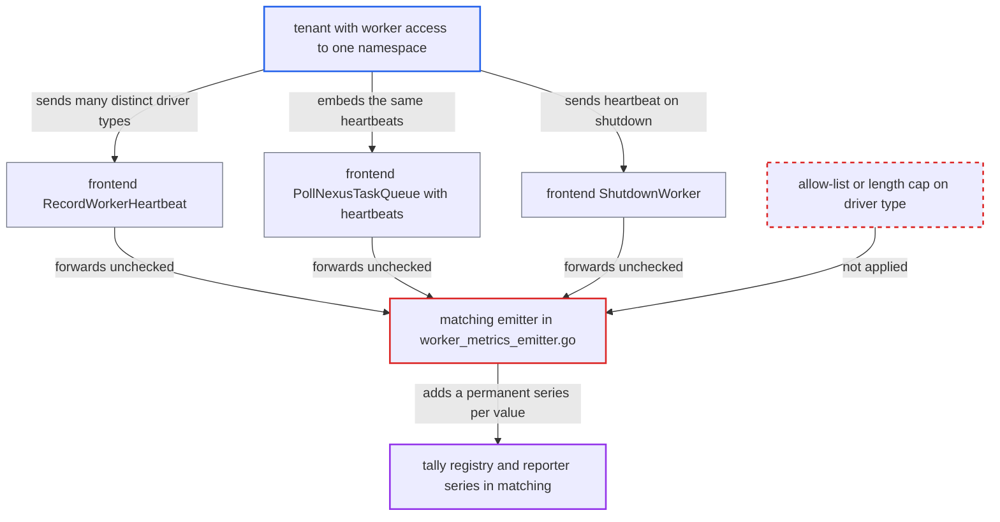

# Tenant-supplied storage driver type becomes an unbounded, default-on metric tag in matching

| Field | Value |
|---|---|
| ID | `find_01X17VrhuvtXTqipTxraWwv7` |
| Severity | **Medium** |
| Status | open |
| CWE | CWE-770 — Resource allocation without limits |
| Created | 2026-10-27T21:37:57.169053Z |
| Claude Security | https://claude.ai/security/findings/find_01X17VrhuvtXTqipTxraWwv7 |

## Description

A tenant with worker write access to one namespace can make the shared matching service run out of memory. This disrupts task dispatch for every namespace on that host. It needs a metrics reporter (Prometheus or StatsD) to be configured, which every shipped `config/*.yaml` does. The emitter in `service/matching/workers/worker_metrics_emitter.go` uses each raw `drivers[].type` string as the `worker_storage_driver_type` metric tag, with no limit.

1. **tenant with worker access** sends a heartbeat carrying very many distinct, long `drivers[].type` strings. One request can be as large as the gRPC 4 MiB limit, which is hundreds of thousands of values, and the `RecordWorkerHeartbeat` call is open to anyone with write access to the namespace. ([`service/frontend/workflow_handler.go:7696-7717`](https://github.com/cx-benchmark/temporal/blob/bf81a4c20009db89dc952592c9cfe770bafe66ee/service/frontend/workflow_handler.go#L7696-L7717))
2. **frontend `workflow_handler.go`** forwards the whole heartbeat list to matching. The only check is `frontend.WorkerHeartbeatsEnabled`, which defaults to true, and nothing limits the number of drivers or the length of a type string. ([`service/frontend/workflow_handler.go:7696-7717`](https://github.com/cx-benchmark/temporal/blob/bf81a4c20009db89dc952592c9cfe770bafe66ee/service/frontend/workflow_handler.go#L7696-L7717))
3. **matching `Handler.RecordWorkerHeartbeat`** hands the heartbeats to the registry, which calls `emit` for every batch. Neither `Handler.RecordWorkerHeartbeat` nor `registryImpl.RecordWorkerHeartbeats` validates the heartbeats. ([`service/matching/workers/registry_impl.go:426-429`](https://github.com/cx-benchmark/temporal/blob/bf81a4c20009db89dc952592c9cfe770bafe66ee/service/matching/workers/registry_impl.go#L426-L429))
4. **the emitter in `worker_metrics_emitter.go`** records the gauge `worker_storage_driver_type` once per distinct type, using the raw string as the tag value. The only gate is `ExternalPayloadsEnabled(namespace)`, which follows `history.externalPayloadsEnabled` and defaults to true. The only de-duplication is the per-call `recordedDrivers` map, so values from different calls are never merged. ([`service/matching/workers/worker_metrics_emitter.go:70-81`](https://github.com/cx-benchmark/temporal/blob/bf81a4c20009db89dc952592c9cfe770bafe66ee/service/matching/workers/worker_metrics_emitter.go#L70-L81))
5. **the tally metrics handler** creates a new tagged sub-scope and gauge for every new tag set. Temporal's own lookup cache clears when full, but tally's root registry and the reporter keep every sub-scope and series until the process restarts. ([`common/metrics/tally_metrics_handler.go:180-188`](https://github.com/cx-benchmark/temporal/blob/bf81a4c20009db89dc952592c9cfe770bafe66ee/common/metrics/tally_metrics_handler.go#L180-L188))

## Assessment

The attacker is a tenant with worker (write) access to one namespace who can reach the public frontend. No victim action is needed. The default settings are enough: `history.externalPayloadsEnabled` and `frontend.WorkerHeartbeatsEnabled` both default to true. A metrics reporter (Prometheus or StatsD) must be configured, as in every shipped `config/*.yaml`. With no metrics config the handler does nothing. There are three ways in: `RecordWorkerHeartbeat`, heartbeats embedded in `PollNexusTaskQueue`, and `ShutdownWorker`. All three forward the heartbeat with no check on the number of drivers or the length of the type string.

Impact: Heap use and scrape cost in the shared matching process grow with the attacker's input and stay high after the attack stops, until restart. Requests are rate-limited by count, not by values per request, so a few requests can push matching toward memory exhaustion and disrupt task dispatch for every namespace on that host. No data is disclosed.

## Recommendation

The tenant-supplied string `WorkerHeartbeat.drivers[].type` is used as-is as the value of the `worker_storage_driver_type` tag. It is gated only by the unrelated flag `history.externalPayloadsEnabled`, which is on by default. The sibling heartbeat metrics have default-off opt-ins such as `matching.enableWorkerPluginMetrics`.

Fix criteria: The `worker_storage_driver_type` tag takes values only from a bounded, server-defined set, with one placeholder for anything else. Alternatively, the metric sits behind an explicit default-off opt-in like `matching.enableWorkerPluginMetrics`. A test confirms that heartbeats carrying N distinct or very long driver types add at most a constant number of new series in matching.

## Evidence

**https://github.com/cx-benchmark/temporal**

- [`service/matching/workers/worker_metrics_emitter.go:70-81`](https://github.com/cx-benchmark/temporal/blob/bf81a4c20009db89dc952592c9cfe770bafe66ee/service/matching/workers/worker_metrics_emitter.go#L70-L81)
- [`service/matching/workers/worker_metrics_emitter.go:38-41`](https://github.com/cx-benchmark/temporal/blob/bf81a4c20009db89dc952592c9cfe770bafe66ee/service/matching/workers/worker_metrics_emitter.go#L38-L41)
- [`common/dynamicconfig/constants.go:3575-3579`](https://github.com/cx-benchmark/temporal/blob/bf81a4c20009db89dc952592c9cfe770bafe66ee/common/dynamicconfig/constants.go#L3575-L3579)
- [`common/dynamicconfig/constants.go:1722-1745`](https://github.com/cx-benchmark/temporal/blob/bf81a4c20009db89dc952592c9cfe770bafe66ee/common/dynamicconfig/constants.go#L1722-L1745)
- [`common/metrics/tags.go:431-433`](https://github.com/cx-benchmark/temporal/blob/bf81a4c20009db89dc952592c9cfe770bafe66ee/common/metrics/tags.go#L431-L433)
- [`service/frontend/workflow_handler.go:7696-7717`](https://github.com/cx-benchmark/temporal/blob/bf81a4c20009db89dc952592c9cfe770bafe66ee/service/frontend/workflow_handler.go#L7696-L7717)
- [`service/frontend/workflow_handler.go:6503-6513`](https://github.com/cx-benchmark/temporal/blob/bf81a4c20009db89dc952592c9cfe770bafe66ee/service/frontend/workflow_handler.go#L6503-L6513)
- [`service/matching/handler.go:609-618`](https://github.com/cx-benchmark/temporal/blob/bf81a4c20009db89dc952592c9cfe770bafe66ee/service/matching/handler.go#L609-L618)
- [`service/matching/workers/registry_impl.go:426-429`](https://github.com/cx-benchmark/temporal/blob/bf81a4c20009db89dc952592c9cfe770bafe66ee/service/matching/workers/registry_impl.go#L426-L429)
- [`common/metrics/tally_metrics_handler.go:180-188`](https://github.com/cx-benchmark/temporal/blob/bf81a4c20009db89dc952592c9cfe770bafe66ee/common/metrics/tally_metrics_handler.go#L180-L188)

