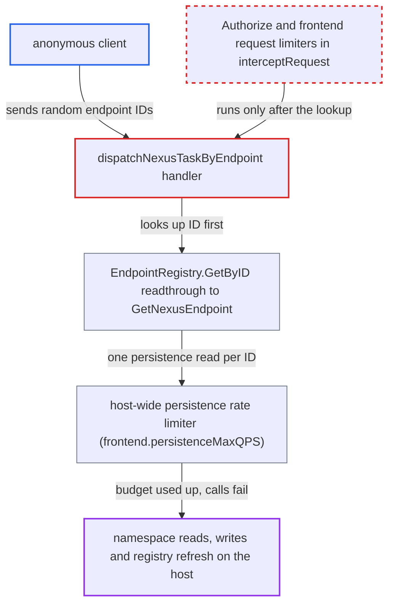

# Unauthenticated Nexus by-endpoint requests force unthrottled persistence reads before authorization

| Field | Value |
|---|---|
| ID | `find_015p1mbZf5jx35UzGnYzM1ui` |
| Severity | **Medium** |
| Status | open |
| CWE | CWE-770 — Resource exhaustion |
| Created | 2026-10-27T21:42:16.604866Z |
| Claude Security | https://claude.ai/security/findings/find_015p1mbZf5jx35UzGnYzM1ui |

## Description

An anonymous client can slow down a Nexus-enabled frontend host by flooding it with requests for random endpoint IDs. While the flood lasts, authenticated namespace calls on that host fail with `ResourceExhausted`, and the namespace registry refresh is starved. It matters only where an enforcing authorizer is configured. The cause is that `dispatchNexusTaskByEndpoint` calls `EndpointRegistry.GetByID`, which reads from persistence, before any authorization or rate limit runs.

1. **anonymous client** sends many POST requests to the by-endpoint Nexus route with fresh random endpoint IDs. The route looks like `/nexus/endpoints/<random-uuid>/services/s/o`. The report puts the flood at about 2000+ requests per second per frontend host, and no credentials are needed.
2. **the handler `dispatchNexusTaskByEndpoint`** looks up the endpoint ID from the URL with `EndpointRegistry.GetByID` as its first action. This happens before `parseTLSAndAuthInfo`, which lets requests without credentials through anyway. It also happens before `interceptRequest`, which holds `Authorize` and every frontend request limiter. ([`service/frontend/nexus_operation_http_handler.go:202-252`](https://github.com/cx-benchmark/temporal/blob/bf81a4c20009db89dc952592c9cfe770bafe66ee/service/frontend/nexus_operation_http_handler.go#L202-L252))
3. **`EndpointRegistry.GetByID`** reads through to `persistence.GetNexusEndpoint` when the ID is not in the in-memory table. The only dedupe is a per-ID future in a 100-entry, 30 s LRU. Each fresh random ID therefore costs one concurrent persistence call, and nothing serializes them. ([`common/nexus/endpoint_registry.go:173-209`](https://github.com/cx-benchmark/temporal/blob/bf81a4c20009db89dc952592c9cfe770bafe66ee/common/nexus/endpoint_registry.go#L173-L209))
4. **`interceptRequest`** never runs for these requests. `Authorize` and the caller, namespace concurrency, namespace and global rate limiters all sit inside it, so a request that fails endpoint resolution is never throttled. ([`service/frontend/nexus_handler.go:173-268`](https://github.com/cx-benchmark/temporal/blob/bf81a4c20009db89dc952592c9cfe770bafe66ee/service/frontend/nexus_handler.go#L173-L268))
5. **the persistence rate limiter** admits each `GetNexusEndpoint` call from the host's shared budget at API priority. The HTTP context carries no caller info, so the namespace and shard limiters do nothing. Only the host-wide limiter applies, with `frontend.persistenceMaxQPS` at 2000 by default. ([`common/persistence/persistence_rate_limited_clients.go:1146-1175`](https://github.com/cx-benchmark/temporal/blob/bf81a4c20009db89dc952592c9cfe770bafe66ee/common/persistence/persistence_rate_limited_clients.go#L1146-L1175))
6. **the priority rate limiter** puts the lower-priority background buckets into debt as well. An admitted request also reserves tokens from every lower-priority bucket. The background work of the host's namespace registry is therefore starved too. ([`common/quotas/priority_rate_limiter_impl.go:79-96`](https://github.com/cx-benchmark/temporal/blob/bf81a4c20009db89dc952592c9cfe770bafe66ee/common/quotas/priority_rate_limiter_impl.go#L79-L96))
7. **namespace registry and namespace calls on the host** fail with `ResourceExhausted` or go stale while the flood lasts. The metadata manager shares the same limiter, so `DescribeNamespace`, `Register`/`UpdateNamespace`, cache-miss readthroughs and the registry's polling refresh all draw from the exhausted budget. ([`common/persistence/client/factory.go:165-260`](https://github.com/cx-benchmark/temporal/blob/bf81a4c20009db89dc952592c9cfe770bafe66ee/common/persistence/client/factory.go#L165-L260))

## Assessment

The attacker is an unauthenticated client who can reach the frontend's Nexus HTTP route. No credentials or victim action are needed. The attack matters only in a deployment with an enforcing authorizer and claim mapper. Under the default noop authorizer, anyone can already fill the same budget with `DescribeNamespace` within `frontend.rps` 2400. The by-namespace and completion routes also read the namespace registry before auth (`nexus_handler.go:406`, `nexus_completion_http_handler.go:148`). Those reads are serialized by `readthroughLock`, and the gRPC pre-auth `NamespaceLogInterceptor` already offers the same thing, so they add little.

Impact: While the flood lasts, authenticated namespace reads and writes, endpoint and namespace cache-miss lookups and namespace registry refresh on the targeted host fail with `ResourceExhausted` or go stale. Workflow APIs served by history and matching use their own limiters and are not directly denied. Database load is capped at `persistenceMaxQPS` per host. No data is disclosed or changed, so the impact is partial and temporary.

## Recommendation

(1) The by-endpoint Nexus route resolves the attacker-supplied endpoint ID with a persistence readthrough before the caller's credentials are checked or any rate limit runs. Anonymous requests therefore cost database work and shared persistence quota.

Fix criteria: An unauthenticated or unauthorized request to a Nexus HTTP route causes no persistence read. Lookups before authorization are served only from the in-memory endpoint table, or are made only after credentials are verified. To check, send anonymous requests with unknown endpoint IDs. Confirm that no `GetNexusEndpoint` persistence call is issued. Confirm that the frontend persistence quota stays unchanged.

(2) Every frontend request limiter for Nexus HTTP requests runs inside `interceptRequest`, after endpoint and namespace resolution. Traffic that fails resolution is therefore never throttled.

Fix criteria: Nexus HTTP requests are subject to a host-level request limit before any registry or persistence lookup. This bounds the per-host cost of anonymous traffic independently of the persistence quota. To check, flood the routes anonymously. Confirm that the frontend sheds requests before any lookup. Confirm that authenticated namespace calls on that host keep succeeding.

## Evidence

**https://github.com/cx-benchmark/temporal**

- [`service/frontend/nexus_operation_http_handler.go:202-252`](https://github.com/cx-benchmark/temporal/blob/bf81a4c20009db89dc952592c9cfe770bafe66ee/service/frontend/nexus_operation_http_handler.go#L202-L252)
- [`common/nexus/endpoint_registry.go:173-209`](https://github.com/cx-benchmark/temporal/blob/bf81a4c20009db89dc952592c9cfe770bafe66ee/common/nexus/endpoint_registry.go#L173-L209)
- [`service/frontend/nexus_handler.go:173-268`](https://github.com/cx-benchmark/temporal/blob/bf81a4c20009db89dc952592c9cfe770bafe66ee/service/frontend/nexus_handler.go#L173-L268)
- [`common/persistence/persistence_rate_limited_clients.go:1146-1175`](https://github.com/cx-benchmark/temporal/blob/bf81a4c20009db89dc952592c9cfe770bafe66ee/common/persistence/persistence_rate_limited_clients.go#L1146-L1175)
- [`common/persistence/client/factory.go:165-260`](https://github.com/cx-benchmark/temporal/blob/bf81a4c20009db89dc952592c9cfe770bafe66ee/common/persistence/client/factory.go#L165-L260)
- [`common/quotas/priority_rate_limiter_impl.go:79-96`](https://github.com/cx-benchmark/temporal/blob/bf81a4c20009db89dc952592c9cfe770bafe66ee/common/quotas/priority_rate_limiter_impl.go#L79-L96)
- [`common/namespace/nsregistry/registry.go:215-242`](https://github.com/cx-benchmark/temporal/blob/bf81a4c20009db89dc952592c9cfe770bafe66ee/common/namespace/nsregistry/registry.go#L215-L242)
- [`chasm/lib/nexusoperation/fx.go:73-92`](https://github.com/cx-benchmark/temporal/blob/bf81a4c20009db89dc952592c9cfe770bafe66ee/chasm/lib/nexusoperation/fx.go#L73-L92)
- [`common/dynamicconfig/constants.go:744-748`](https://github.com/cx-benchmark/temporal/blob/bf81a4c20009db89dc952592c9cfe770bafe66ee/common/dynamicconfig/constants.go#L744-L748)

