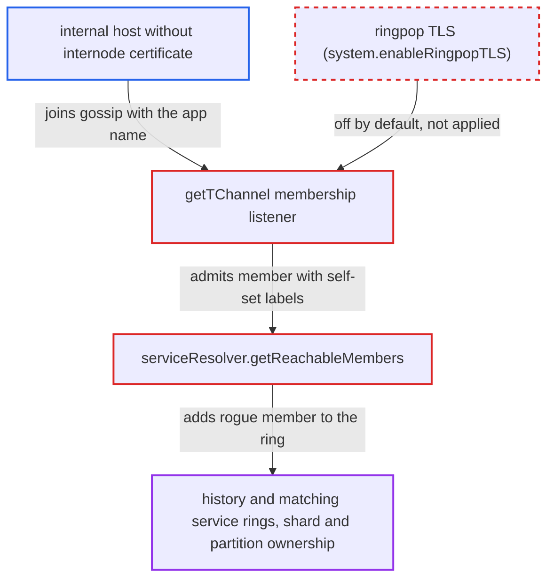

# Unauthenticated ringpop gossip lets internal hosts poison service rings despite internode mTLS

| Field | Value |
|---|---|
| ID | `find_01SXKeZinP2XPbwzQpZ9SJCD` |
| Severity | **Medium** |
| Status | open |
| CWE | CWE-306 — Missing authentication |
| Created | 2026-10-27T21:35:13.947060Z |
| Claude Security | https://claude.ai/security/findings/find_01SXKeZinP2XPbwzQpZ9SJCD |

## Description

A host on the internal network with no internode certificate can make history shards and matching partitions stop serving for all namespaces. It works against clusters that enable internode mTLS but leave `system.enableRingpopTLS` at its default of `false`. The membership listener built by `getTChannel` then stays plaintext and admits any peer that knows the app name. `serviceResolver.getReachableMembers` trusts the labels a peer sets on itself.

1. **attacker on the internal network** gets the cluster ID from `GetClusterInfo`. The ringpop app name is only `temporal` or `temporal-<clusterId>`, and the cluster ID is not secret, so it is the only value needed to join. ([`common/membership/ringpop/factory.go:101-105`](https://github.com/cx-benchmark/temporal/blob/bf81a4c20009db89dc952592c9cfe770bafe66ee/common/membership/ringpop/factory.go#L101-L105))
2. **attacker** joins gossip on a `membershipPort` with ringpop-go. `getTChannel` uses TLS only when `system.enableRingpopTLS` is true, and that flag defaults to `false` and is not derived from the internode TLS settings, so the listener is plaintext and unauthenticated. ([`common/membership/ringpop/factory.go:150-183`](https://github.com/cx-benchmark/temporal/blob/bf81a4c20009db89dc952592c9cfe770bafe66ee/common/membership/ringpop/factory.go#L150-L183))
3. **attacker** sets the labels `serviceName=history` or `serviceName=matching` and a `servicePort` on its own member, optionally on many ports. The shipped config template turns on internode mTLS but never turns on ringpop TLS, so the project's own mTLS setup leaves gossip open. ([`common/config/config_template_embedded.yaml:208-241`](https://github.com/cx-benchmark/temporal/blob/bf81a4c20009db89dc952592c9cfe770bafe66ee/common/config/config_template_embedded.yaml#L208-L241))
4. **`serviceResolver` on every node** adds the rogue member to the service ring. Ring membership comes only from the self-set `serviceName` label, and the RPC address is the gossip host plus the self-set `servicePort`, with no check against a certificate or persisted records. ([`common/membership/ringpop/service_resolver.go:335-397`](https://github.com/cx-benchmark/temporal/blob/bf81a4c20009db89dc952592c9cfe770bafe66ee/common/membership/ringpop/service_resolver.go#L335-L397))
5. **history shard controller** unloads shards that the ring now assigns to the rogue member. Ownership comes only from `historyServiceResolver.Lookup`, so the real owner gets `ShardOwnershipLost` and closes those shards. ([`service/history/shard/controller_impl.go:400-413`](https://github.com/cx-benchmark/temporal/blob/bf81a4c20009db89dc952592c9cfe770bafe66ee/service/history/shard/controller_impl.go#L400-L413))
6. **callers of history and matching** fail to reach the rogue address. Internode clients verify the server certificate unless `disableHostVerification` is set, so the TLS dial to the rogue fails and the shards and partitions it owns stop serving. ([`common/rpc/encryption/local_store_tls_provider.go:111-121`](https://github.com/cx-benchmark/temporal/blob/bf81a4c20009db89dc952592c9cfe770bafe66ee/common/rpc/encryption/local_store_tls_provider.go#L111-L121))
7. **attacker** alternatively sets a non-numeric `servicePort` label. `strconv.Atoi` fails and the whole ring refresh aborts, so running nodes keep a stale ring, and `Start` treats the error as `Fatal`, so starting nodes exit. ([`common/membership/ringpop/service_resolver.go:125-129`](https://github.com/cx-benchmark/temporal/blob/bf81a4c20009db89dc952592c9cfe770bafe66ee/common/membership/ringpop/service_resolver.go#L125-L129))

## Assessment

The attacker is a host on the cluster's internal network and needs no internode certificate. The target uses internode mTLS and leaves `system.enableRingpopTLS` at its default. The attacker runs ringpop-go with the app name `temporal-<clusterId>`, joins through any `membershipPort`, and sets the `serviceName` and `servicePort` labels. The cluster ID comes from `GetClusterInfo`, which answers any caller under the shipped noop authorizer. Registering many members, each on its own port, takes most of the ring. A non-numeric `servicePort` label is a second way to cause harm.

Impact: Every shard and task-queue partition that hashes to a rogue member is released by its real owner and becomes unreachable for every namespace. With many rogue members this is close to a full outage. A malformed port label leaves running nodes with stale rings and makes starting nodes exit. Internode client host verification, on by default, stops the rogue from completing TLS, so it cannot read or alter workflow data or responses.

## Recommendation

(1) Gossip membership admits any peer that presents only the non-secret app name over an unauthenticated channel. Ringpop TLS stays off even when internode mTLS is configured, so ring membership, shard ownership and internode routing are not tied to an authenticated identity.

Fix criteria: Wherever internode mTLS with client auth is configured, a peer without a valid internode certificate cannot join membership or appear in any service ring, and gossip does not silently stay plaintext. On a cluster with internode mTLS, an uncertified ringpop client with the correct app name and `serviceName=history` is rejected. It never appears in `Lookup` or `Members` on any node, and no shard is unloaded.

(2) One member's malformed `servicePort` label aborts the whole ring refresh and is fatal at startup, so a single peer can freeze rings and crash starting nodes.

Fix criteria: Ring refresh skips and logs an individual member whose labels cannot be parsed, and does not fail the refresh. A node starts and serves while such a member is present. Inject a member with `servicePort=abc`: the other members' rings are still built and nodes start normally.

## Evidence

**https://github.com/cx-benchmark/temporal**

- [`common/membership/ringpop/factory.go:150-183`](https://github.com/cx-benchmark/temporal/blob/bf81a4c20009db89dc952592c9cfe770bafe66ee/common/membership/ringpop/factory.go#L150-L183)
- [`common/dynamicconfig/constants.go:187-192`](https://github.com/cx-benchmark/temporal/blob/bf81a4c20009db89dc952592c9cfe770bafe66ee/common/dynamicconfig/constants.go#L187-L192)
- [`common/membership/ringpop/service_resolver.go:335-397`](https://github.com/cx-benchmark/temporal/blob/bf81a4c20009db89dc952592c9cfe770bafe66ee/common/membership/ringpop/service_resolver.go#L335-L397)
- [`common/membership/ringpop/service_resolver.go:125-129`](https://github.com/cx-benchmark/temporal/blob/bf81a4c20009db89dc952592c9cfe770bafe66ee/common/membership/ringpop/service_resolver.go#L125-L129)
- [`common/membership/ringpop/factory.go:101-105`](https://github.com/cx-benchmark/temporal/blob/bf81a4c20009db89dc952592c9cfe770bafe66ee/common/membership/ringpop/factory.go#L101-L105)
- [`service/history/shard/ownership.go:130-146`](https://github.com/cx-benchmark/temporal/blob/bf81a4c20009db89dc952592c9cfe770bafe66ee/service/history/shard/ownership.go#L130-L146)
- [`service/history/shard/controller_impl.go:400-413`](https://github.com/cx-benchmark/temporal/blob/bf81a4c20009db89dc952592c9cfe770bafe66ee/service/history/shard/controller_impl.go#L400-L413)
- [`common/rpc/rpc.go:164-182`](https://github.com/cx-benchmark/temporal/blob/bf81a4c20009db89dc952592c9cfe770bafe66ee/common/rpc/rpc.go#L164-L182)
- [`common/rpc/encryption/local_store_tls_provider.go:111-121`](https://github.com/cx-benchmark/temporal/blob/bf81a4c20009db89dc952592c9cfe770bafe66ee/common/rpc/encryption/local_store_tls_provider.go#L111-L121)
- [`common/config/config_template_embedded.yaml:208-241`](https://github.com/cx-benchmark/temporal/blob/bf81a4c20009db89dc952592c9cfe770bafe66ee/common/config/config_template_embedded.yaml#L208-L241)

