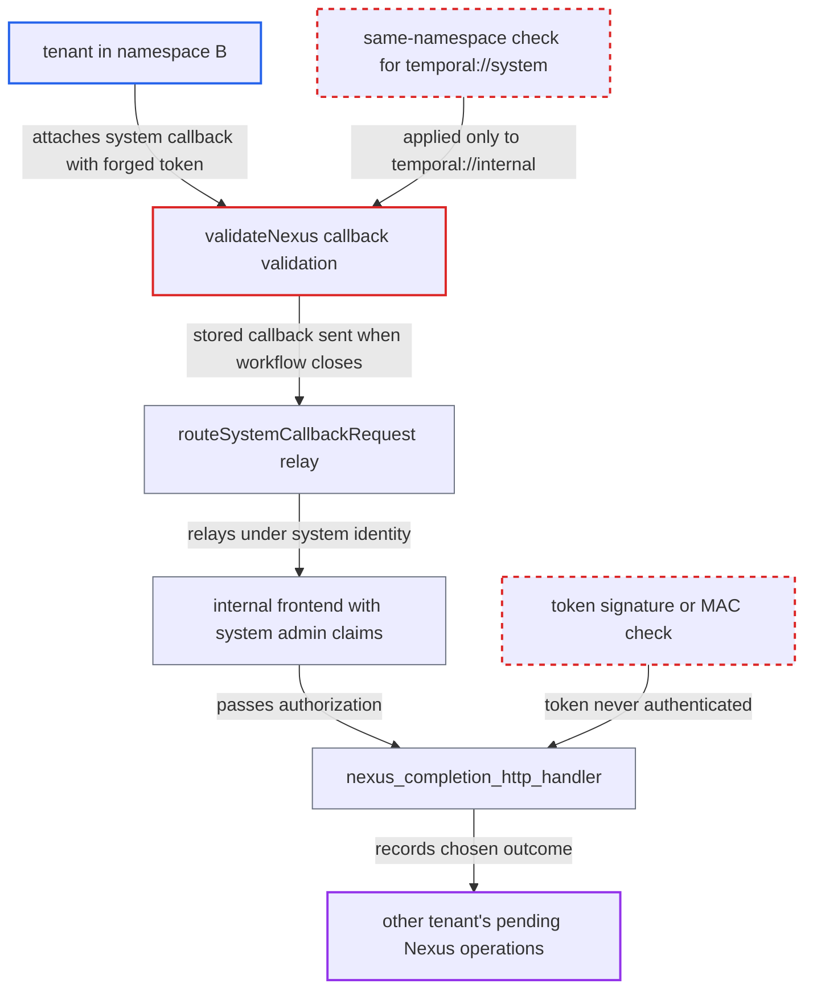

# Unsigned callback token relayed with system identity completes other tenants' Nexus operations

| Field | Value |
|---|---|
| ID | `find_01YCwuPME9bfTvbt1hg1Lbqy` |
| Severity | **Medium** |
| Status | open |
| CWE | CWE-345 — Insufficient data authenticity verification |
| Created | 2026-10-27T21:12:45.746235Z |
| Claude Security | https://claude.ai/security/findings/find_01YCwuPME9bfTvbt1hg1Lbqy |

## Description

A tenant can make the server record a result, failure or cancellation of its choice for another tenant's pending Nexus operations, so long as it knows the victim run's namespace ID, workflow ID and run ID. It needs write access to its own namespace and a deployment that enforces authorization through an internal frontend. The callback token in `common/nexus/callback_token.go` has no signature, and the server relays it under its own system identity.

1. **Nexus handler in namespace B** receives a genuine callback token for an operation called by a workflow in namespace A. The server passes the token in cleartext as a callback header, so the handler learns A's namespace ID, workflow ID and run ID and sees the token format. ([`service/history/hsm/nexusoperations/executors.go:262-268`](https://github.com/cx-benchmark/temporal/blob/bf81a4c20009db89dc952592c9cfe770bafe66ee/service/history/hsm/nexusoperations/executors.go#L262-L268))
2. **attacker** builds a forged token for another operation of that run. The token is plain JSON around a base64 proto with no MAC or signature, so the attacker can name any `Operation/<eventId>` path, with no versioned transitions and an empty `request_id`. ([`common/nexus/callback_token.go:22-70`](https://github.com/cx-benchmark/temporal/blob/bf81a4c20009db89dc952592c9cfe770bafe66ee/common/nexus/callback_token.go#L22-L70))
3. **attacker** starts a workflow in namespace B with a `temporal://system` completion callback carrying the forged token. `validateNexus` applies the same-namespace check only to `temporal://internal`, and `AddressMatchRules.Validate` returns nil for `temporal://system`, so the foreign token is stored unchecked. ([`common/callbacks/validator.go:188-222`](https://github.com/cx-benchmark/temporal/blob/bf81a4c20009db89dc952592c9cfe770bafe66ee/common/callbacks/validator.go#L188-L222))
4. **callback router `routeSystemCallbackRequest`** relays the stored token when the attacker's workflow closes. It resolves the namespace named in the token and sends the request to `/nexus/callback` on the local frontend client. The same logic exists in the legacy HSM router. ([`chasm/lib/callback/request.go:23-118`](https://github.com/cx-benchmark/temporal/blob/bf81a4c20009db89dc952592c9cfe770bafe66ee/chasm/lib/callback/request.go#L23-L118))
5. **internal frontend** accepts the relayed request with system administrator claims. The internal claim mapper grants `System: RoleAdmin` without auth info, so authorization passes for any namespace. ([`temporal/fx.go:565-574`](https://github.com/cx-benchmark/temporal/blob/bf81a4c20009db89dc952592c9cfe770bafe66ee/temporal/fx.go#L565-L574))
6. **completion handler `CompleteOperation`** takes its target from the token alone and authorizes against the token's namespace. System claims always pass this check, so the namespace authorizer that would stop a direct POST is bypassed. ([`service/frontend/nexus_completion_http_handler.go:125-235`](https://github.com/cx-benchmark/temporal/blob/bf81a4c20009db89dc952592c9cfe770bafe66ee/service/frontend/nexus_completion_http_handler.go#L125-L235))
7. **history service** applies the attacker's outcome to the victim's operation. The request-ID comparison is skipped when `request_id` is empty, and a ref without versioned transitions only needs the `Operation/<id>` node to exist. ([`service/history/hsm/nexusoperations/completion.go:184-207`](https://github.com/cx-benchmark/temporal/blob/bf81a4c20009db89dc952592c9cfe770bafe66ee/service/history/hsm/nexusoperations/completion.go#L184-L207))

## Assessment

The attacker is an authenticated tenant with write access to namespace B. Their Nexus handler must have received a genuine `Temporal-Callback-Token` for an operation called by a workflow in namespace A. That reveals the IDs they need. They then forge a token for another operation of that run and attach it as a `temporal://system` completion callback on a workflow they start in B. The attack works only in a deployment that enforces authorization through an internal frontend. Because the token reveals the calling workflow's IDs, the handler can also take over other operations of that workflow, including ones served by other handlers.

Impact: The attacker chooses the outcome recorded for another tenant's Nexus operations: an arbitrary success payload, a failure or a cancellation. This steers the victim workflow's logic and ends its pending operations early. Reach is limited to operations whose namespace ID, workflow ID, run ID and scheduled event ID the attacker knows, and no data is read back.

## Recommendation

(1) `CallbackTokenGenerator.Tokenize` and `DecodeCompletion` in `common/nexus/callback_token.go` produce and accept a token with no integrity protection. Anyone who has seen the format can forge a token naming another namespace, workflow, run and operation.

Fix criteria: Only the server can produce a token that `DecodeCompletion` accepts. It rejects any token whose content the server did not authenticate, and it supports key rotation and multi-cluster delivery. A token with an altered `namespace_id`, `workflow_id`, `run_id` or ref is rejected before any history call. This holds when it is sent directly to `/nexus/callback` and when it is sent through a `temporal://system` workflow callback.

(2) `validateNexus` in `common/callbacks/validator.go` and `address.go` accept a client-supplied `temporal://system` callback without binding its token to the execution being started. `chasm/lib/callback/request.go` and `service/history/hsm/callbacks/request.go` then deliver it under the server's privileged identity.

Fix criteria: A client-attached `temporal://system` callback is accepted only when its token is verified as issued for an operation dispatched to the attaching namespace. A relayed completion is not authorized on the server's identity alone. Attaching a forged token that names a foreign operation makes the start fail, or the callback is rejected before history applies it.

(3) History's completion handlers (`service/history/hsm/nexusoperations/completion.go:204` and `chasm/lib/nexusoperation/operation.go:310`) skip the request-ID match when the token's `request_id` is empty. A forged ref that gives only a path can therefore complete the operation.

Fix criteria: A completion must carry a per-operation identifier that matches the stored operation. Tokens without one are rejected once no legacy tokens can still be outstanding. A completion whose token omits `request_id` or carries a wrong one is rejected with NotFound.

## Evidence

**https://github.com/cx-benchmark/temporal**

- [`common/nexus/callback_token.go:22-70`](https://github.com/cx-benchmark/temporal/blob/bf81a4c20009db89dc952592c9cfe770bafe66ee/common/nexus/callback_token.go#L22-L70)
- [`common/callbacks/validator.go:188-222`](https://github.com/cx-benchmark/temporal/blob/bf81a4c20009db89dc952592c9cfe770bafe66ee/common/callbacks/validator.go#L188-L222)
- [`chasm/lib/callback/request.go:23-118`](https://github.com/cx-benchmark/temporal/blob/bf81a4c20009db89dc952592c9cfe770bafe66ee/chasm/lib/callback/request.go#L23-L118)
- [`service/history/hsm/callbacks/request.go:22-103`](https://github.com/cx-benchmark/temporal/blob/bf81a4c20009db89dc952592c9cfe770bafe66ee/service/history/hsm/callbacks/request.go#L22-L103)
- [`temporal/fx.go:565-574`](https://github.com/cx-benchmark/temporal/blob/bf81a4c20009db89dc952592c9cfe770bafe66ee/temporal/fx.go#L565-L574)
- [`service/frontend/nexus_completion_http_handler.go:125-235`](https://github.com/cx-benchmark/temporal/blob/bf81a4c20009db89dc952592c9cfe770bafe66ee/service/frontend/nexus_completion_http_handler.go#L125-L235)
- [`service/history/hsm/nexusoperations/completion.go:184-207`](https://github.com/cx-benchmark/temporal/blob/bf81a4c20009db89dc952592c9cfe770bafe66ee/service/history/hsm/nexusoperations/completion.go#L184-L207)
- [`service/history/statemachine_environment.go:234-238`](https://github.com/cx-benchmark/temporal/blob/bf81a4c20009db89dc952592c9cfe770bafe66ee/service/history/statemachine_environment.go#L234-L238)
- [`service/history/hsm/nexusoperations/executors.go:262-268`](https://github.com/cx-benchmark/temporal/blob/bf81a4c20009db89dc952592c9cfe770bafe66ee/service/history/hsm/nexusoperations/executors.go#L262-L268)

