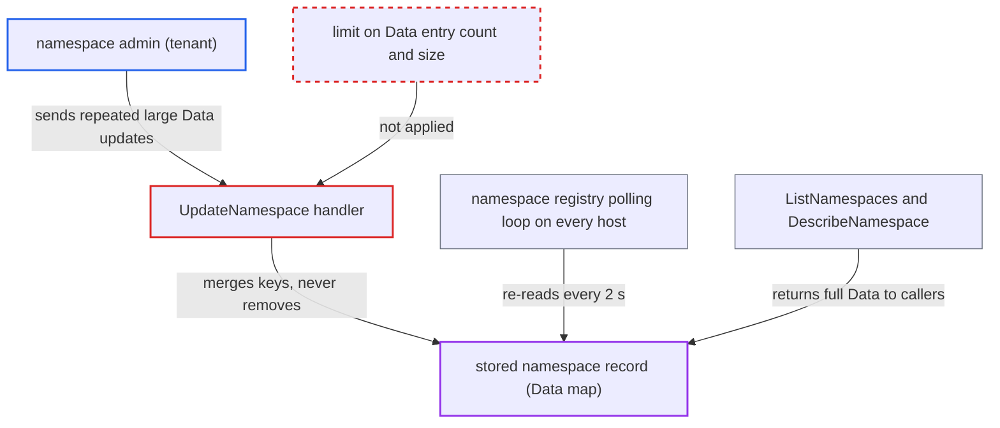

# UpdateNamespace lets a namespace admin grow namespace metadata without bound, degrading every host

| Field | Value |
|---|---|
| ID | `find_01QDj5v3n3hBQu2TcpdzM5YA` |
| Severity | **Medium** |
| Status | open |
| CWE | CWE-770 — Resource Allocation Without Limits |
| Created | 2026-10-27T21:15:26.040331Z |
| Claude Security | https://claude.ai/security/findings/find_01QDj5v3n3hBQu2TcpdzM5YA |

## Description

A tenant with the Admin role on their own namespace can make that namespace's stored record grow without limit. Every frontend, history, matching and worker host then re-reads the bloated record every 2 seconds, which degrades the shared cluster for all tenants. The cause is `UpdateNamespace` in `namespace_handler.go`, which merges caller-supplied `Data` with no cap on entry count or byte size.

1. **namespace admin** calls `WorkflowService/UpdateNamespace` with a large `UpdateInfo.Data` map. The Admin role on the attacker's own namespace is enough, and each request can carry up to about 4 MiB, the frontend's default gRPC receive limit. ([`common/api/metadata.go:74`](https://github.com/cx-benchmark/temporal/blob/bf81a4c20009db89dc952592c9cfe770bafe66ee/common/api/metadata.go#L74))
2. **the handler `UpdateNamespace`** merges the caller's `Data` into the stored `Data` without any size or count check. No dynamic-config limit applies here; `ValidateNamespaceConfig` checks only archival. ([`service/frontend/namespace_handler.go:521-525`](https://github.com/cx-benchmark/temporal/blob/bf81a4c20009db89dc952592c9cfe770bafe66ee/service/frontend/namespace_handler.go#L521-L525))
3. **the function `mergeNamespaceData`** copies the new keys into the old map with `maps.Copy`. It can add or overwrite keys but never remove them, so the stored map only grows with each call. ([`service/frontend/namespace_handler.go:1235-1245`](https://github.com/cx-benchmark/temporal/blob/bf81a4c20009db89dc952592c9cfe770bafe66ee/service/frontend/namespace_handler.go#L1235-L1245))
4. **the function `upsertCustomSearchAttributesAliases`** accepts any key as a field name for `CustomSearchAttributeAliases`. It does not check keys against the pre-allocated custom search attribute fields, so this is a second map the caller can size. ([`service/frontend/namespace_handler.go:1247-1268`](https://github.com/cx-benchmark/temporal/blob/bf81a4c20009db89dc952592c9cfe770bafe66ee/service/frontend/namespace_handler.go#L1247-L1268))
5. **the persistence layer `metadataManagerImpl.UpdateNamespace`** serializes the whole `NamespaceDetail` and writes it as is. No size limit applies, so repeated calls grow the blob up to the backend column ceiling (16 MiB `MEDIUMBLOB` on MySQL/SQLite, `BYTEA` on PostgreSQL). ([`common/persistence/metadata_manager.go:80-96`](https://github.com/cx-benchmark/temporal/blob/bf81a4c20009db89dc952592c9cfe770bafe66ee/common/persistence/metadata_manager.go#L80-L96))
6. **the namespace registry on every host** re-reads and unmarshals every namespace record in `runPollingLoop` and `refreshNamespaces`. Persistence returns `ErrWatchNotSupported`, so the registry polls, and the default `system.namespaceCacheRefreshInterval` is 2 s. ([`common/namespace/nsregistry/registry.go:533-598`](https://github.com/cx-benchmark/temporal/blob/bf81a4c20009db89dc952592c9cfe770bafe66ee/common/namespace/nsregistry/registry.go#L533-L598))

## Assessment

The attacker is an authenticated tenant with the Admin role on their own namespace. They call `WorkflowService/UpdateNamespace` on the public frontend repeatedly, adding fresh `Data` keys each time. Within a few calls the record reaches the backend ceiling (16 MiB on MySQL; PostgreSQL allows more). No victim action is needed and there is no defense to bypass. The other route in is `CustomSearchAttributeAliases`, which accepts any field-name key.

Impact: The attacker causes a recurring cost on the shared cluster for as long as the namespace exists. This is database egress, plus allocation and unmarshal CPU on every host every 2 s. `ListNamespaces` pages holding the bloated record exceed the 4 MiB receive limit of standard clients, so the call breaks for other callers; `DescribeNamespace` also returns the full `Data` map. The report rates this as degradation of the cluster, not a full outage. It discloses no data, and the attacker changes only their own namespace record.

## Recommendation

`UpdateNamespace` and `RegisterNamespace` persist caller-controlled maps (`Data`, `CustomSearchAttributeAliases`) with no cap on entry count or byte size. The merge only adds keys, so one tenant can inflate shared-cluster metadata indefinitely.

Fix criteria: The persisted namespace record stays below an operator-configurable bound. Limits apply to the number of `Data` entries and to the total `Data` byte size. Alias keys that are not valid pre-allocated custom search attribute fields are rejected, so that map is bounded by the field set. A merge that would exceed a limit returns InvalidArgument. Replaying repeated `UpdateNamespace` calls with fresh keys shows the stored blob size levelling off at the configured limit. Legitimate small updates still succeed.

## Evidence

**https://github.com/cx-benchmark/temporal**

- [`service/frontend/namespace_handler.go:521-525`](https://github.com/cx-benchmark/temporal/blob/bf81a4c20009db89dc952592c9cfe770bafe66ee/service/frontend/namespace_handler.go#L521-L525)
- [`service/frontend/namespace_handler.go:1235-1245`](https://github.com/cx-benchmark/temporal/blob/bf81a4c20009db89dc952592c9cfe770bafe66ee/service/frontend/namespace_handler.go#L1235-L1245)
- [`service/frontend/namespace_handler.go:1247-1268`](https://github.com/cx-benchmark/temporal/blob/bf81a4c20009db89dc952592c9cfe770bafe66ee/service/frontend/namespace_handler.go#L1247-L1268)
- [`common/persistence/metadata_manager.go:80-96`](https://github.com/cx-benchmark/temporal/blob/bf81a4c20009db89dc952592c9cfe770bafe66ee/common/persistence/metadata_manager.go#L80-L96)
- [`common/persistence/metadata_manager.go:265-267`](https://github.com/cx-benchmark/temporal/blob/bf81a4c20009db89dc952592c9cfe770bafe66ee/common/persistence/metadata_manager.go#L265-L267)
- [`common/namespace/nsregistry/registry.go:533-598`](https://github.com/cx-benchmark/temporal/blob/bf81a4c20009db89dc952592c9cfe770bafe66ee/common/namespace/nsregistry/registry.go#L533-L598)
- [`common/dynamicconfig/constants.go:272-276`](https://github.com/cx-benchmark/temporal/blob/bf81a4c20009db89dc952592c9cfe770bafe66ee/common/dynamicconfig/constants.go#L272-L276)
- [`common/api/metadata.go:74`](https://github.com/cx-benchmark/temporal/blob/bf81a4c20009db89dc952592c9cfe770bafe66ee/common/api/metadata.go#L74)

