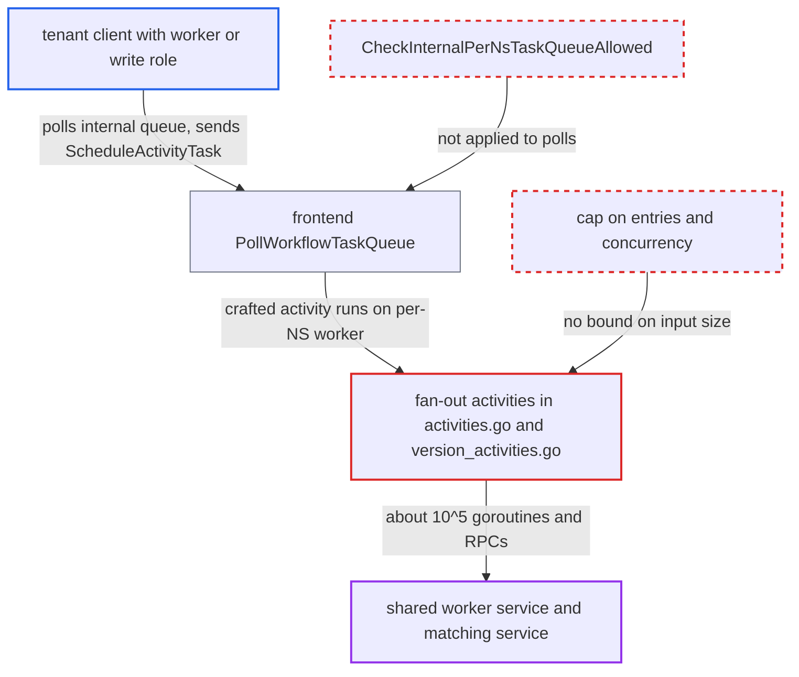

# Worker-deployment activities fan out one goroutine and RPC per input entry without a cap

| Field | Value |
|---|---|
| ID | `find_01EG7hfjEAHFL8GdCGJHXGHQ` |
| Severity | **Medium** |
| Status | open |
| CWE | CWE-770 — Uncontrolled resource consumption |
| Created | 2026-10-27T21:19:54.684121Z |
| Claude Security | https://claude.ai/security/findings/find_01EG7hfjEAHFL8GdCGJHXGHQ |

## Description

An authenticated client with worker or write access in its own namespace can overload the server's shared worker service and matching service, and can write or forget task-queue versioning data in its own namespace. The client polls the internal per-namespace queue and schedules a deployment activity with about 10^5 entries. The activities such as `SyncDeploymentVersionUserData` start one goroutine and one RPC per entry and enforce no cap. The frontend also lets tenants poll that internal queue.

1. **tenant client** polls the internal task queue `temporal-sys-per-ns-tq` in its own namespace. `PollWorkflowTaskQueue` validates the queue with `tqid.NormalizeAndValidate`, which does not apply `CheckInternalPerNsTaskQueueAllowed`, so the poll is accepted. ([`service/frontend/workflow_handler.go:1145`](https://github.com/cx-benchmark/temporal/blob/bf81a4c20009db89dc952592c9cfe770bafe66ee/service/frontend/workflow_handler.go#L1145))
2. **tenant client** triggers a deployment-workflow task and wins it against the server's two pollers. It can do this by calling `SetWorkerDeploymentCurrentVersion` or by signalling the deployment workflow; winning the poll race is a runtime condition. ([`service/worker/pernamespaceworker.go:470-508`](https://github.com/cx-benchmark/temporal/blob/bf81a4c20009db89dc952592c9cfe770bafe66ee/service/worker/pernamespaceworker.go#L470-L508))
3. **tenant client** responds with a `ScheduleActivityTask` command carrying a huge input and an unlimited retry policy. The input can be up to the blob size limit (2 MB by default), which is on the order of 10^5 `Sync` entries or map keys; history allows the command because the parent workflow's queue is itself internal.
4. **per-namespace SDK worker** runs the scheduled activity on the server side. The activities are registered on the per-namespace worker, and the worker does not check the input size, since it relies on the workflow to have batched it with `SyncBatchSize` (default 25). ([`service/worker/workerdeployment/fx.go:128-160`](https://github.com/cx-benchmark/temporal/blob/bf81a4c20009db89dc952592c9cfe770bafe66ee/service/worker/workerdeployment/fx.go#L128-L160))
5. **the activity `SyncDeploymentVersionUserData`** starts one goroutine and one matching RPC per entry of `input.Sync`. Each RPC is `SyncDeploymentUserData`, a user-data write for a task queue name the attacker chose. ([`service/worker/workerdeployment/version_activities.go:52-117`](https://github.com/cx-benchmark/temporal/blob/bf81a4c20009db89dc952592c9cfe770bafe66ee/service/worker/workerdeployment/version_activities.go#L52-L117))
6. **the activities `CheckWorkerDeploymentUserDataPropagation` and `CheckUnversionedRampUserDataPropagation`** start one blocking long-poll goroutine per key of `TaskQueueMaxVersions`. Each long-poll `CheckTaskQueueUserDataPropagation` is held until the activity's StartToClose timeout, and retries repeat the load. ([`service/worker/workerdeployment/version_activities.go:127-154`](https://github.com/cx-benchmark/temporal/blob/bf81a4c20009db89dc952592c9cfe770bafe66ee/service/worker/workerdeployment/version_activities.go#L127-L154))

## Assessment

The attacker is an authenticated client with write or worker role in its own namespace. It needs no other access. It must win a deployment-workflow task against the server's own two pollers on `temporal-sys-per-ns-tq`, which is a runtime race. The report names these activities as reachable this way: `SyncDeploymentVersionUserData`, `CheckWorkerDeploymentUserDataPropagation`, `SyncDeploymentVersionUserDataFromWorkerDeployment`, `SyncUnversionedRamp` and `CheckUnversionedRampUserDataPropagation`. One of them, `SyncDeploymentVersionUserDataFromWorkerDeployment`, also has a `ForgetVersion` operation that removes version data from any named task queue in the namespace.

Impact: The attacker can exhaust memory in the shared worker service (possible out-of-memory) and flood matching and persistence with about 10^5 internal RPCs per attempt, repeated on each retry. It can also create or forget versioning user data on arbitrary task queues, but only in its own namespace. No data from other namespaces is reached, because the activities bind `a.namespace`.

## Recommendation

(1) The fan-out activities in `activities.go` and `version_activities.go` trust the size of `input.Sync` and `input.TaskQueueMaxVersions` and spawn an unbounded number of goroutines and RPCs. Tenant pollers of the per-namespace queue can supply that input.

Fix criteria: Each activity enforces an upper bound on the entries it accepts, for example by rejecting inputs larger than the configured sync batch size or max task queues per version with a non-retryable error. Entries are processed with bounded concurrency (worker pool or semaphore). A crafted `ScheduleActivityTask` input of 10^5 entries then causes at most a small fixed number of concurrent goroutines and matching RPCs. Check this by scheduling such an activity on the per-namespace queue and observing bounded goroutine and RPC counts.

(2) The per-namespace system task queues (`temporal-sys-per-ns-*`) accept polls from tenant clients. That is what lets a tenant write the activity inputs that the server's per-namespace worker runs.

Fix criteria: The frontend poll and respond APIs reject non-internal principals for task queues matching `primitives.IsInternalPerNsTaskQueue`, so a tenant client cannot get system workflow tasks in its namespace. Check that `PollWorkflowTaskQueue` and `PollActivityTaskQueue` on `temporal-sys-per-ns-tq` with a tenant identity are denied.

## Evidence

**https://github.com/cx-benchmark/temporal**

- [`service/worker/workerdeployment/version_activities.go:52-117`](https://github.com/cx-benchmark/temporal/blob/bf81a4c20009db89dc952592c9cfe770bafe66ee/service/worker/workerdeployment/version_activities.go#L52-L117)
- [`service/worker/workerdeployment/version_activities.go:127-154`](https://github.com/cx-benchmark/temporal/blob/bf81a4c20009db89dc952592c9cfe770bafe66ee/service/worker/workerdeployment/version_activities.go#L127-L154)
- [`service/worker/workerdeployment/activities.go:232-291`](https://github.com/cx-benchmark/temporal/blob/bf81a4c20009db89dc952592c9cfe770bafe66ee/service/worker/workerdeployment/activities.go#L232-L291)
- [`service/worker/workerdeployment/activities.go:109-131`](https://github.com/cx-benchmark/temporal/blob/bf81a4c20009db89dc952592c9cfe770bafe66ee/service/worker/workerdeployment/activities.go#L109-L131)
- [`service/worker/workerdeployment/fx.go:128-160`](https://github.com/cx-benchmark/temporal/blob/bf81a4c20009db89dc952592c9cfe770bafe66ee/service/worker/workerdeployment/fx.go#L128-L160)
- [`service/worker/pernamespaceworker.go:470-508`](https://github.com/cx-benchmark/temporal/blob/bf81a4c20009db89dc952592c9cfe770bafe66ee/service/worker/pernamespaceworker.go#L470-L508)
- [`service/frontend/workflow_handler.go:1145`](https://github.com/cx-benchmark/temporal/blob/bf81a4c20009db89dc952592c9cfe770bafe66ee/service/frontend/workflow_handler.go#L1145)

