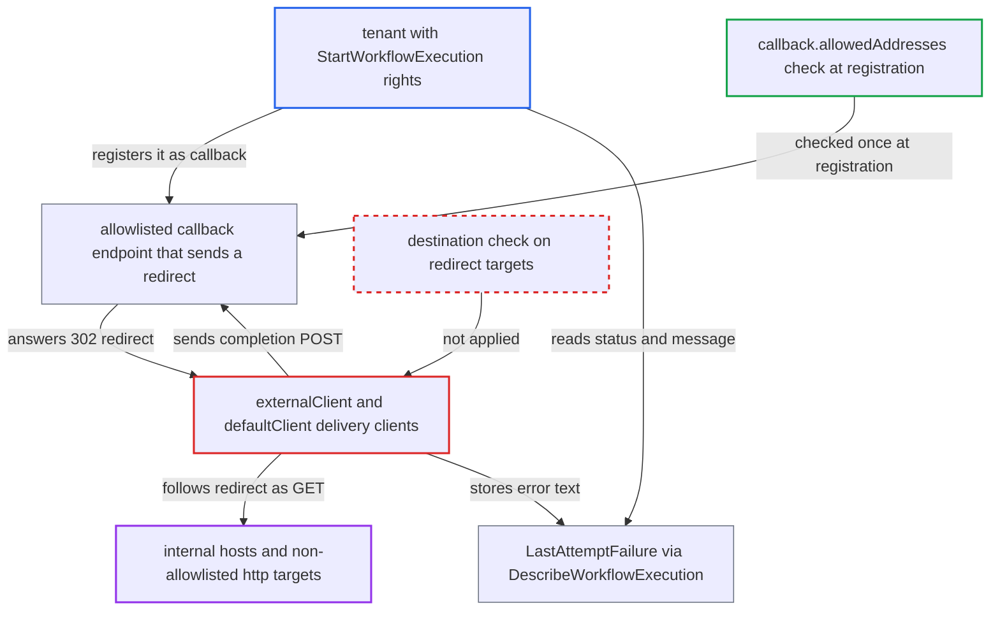

# Callback delivery clients follow HTTP redirects past the callback address allowlist (SSRF)

| Field | Value |
|---|---|
| ID | `find_01Fd39H32XQCfKC9dL83vjtm` |
| Severity | **Low** |
| Status | open |
| CWE | CWE-918 — Server-side request forgery |
| Created | 2026-10-27T21:17:52.621871Z |
| Claude Security | https://claude.ai/security/findings/find_01Fd39H32XQCfKC9dL83vjtm |

## Description

An authenticated tenant can make the history service send GET requests to internal addresses and plain `http` URLs that the namespace's callback allowlist should block. The tenant needs `StartWorkflowExecution` rights and an allowlisted callback host that answers with a redirect. The delivery clients `externalClient` and `defaultClient` follow redirects and never re-check the target.

1. **tenant** starts a workflow with an allowlisted callback URL. The URL, for example `https://cb.tenant.example/x`, is checked once against `callback.allowedAddresses` and the https requirement, and the check looks only at the registered URL string. ([`service/frontend/workflow_handler.go:700-707`](https://github.com/cx-benchmark/temporal/blob/bf81a4c20009db89dc952592c9cfe770bafe66ee/service/frontend/workflow_handler.go#L700-L707))
2. **address rules** accept the registered URL and never run again. `AddressMatchRules.Validate` checks only the scheme and `u.Host` of the registered URL, so redirect targets are never compared with the allowlist. ([`common/callbacks/address.go:19-68`](https://github.com/cx-benchmark/temporal/blob/bf81a4c20009db89dc952592c9cfe770bafe66ee/common/callbacks/address.go#L19-L68))
3. **history service** sends the completion POST to the stored URL with the tenant's headers. The stored URL and the tenant's headers are placed on the request at delivery time, with no new validation. ([`chasm/lib/callback/invocable_outbound.go:67-80`](https://github.com/cx-benchmark/temporal/blob/bf81a4c20009db89dc952592c9cfe770bafe66ee/chasm/lib/callback/invocable_outbound.go#L67-L80))
4. **callback endpoint** replies with a redirect such as `302 Location: http://10.0.0.5:8080/admin?...`. The tenant controls this endpoint, or uses an allowlisted host that has an open redirect.
5. **`externalClient`** follows the redirect and turns the POST into a GET. It is a plain `http.Client` with no `CheckRedirect`, so Go follows up to 10 `301`/`302`/`303` redirects to any scheme, host and port. `307` and `308` are not followed. ([`chasm/lib/callback/fx.go:46-52`](https://github.com/cx-benchmark/temporal/blob/bf81a4c20009db89dc952592c9cfe770bafe66ee/chasm/lib/callback/fx.go#L46-L52))
6. **HSM `defaultClient`** does the same for HSM-backed callbacks. The HSM path builds an identical client without `CheckRedirect`, so the bypass exists on both delivery paths. ([`service/history/hsm/callbacks/fx.go:44-48`](https://github.com/cx-benchmark/temporal/blob/bf81a4c20009db89dc952592c9cfe770bafe66ee/service/history/hsm/callbacks/fx.go#L44-L48))
7. **callback error handling** stores the outcome as `LastAttemptFailure`. For non-2xx responses the JSON `message` is copied into the error text, and dial errors name the target and its refusal or timeout. ([`chasm/lib/callback/statemachine.go:84-128`](https://github.com/cx-benchmark/temporal/blob/bf81a4c20009db89dc952592c9cfe770bafe66ee/chasm/lib/callback/statemachine.go#L84-L128))
8. **tenant** reads the outcome through `DescribeWorkflowExecution`. The call returns `LastAttemptFailure`, which gives the tenant a partial view of what the internal target answered. ([`service/history/api/describeworkflow/api.go:579-591`](https://github.com/cx-benchmark/temporal/blob/bf81a4c20009db89dc952592c9cfe770bafe66ee/service/history/api/describeworkflow/api.go#L579-L591))

## Assessment

The attacker is an authenticated tenant with `StartWorkflowExecution` rights. The tenant needs an allowlisted callback host that returns a redirect it chooses. That host can be its own receiver allowlisted for its namespace, or an allowlisted host with an open redirect. The tenant starts a workflow with a callback such as `https://cb.tenant.example/x` and lets it close. The endpoint then answers `302` with an internal `http` target. The shipped default allowlist is empty (`chasm/lib/callback/config.go`). The project's production guidance is to restrict hosts and require HTTPS, and that restricted setup is the one the redirect defeats. A wildcard allowlist already allows every host. Pointing an allowlisted name's DNS at an internal IP fails TLS when HTTPS is required.

Impact: The tenant can use the history host's network position to probe internal hosts and ports, including the history host's own localhost listeners. It learns status classes, JSON error messages and connection errors from the stored failure text. Bodies of `2xx` responses are discarded, so little is read back. History state changes only for the attacker's own callback.

Subsequent-system impact: Internal HTTP services reachable from history hosts get GET requests that the attacker directs, with the path, query and headers it chooses. Examples are cloud metadata endpoints, admin UIs and other cluster components. Only partial response data comes back, namely the non-2xx status and the JSON `message`. GET-triggered side effects on those services are possible but limited. `307` and `308` POST replay is not followed.

## Recommendation

The external callback clients (CHASM `externalClient` and HSM `defaultClient`) follow HTTP redirects to destinations never checked against `callback.allowedAddresses` or the https requirement. The registration-time check therefore does not limit where the history service connects.

Fix criteria: Every destination either client connects to, redirect targets included, satisfies the namespace's address rules and https requirement, or the clients do not follow redirects at all. Test: an allowlisted callback endpoint answers 301, 302 or 303 with a host that is not allowlisted, or with an `http://` URL. No connection is made to that host. The attempt fails without recording any content from the redirect target. This holds on both the CHASM and HSM delivery paths.

## Evidence

**https://github.com/cx-benchmark/temporal**

- [`chasm/lib/callback/fx.go:46-52`](https://github.com/cx-benchmark/temporal/blob/bf81a4c20009db89dc952592c9cfe770bafe66ee/chasm/lib/callback/fx.go#L46-L52)
- [`service/history/hsm/callbacks/fx.go:44-48`](https://github.com/cx-benchmark/temporal/blob/bf81a4c20009db89dc952592c9cfe770bafe66ee/service/history/hsm/callbacks/fx.go#L44-L48)
- [`chasm/lib/callback/request.go:117-123`](https://github.com/cx-benchmark/temporal/blob/bf81a4c20009db89dc952592c9cfe770bafe66ee/chasm/lib/callback/request.go#L117-L123)
- [`service/history/hsm/callbacks/request.go:101-107`](https://github.com/cx-benchmark/temporal/blob/bf81a4c20009db89dc952592c9cfe770bafe66ee/service/history/hsm/callbacks/request.go#L101-L107)
- [`chasm/lib/callback/invocable_outbound.go:67-80`](https://github.com/cx-benchmark/temporal/blob/bf81a4c20009db89dc952592c9cfe770bafe66ee/chasm/lib/callback/invocable_outbound.go#L67-L80)
- [`common/callbacks/address.go:19-68`](https://github.com/cx-benchmark/temporal/blob/bf81a4c20009db89dc952592c9cfe770bafe66ee/common/callbacks/address.go#L19-L68)
- [`service/frontend/workflow_handler.go:700-707`](https://github.com/cx-benchmark/temporal/blob/bf81a4c20009db89dc952592c9cfe770bafe66ee/service/frontend/workflow_handler.go#L700-L707)
- [`common/nexus/nexusrpc/completion.go:55-87`](https://github.com/cx-benchmark/temporal/blob/bf81a4c20009db89dc952592c9cfe770bafe66ee/common/nexus/nexusrpc/completion.go#L55-L87)
- [`common/nexus/nexusrpc/api.go:122-127`](https://github.com/cx-benchmark/temporal/blob/bf81a4c20009db89dc952592c9cfe770bafe66ee/common/nexus/nexusrpc/api.go#L122-L127)
- [`common/nexus/nexusrpc/client.go:62-75`](https://github.com/cx-benchmark/temporal/blob/bf81a4c20009db89dc952592c9cfe770bafe66ee/common/nexus/nexusrpc/client.go#L62-L75)
- [`chasm/lib/callback/statemachine.go:84-128`](https://github.com/cx-benchmark/temporal/blob/bf81a4c20009db89dc952592c9cfe770bafe66ee/chasm/lib/callback/statemachine.go#L84-L128)
- [`service/history/api/describeworkflow/api.go:579-591`](https://github.com/cx-benchmark/temporal/blob/bf81a4c20009db89dc952592c9cfe770bafe66ee/service/history/api/describeworkflow/api.go#L579-L591)
- [`chasm/lib/callback/config.go:88-100`](https://github.com/cx-benchmark/temporal/blob/bf81a4c20009db89dc952592c9cfe770bafe66ee/chasm/lib/callback/config.go#L88-L100)

