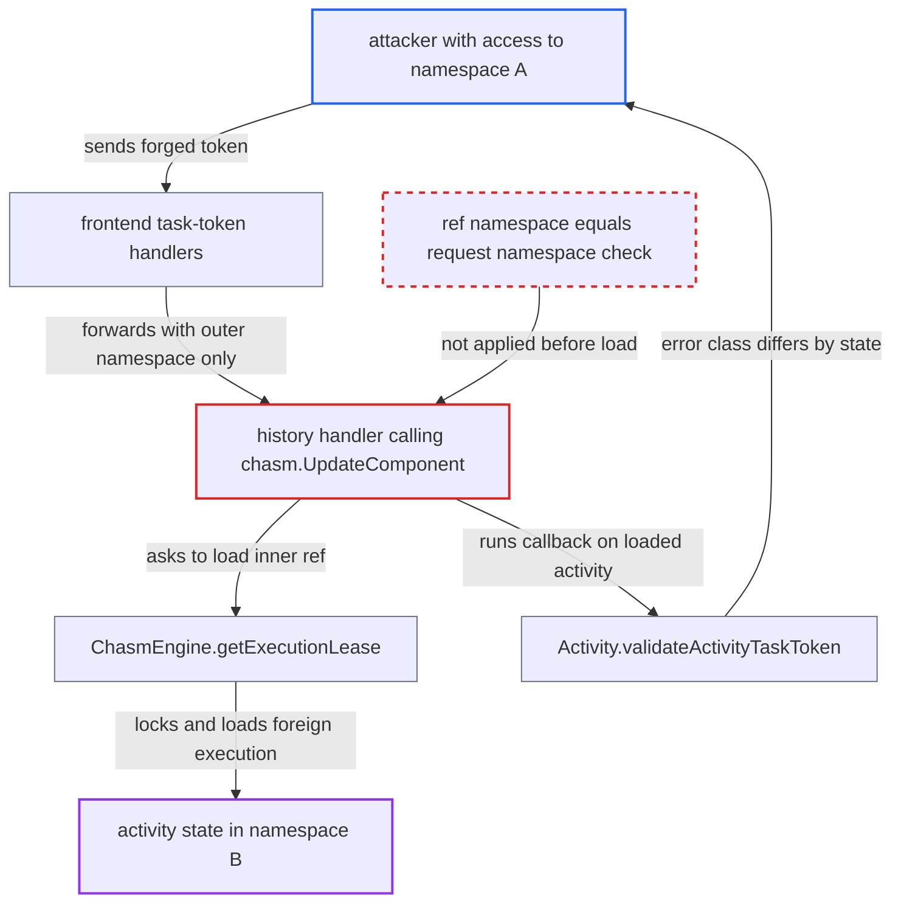

# Cross-namespace standalone-activity existence and attempt oracle via forged task-token ComponentRef

| Field | Value |
|---|---|
| ID | `find_01KfYoCkD277kenZrhqk8gmp` |
| Severity | **Low** |
| Status | open |
| CWE | CWE-204 — Observable Response Discrepancy |
| Created | 2026-10-27T21:11:45.539524Z |
| Claude Security | https://claude.ai/security/findings/find_01KfYoCkD277kenZrhqk8gmp |

## Description

An authenticated user with write access to one namespace can learn whether a guessed standalone activity ID exists in another namespace. They can also learn whether an attempt is running there and its exact attempt count. No payloads or history are returned and nothing is changed. The attacker must know the other namespace's random ID. The cause is that the namespace inside the token's `component_ref` is used to load the execution before it is compared with the authorized request namespace.

1. **attacker** forges a task token with an outer and an inner namespace. The outer `namespace_id` is the attacker's namespace A, and the inner `component_ref` names namespace B, a guessed activity ID and the activity archetype. Tokens are plain protobuf with no signature, so every field is caller-chosen. ([`common/tasktoken/serializer.go:15-26`](https://github.com/cx-benchmark/temporal/blob/bf81a4c20009db89dc952592c9cfe770bafe66ee/common/tasktoken/serializer.go#L15-L26))
2. **frontend handler** authorizes the call using only the outer namespace. `RespondActivityTaskCompleted` and `RecordActivityTaskHeartbeat` take the namespace for validation and for the history request's `NamespaceId` from `taskToken.GetNamespaceId()` and never inspect the inner ref. ([`service/frontend/workflow_handler.go:1694-1704`](https://github.com/cx-benchmark/temporal/blob/bf81a4c20009db89dc952592c9cfe770bafe66ee/service/frontend/workflow_handler.go#L1694-L1704))
3. **history client** routes the call by the inner ref. It uses the inner namespace and business ID, so the call reaches the shard that owns namespace B's execution. ([`client/history/client_gen.go:1112-1134`](https://github.com/cx-benchmark/temporal/blob/bf81a4c20009db89dc952592c9cfe770bafe66ee/client/history/client_gen.go#L1112-L1134))
4. **history handler** passes the inner ref to `chasm.UpdateComponent`. It does not compare the ref's namespace with `request.GetNamespaceId()` first. ([`service/history/handler.go:405-430`](https://github.com/cx-benchmark/temporal/blob/bf81a4c20009db89dc952592c9cfe770bafe66ee/service/history/handler.go#L405-L430))
5. **`ChasmEngine.getExecutionLease`** locks and loads the execution in namespace B. The key comes from the client's ref, and an empty `RunID` resolves to the current run. A missing execution gives NotFound. A far-ahead `execution_versioned_transition` gives `Unavailable "stale state, please retry"`. ([`service/history/chasm_engine.go:1225-1290`](https://github.com/cx-benchmark/temporal/blob/bf81a4c20009db89dc952592c9cfe770bafe66ee/service/history/chasm_engine.go#L1225-L1290))
6. **`Activity.validateActivityTaskToken`** runs its state checks before comparing namespaces. The attempt-in-progress, attempt-count and stamp checks return NotFound first. Only then does the namespace comparison return InvalidArgument `token does not match namespace`, so the error class depends on the foreign activity's state. ([`chasm/lib/activity/activity.go:574-610`](https://github.com/cx-benchmark/temporal/blob/bf81a4c20009db89dc952592c9cfe770bafe66ee/chasm/lib/activity/activity.go#L574-L610))
7. **`ChasmEngine.convertError`** rewrites every NotFound into `activity not found for ID: <id>`. What is left for the attacker to compare is NotFound versus InvalidArgument. ([`service/history/chasm_engine.go:1388-1402`](https://github.com/cx-benchmark/temporal/blob/bf81a4c20009db89dc952592c9cfe770bafe66ee/service/history/chasm_engine.go#L1388-L1402))
8. **attacker** reads the error class and varies `attempt`. With `attempt = 0` and stamp `0`, `RespondActivityTaskCompleted` gives InvalidArgument for any existing activity and NotFound for a missing one. `RecordActivityTaskHeartbeat` gives InvalidArgument only while an attempt is in progress, so trying different `attempt` values reveals the current attempt count.

## Assessment

The attacker is an authenticated worker or client with write access to some namespace A. They must know the namespace ID of the target namespace B, which is a random UUID and has to have leaked to them. They also need to guess an activity ID. Standalone activities are enabled by default (`activity.enableStandalone=true`). The attacker can use `RespondActivityTaskCompleted`, or `RecordActivityTaskHeartbeat` to also learn the attempt count. The other task-token calls, `RespondActivityTaskFailed` and `RespondActivityTaskCanceled`, take the same path in the history handler.

Impact: The attacker learns whether a guessed activity ID exists in another tenant's namespace, including running, scheduled or closed but not yet deleted activities. They can also learn whether an attempt is in progress, the exact current attempt count and roughly the transition count. No payloads or history are returned, and nothing in namespace B changes because the namespace check still rejects before any mutation. The cost to the server is one execution lock and load per request.

## Recommendation

(1) The namespace in the caller-supplied `component_ref` is used to locate, lock and load an execution before it is compared with the namespace the request was authorized for (`taskToken.NamespaceId` / `request.NamespaceId`).

Fix criteria: The frontend or the history handler's CHASM branches reject a token whose deserialized ref namespace differs from the authorized request namespace. This happens before any shard lookup or execution load. A test shows that a namespace-A token whose ref names namespace B returns the same error whether the referenced activity exists, is running, is closed, or has any attempt count. The same test shows that B's execution is never loaded.

(2) `Activity.validateActivityTaskToken` makes the namespace comparison after the state-dependent checks. Even as a second layer of defense, it leaks foreign state through different error classes.

Fix criteria: The namespace comparison is the first check in `validateActivityTaskToken`, and a mismatch is indistinguishable from not-found. A test shows that, for a mismatched namespace, the result is identical for scheduled, started, closed and non-existent activities and for every attempt value.

## Evidence

**https://github.com/cx-benchmark/temporal**

- [`service/history/handler.go:405-430`](https://github.com/cx-benchmark/temporal/blob/bf81a4c20009db89dc952592c9cfe770bafe66ee/service/history/handler.go#L405-L430)
- [`chasm/lib/activity/activity.go:574-610`](https://github.com/cx-benchmark/temporal/blob/bf81a4c20009db89dc952592c9cfe770bafe66ee/chasm/lib/activity/activity.go#L574-L610)
- [`service/history/chasm_engine.go:1225-1290`](https://github.com/cx-benchmark/temporal/blob/bf81a4c20009db89dc952592c9cfe770bafe66ee/service/history/chasm_engine.go#L1225-L1290)
- [`service/history/chasm_engine.go:1388-1402`](https://github.com/cx-benchmark/temporal/blob/bf81a4c20009db89dc952592c9cfe770bafe66ee/service/history/chasm_engine.go#L1388-L1402)
- [`service/frontend/workflow_handler.go:1694-1704`](https://github.com/cx-benchmark/temporal/blob/bf81a4c20009db89dc952592c9cfe770bafe66ee/service/frontend/workflow_handler.go#L1694-L1704)
- [`common/rpc/interceptor/namespace_validator.go:393-433`](https://github.com/cx-benchmark/temporal/blob/bf81a4c20009db89dc952592c9cfe770bafe66ee/common/rpc/interceptor/namespace_validator.go#L393-L433)
- [`client/history/client_gen.go:1112-1134`](https://github.com/cx-benchmark/temporal/blob/bf81a4c20009db89dc952592c9cfe770bafe66ee/client/history/client_gen.go#L1112-L1134)
- [`common/tasktoken/serializer.go:15-26`](https://github.com/cx-benchmark/temporal/blob/bf81a4c20009db89dc952592c9cfe770bafe66ee/common/tasktoken/serializer.go#L15-L26)
- [`tests/activity_standalone_test.go:2041-2102`](https://github.com/cx-benchmark/temporal/blob/bf81a4c20009db89dc952592c9cfe770bafe66ee/tests/activity_standalone_test.go#L2041-L2102)

