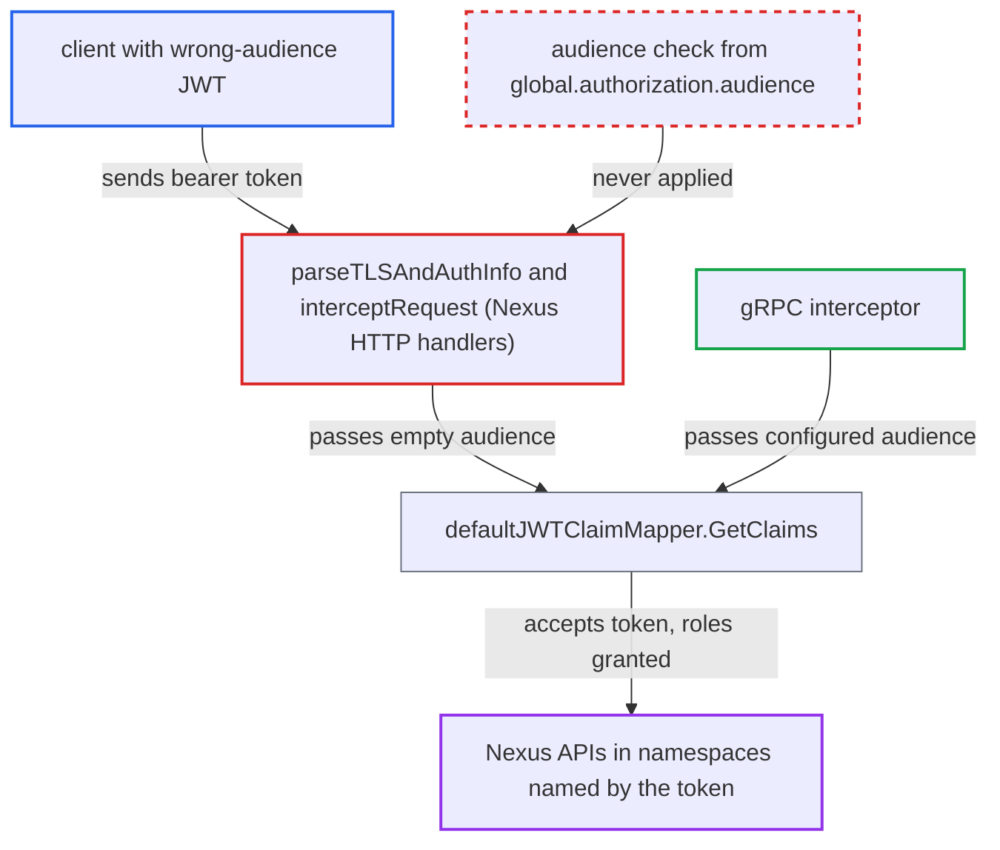

# Nexus HTTP routes ignore configured JWT audience, accepting tokens minted for other audiences

| Field | Value |
|---|---|
| ID | `find_016PpPFmqnMtDbFBy15pwLAo` |
| Severity | **Low** |
| Status | open |
| CWE | CWE-287 — Improper authentication |
| Created | 2026-10-27T21:12:45.673988Z |
| Claude Security | https://claude.ai/security/findings/find_016PpPFmqnMtDbFBy15pwLAo |

## Description

A client holding a JWT signed by a trusted key but issued for a different audience, such as a sibling Temporal cluster, can use it on the Nexus HTTP routes. It gets writer access to the Nexus APIs in the namespaces its claims name. This needs the default claim mapper, a configured `global.authorization.audience` and a shared signing key. The cause is that `parseTLSAndAuthInfo` and `interceptRequest` pass an empty audience, so the `aud` check is skipped.

1. **attacker** obtains a JWT signed by a key the cluster trusts but issued for another audience. The token carries Temporal-format `permissions` claims for namespace names that also exist on this cluster.
2. **attacker** sends a Nexus request with the token as a bearer token. The targets are `/nexus/endpoints/{id}/services/...`, `/namespaces/{ns}/task-queues/{tq}/nexus-services/...` or `/nexus/callback`, with the header `Authorization: Bearer <token>`.
3. **the handler `parseTLSAndAuthInfo`** builds `AuthInfo` with an audience getter that always returns an empty string. The code carries a `TODO: support audience getter` comment, so the configured audience is never used for dispatch requests. ([`service/frontend/nexus_operation_http_handler.go:331-354`](https://github.com/cx-benchmark/temporal/blob/bf81a4c20009db89dc952592c9cfe770bafe66ee/service/frontend/nexus_operation_http_handler.go#L331-L354))
4. **the callback handler `interceptRequest`** does the same for completion requests and then authorizes `CompleteNexusOperation`. It also passes an empty audience, so the claims come from a token that was never checked for audience. ([`service/frontend/nexus_completion_http_handler.go:575-603`](https://github.com/cx-benchmark/temporal/blob/bf81a4c20009db89dc952592c9cfe770bafe66ee/service/frontend/nexus_completion_http_handler.go#L575-L603))
5. **`defaultJWTClaimMapper.GetClaims`** passes the empty audience to `parseJWTWithAudience`. The `aud` claim is checked only when the audience is non-empty after trimming, so the wrong-audience token is accepted and its `permissions` become roles. ([`common/authorization/default_jwt_claim_mapper.go:197-199`](https://github.com/cx-benchmark/temporal/blob/bf81a4c20009db89dc952592c9cfe770bafe66ee/common/authorization/default_jwt_claim_mapper.go#L197-L199))
6. **the default authorizer** grants the token's roles for the Nexus operations. The roles cover `DispatchByNamespaceAndTaskQueue`, `DispatchByEndpoint` and `CompleteNexusOperation`. The same token gets `audience mismatch` on gRPC.

## Assessment

The attacker is a network client with a JWT from the IdP or key set this cluster trusts, issued for another audience, for example a sibling Temporal cluster. The token must carry Temporal-format `permissions` for namespace names that exist here. The cluster must use the default claim mapper with an audience configured and share a signing key with the token's issuer. The attacker can enter through a Nexus StartOperation or CancelOperation on `/nexus/endpoints/{id}/services/...`, through the same calls on `/namespaces/{ns}/task-queues/{tq}/nexus-services/...`, or through a completion on `/nexus/callback`. The report assumes golang-jwt/jwt v4.5.2 `MapClaims.VerifyAudience(aud, true)` would reject such a token, but that check is never reached when the audience is empty.

Impact: The attacker gets writer access to the Nexus APIs in every namespace the token's claims name. It can dispatch Nexus operations to handler workers, which can start handler workflows and return results, and it can cancel them. It can complete or fail Nexus operations only if it also presents a valid callback token. The reach is limited to the Nexus routes and to the namespaces and roles in the claims, and the rest of the gRPC surface still enforces the audience.

## Recommendation

`parseTLSAndAuthInfo` and the completion handler's `interceptRequest` hard-code an empty audience when calling `Interceptor.GetAuthInfo`. The configured `JWTAudienceMapper` is therefore never applied on Nexus HTTP routes, and the JWT `aud` check is skipped.

Fix criteria: Every Nexus HTTP route enforces the same audience requirement as gRPC whenever an audience is configured. A bearer token whose `aud` lacks the configured value is rejected as unauthenticated before authorization. A token signed by a trusted key with a different `aud` fails on dispatch-by-endpoint, dispatch-by-namespace/task-queue and `/nexus/callback`, exactly as on the equivalent gRPC call. A token with the correct audience still succeeds.

## Evidence

**https://github.com/cx-benchmark/temporal**

- [`service/frontend/nexus_operation_http_handler.go:331-354`](https://github.com/cx-benchmark/temporal/blob/bf81a4c20009db89dc952592c9cfe770bafe66ee/service/frontend/nexus_operation_http_handler.go#L331-L354)
- [`service/frontend/nexus_completion_http_handler.go:575-603`](https://github.com/cx-benchmark/temporal/blob/bf81a4c20009db89dc952592c9cfe770bafe66ee/service/frontend/nexus_completion_http_handler.go#L575-L603)
- [`common/authorization/default_jwt_claim_mapper.go:93`](https://github.com/cx-benchmark/temporal/blob/bf81a4c20009db89dc952592c9cfe770bafe66ee/common/authorization/default_jwt_claim_mapper.go#L93)
- [`common/authorization/default_jwt_claim_mapper.go:197-199`](https://github.com/cx-benchmark/temporal/blob/bf81a4c20009db89dc952592c9cfe770bafe66ee/common/authorization/default_jwt_claim_mapper.go#L197-L199)
- [`common/authorization/interceptor.go:136-143`](https://github.com/cx-benchmark/temporal/blob/bf81a4c20009db89dc952592c9cfe770bafe66ee/common/authorization/interceptor.go#L136-L143)
- [`common/authorization/audience_mapper.go:27-29`](https://github.com/cx-benchmark/temporal/blob/bf81a4c20009db89dc952592c9cfe770bafe66ee/common/authorization/audience_mapper.go#L27-L29)

