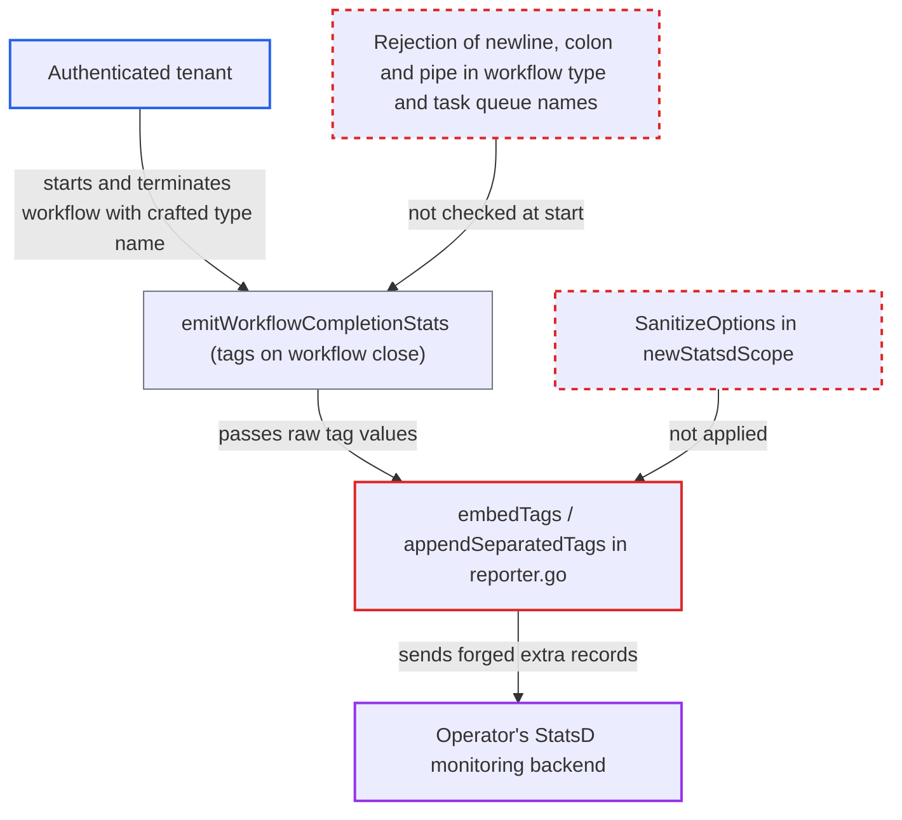

# StatsD metric line injection via unsanitized tenant-controlled tag values

| Field | Value |
|---|---|
| ID | `find_01K9P2rSehpG96D3ENCPhtyF` |
| Severity | **Low** |
| Status | open |
| CWE | CWE-74 — Injection |
| Created | 2026-10-27T21:11:51.243557Z |
| Claude Security | https://claude.ai/security/findings/find_01K9P2rSehpG96D3ENCPhtyF |

## Description

An authenticated tenant can forge metrics in the operator's StatsD monitoring backend, including other namespaces' series and system-level series. This works only when the cluster sends metrics over StatsD. Prometheus deployments are not affected. The cause is that tag values such as workflow type names are joined into the stat name with no escaping, in `embedTags` and `appendSeparatedTags`.

1. **Tenant** starts a workflow whose type name contains a newline and StatsD syntax. The name `x\nforged.metric:100000|c\ny` passes validation because the workflow type name is checked only for emptiness and length. ([`service/frontend/workflow_handler.go:651-661`](https://github.com/cx-benchmark/temporal/blob/bf81a4c20009db89dc952592c9cfe770bafe66ee/service/frontend/workflow_handler.go#L651-L661))
2. **Tenant** terminates the run. Closing the run triggers the completion metrics for that workflow.
3. **`emitWorkflowCompletionStats`** tags the closing counters with the tenant's workflow type name. It also adds the namespace and task queue tags, and the raw task queue name is added when `metrics.breakdownByTaskQueue` is on (the default). ([`service/history/workflow/metrics.go:108-124`](https://github.com/cx-benchmark/temporal/blob/bf81a4c20009db89dc952592c9cfe770bafe66ee/service/history/workflow/metrics.go#L108-L124))
4. **`tagsToMap`** copies the tag values unchanged. It only applies `excludeTags`, and the `sanitizer` declared in that file is never used. ([`common/metrics/tally_metrics_handler.go:283-294`](https://github.com/cx-benchmark/temporal/blob/bf81a4c20009db89dc952592c9cfe770bafe66ee/common/metrics/tally_metrics_handler.go#L283-L294))
5. **`newStatsdScope`** builds the tally root scope without `SanitizeOptions`. The Prometheus scope gets `defaultTallySanitizeOptions`, but the StatsD scope gets nothing, so values reach the reporter unchanged. ([`common/metrics/config.go:404-431`](https://github.com/cx-benchmark/temporal/blob/bf81a4c20009db89dc952592c9cfe770bafe66ee/common/metrics/config.go#L404-L431))
6. **`embedTags` / `appendSeparatedTags`** concatenate the raw key and value into the stat name. The newline ends the real record and the text after it becomes a second record that the attacker fully controls, which `go-statsd-client` sends over UDP on the next flush. ([`common/metrics/tally/statsd/reporter.go:94-126`](https://github.com/cx-benchmark/temporal/blob/bf81a4c20009db89dc952592c9cfe770bafe66ee/common/metrics/tally/statsd/reporter.go#L94-L126))
7. **StatsD collector** parses the datagram as separate records. A newline separates records and `:` and `|` separate fields, so the forged metric name and value are accepted.

## Assessment

The attacker is an authenticated tenant who can start and terminate workflows in their own namespace. The cluster must use the StatsD reporter, which the shipped `common/config/config_template_embedded.yaml` enables when `STATSD_ENDPOINT` is set. The OpenTelemetry StatsD exporter in `common/metrics/statsd_exporter.go` (`framework: opentelemetry`) has the same flaw, so it is a second way in. The task queue name is another tenant-controlled tag value, because `validate` in `common/tqid/task_queue_validator.go` checks only emptiness, length and the `/_sys/` prefix. No victim action is needed. The report assumes `tally` v4.1.17 uses a no-op sanitizer when no options are set, and that it and `go-statsd-client` v5.1.0 write names verbatim. Neither module's source was in the checkout.

Impact: The tenant can make the server emit StatsD records it never meant to emit, with any metric name and value. This is a limited integrity loss in the server's metrics output. Temporal's own persisted data is not read or changed.

Subsequent-system impact: The operator's monitoring backend accepts the forged names and values. That includes fake error or latency series for any namespace or system metric. These can trigger or suppress alerts and mislead dashboards or autoscaling. The impact is limited to telemetry integrity, and the report shows no disclosure or code execution in the backend.

## Recommendation

On both StatsD paths, tally `embedTags`/`appendSeparatedTags` in `common/metrics/tally/statsd/reporter.go` and the OpenTelemetry exporter in `common/metrics/statsd_exporter.go`, stat names are built from raw tag values. The tally StatsD scope is also created without `SanitizeOptions`. Tenant-controlled names containing `\n`, `:`, `|` or the tag separator therefore go out unchanged and break the record structure.

Fix criteria: Every tag key and value on both StatsD paths is restricted to a safe character set, or has the delimiters `\n`, `\r`, `:`, `|`, `@`, `#`, the configured tag separator, `=` and `,` replaced before it enters the stat name. Closing a workflow whose type or task queue name contains `\nforged:1|c` produces exactly one well-formed datagram line, with no extra record.

## Evidence

**https://github.com/cx-benchmark/temporal**

- [`common/metrics/tally/statsd/reporter.go:94-126`](https://github.com/cx-benchmark/temporal/blob/bf81a4c20009db89dc952592c9cfe770bafe66ee/common/metrics/tally/statsd/reporter.go#L94-L126)
- [`common/metrics/config.go:404-431`](https://github.com/cx-benchmark/temporal/blob/bf81a4c20009db89dc952592c9cfe770bafe66ee/common/metrics/config.go#L404-L431)
- [`common/metrics/tally_metrics_handler.go:283-294`](https://github.com/cx-benchmark/temporal/blob/bf81a4c20009db89dc952592c9cfe770bafe66ee/common/metrics/tally_metrics_handler.go#L283-L294)
- [`common/metrics/statsd_exporter.go:225-287`](https://github.com/cx-benchmark/temporal/blob/bf81a4c20009db89dc952592c9cfe770bafe66ee/common/metrics/statsd_exporter.go#L225-L287)
- [`service/history/workflow/metrics.go:108-124`](https://github.com/cx-benchmark/temporal/blob/bf81a4c20009db89dc952592c9cfe770bafe66ee/service/history/workflow/metrics.go#L108-L124)
- [`service/frontend/workflow_handler.go:651-661`](https://github.com/cx-benchmark/temporal/blob/bf81a4c20009db89dc952592c9cfe770bafe66ee/service/frontend/workflow_handler.go#L651-L661)
- [`common/tqid/task_queue_validator.go:136-149`](https://github.com/cx-benchmark/temporal/blob/bf81a4c20009db89dc952592c9cfe770bafe66ee/common/tqid/task_queue_validator.go#L136-L149)
- [`common/metrics/task_queues.go:13-27`](https://github.com/cx-benchmark/temporal/blob/bf81a4c20009db89dc952592c9cfe770bafe66ee/common/metrics/task_queues.go#L13-L27)

