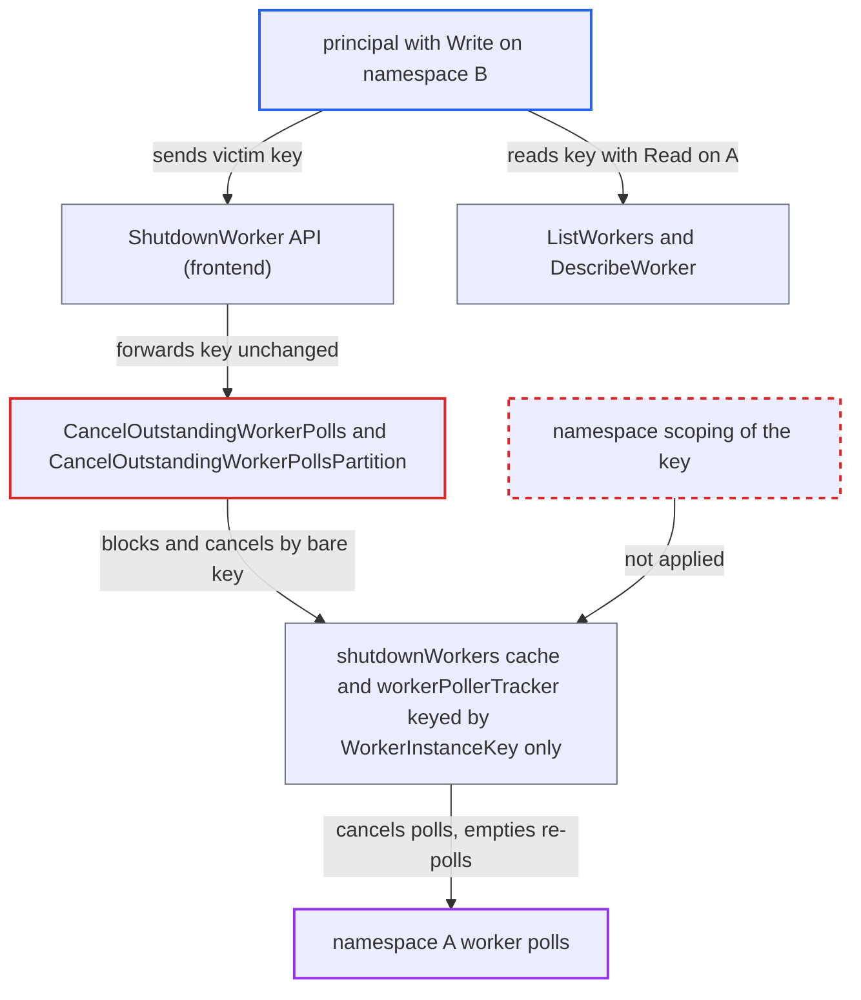

# Worker poll cancellation and shutdown blocklist keyed by WorkerInstanceKey without namespace scoping

| Field | Value |
|---|---|
| ID | `find_014SuqrL8jAGqrQoxBj93vtx` |
| Severity | **Low** |
| Status | open |
| CWE | CWE-639 — Missing authorization |
| Created | 2026-10-27T21:16:08.803600Z |
| Claude Security | https://claude.ai/security/findings/find_014SuqrL8jAGqrQoxBj93vtx |

## Description

A user with Write access to one namespace can stop workers in a different namespace from receiving tasks. The attacker must know the victim worker's `WorkerInstanceKey`, which users with Read access to the victim namespace can see. The matching engine tracks pollers and shut-down workers by this key alone, with no namespace, so a `ShutdownWorker` call from namespace B cancels and blocks polls of namespace A.

1. **attacker** learns a namespace-A worker's `WorkerInstanceKey`. Read access on A is enough, because `ListWorkers` and `DescribeWorker` return worker instance keys to read-only callers. ([`common/api/metadata.go:125-188`](https://github.com/cx-benchmark/temporal/blob/bf81a4c20009db89dc952592c9cfe770bafe66ee/common/api/metadata.go#L125-L188))
2. **attacker** polls their own task queue in namespace B. This loads the queue's root partition, which the fan-out cancellation path requires. ([`service/matching/matching_engine.go:1338-1366`](https://github.com/cx-benchmark/temporal/blob/bf81a4c20009db89dc952592c9cfe770bafe66ee/service/matching/matching_engine.go#L1338-L1366))
3. **attacker** calls `ShutdownWorker` in namespace B with the victim's `WorkerInstanceKey`. The call is authorized as namespace-scoped Write against B only, and the frontend forwards the caller-chosen key unchanged to matching. ([`service/frontend/workflow_handler.go:3103-3225`](https://github.com/cx-benchmark/temporal/blob/bf81a4c20009db89dc952592c9cfe770bafe66ee/service/frontend/workflow_handler.go#L3103-L3225))
4. **matching engine** cancels the victim's outstanding polls. `CancelOutstandingWorkerPolls` and `CancelOutstandingWorkerPollsPartition` call `CancelAll` on the bare key, so polls from namespace A on that host are cancelled too, and `request.NamespaceId` is used only for routing and poller-history cleanup. ([`service/matching/matching_engine.go:1488-1525`](https://github.com/cx-benchmark/temporal/blob/bf81a4c20009db89dc952592c9cfe770bafe66ee/service/matching/matching_engine.go#L1488-L1525))
5. **matching engine** puts the key into the `shutdownWorkers` cache. The cache is keyed by the bare string and entries last 30 seconds. ([`service/matching/matching_engine.go:1338-1366`](https://github.com/cx-benchmark/temporal/blob/bf81a4c20009db89dc952592c9cfe770bafe66ee/service/matching/matching_engine.go#L1338-L1366))
6. **`pollTask`** returns an empty poll response to the victim's re-polls. `pollTask` returns `errNoTasks` for any poll whose key is in `shutdownWorkers`, whatever the poll's namespace. ([`service/matching/matching_engine.go:3196-3212`](https://github.com/cx-benchmark/temporal/blob/bf81a4c20009db89dc952592c9cfe770bafe66ee/service/matching/matching_engine.go#L3196-L3212))
7. **attacker** repeats the call more often than every 30 seconds, using several queue names. Different queue names make the partitions route to different matching hosts, so the block covers every host.

## Assessment

The attacker is an authenticated principal with Write on some namespace B. They also need the `WorkerInstanceKey` of a worker in namespace A, and the victim worker must send a key in its polls. Read-only callers of A can get the key through `ListWorkers` or `DescribeWorker`, so Read on A plus Write on any other namespace is enough. Read on A alone does not allow this, because `ShutdownWorker` in A needs Write on A. The fan-out path needs the attacker's own root partition loaded, which polling their own queue does. Both `EnableCancelWorkerPollsOnShutdown` and `EnableMatchingFanOutForPollCancellation` default to true.

Impact: Targeted namespace-A worker instances receive no workflow, activity or Nexus tasks while the attack continues. With Read on A, the attacker can list and target every heartbeating worker of A. Workers whose keys the attacker does not know, and hosts the attacker's queues do not reach, are unaffected. No data is disclosed or modified.

## Recommendation

Poller tracking and the shutdown blocklist use a client-chosen `WorkerInstanceKey` as a global key, so a request authorized for one namespace affects pollers of other namespaces.

Fix criteria: `workerInstancePollers` and `shutdownWorkers` are keyed by namespace ID plus `WorkerInstanceKey`. `CancelOutstandingWorkerPolls` and `CancelOutstandingWorkerPollsPartition` cancel and blocklist only entries of `request.NamespaceId`. `pollTask` checks the blocklist with the poll's own namespace. A `ShutdownWorker` call from namespace B naming a key used by a namespace-A poller neither cancels that poll nor makes A's later polls return empty.

## Evidence

**https://github.com/cx-benchmark/temporal**

- [`service/matching/matching_engine.go:1338-1366`](https://github.com/cx-benchmark/temporal/blob/bf81a4c20009db89dc952592c9cfe770bafe66ee/service/matching/matching_engine.go#L1338-L1366)
- [`service/matching/matching_engine.go:1488-1525`](https://github.com/cx-benchmark/temporal/blob/bf81a4c20009db89dc952592c9cfe770bafe66ee/service/matching/matching_engine.go#L1488-L1525)
- [`service/matching/matching_engine.go:3196-3212`](https://github.com/cx-benchmark/temporal/blob/bf81a4c20009db89dc952592c9cfe770bafe66ee/service/matching/matching_engine.go#L3196-L3212)
- [`service/matching/matching_engine.go:140-146`](https://github.com/cx-benchmark/temporal/blob/bf81a4c20009db89dc952592c9cfe770bafe66ee/service/matching/matching_engine.go#L140-L146)
- [`service/matching/matching_engine.go:231-244`](https://github.com/cx-benchmark/temporal/blob/bf81a4c20009db89dc952592c9cfe770bafe66ee/service/matching/matching_engine.go#L231-L244)
- [`service/frontend/workflow_handler.go:3103-3225`](https://github.com/cx-benchmark/temporal/blob/bf81a4c20009db89dc952592c9cfe770bafe66ee/service/frontend/workflow_handler.go#L3103-L3225)
- [`common/api/metadata.go:125-188`](https://github.com/cx-benchmark/temporal/blob/bf81a4c20009db89dc952592c9cfe770bafe66ee/common/api/metadata.go#L125-L188)
- [`service/matching/workers/registry_impl.go:105-113`](https://github.com/cx-benchmark/temporal/blob/bf81a4c20009db89dc952592c9cfe770bafe66ee/service/matching/workers/registry_impl.go#L105-L113)
- [`common/dynamicconfig/constants.go:3905-3920`](https://github.com/cx-benchmark/temporal/blob/bf81a4c20009db89dc952592c9cfe770bafe66ee/common/dynamicconfig/constants.go#L3905-L3920)

